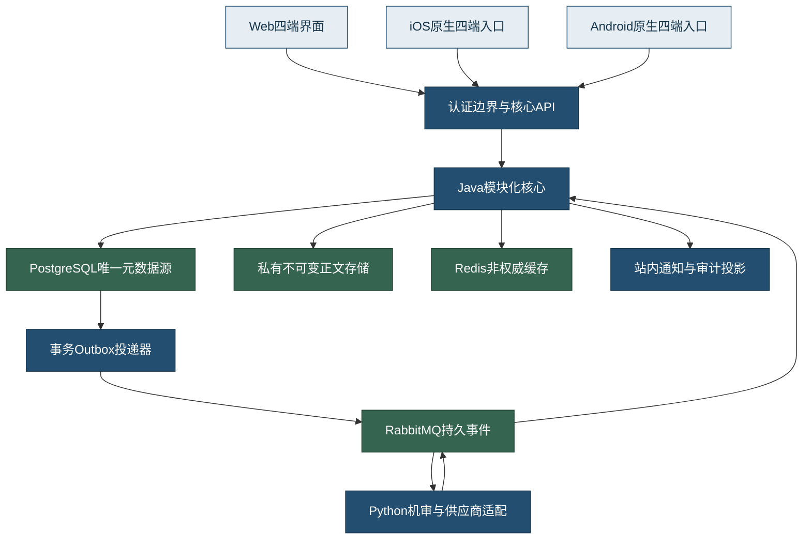

# 概要设计说明书

## 1. 设计目标与状态

P0-BL-1，2026-11-12。输入为[01需求](01-需求分析说明书.md)，本文件定义工程候选，尚不表示已经部署。选定单仓库、模块化核心服务、独立Agent服务；目标是在小型团队内建立安全可测的闭环，允许模块沿聚合边界独立扩容。

## 2. 技术选型与理由

| 领域 | 选定 | 理由与放弃方案 |
| --- | --- | --- |
| 仓库 | monorepo | 契约与三平台同步评审；不使用多仓库以免初期契约漂移 |
| 核心 | Java 21、Spring Boot 4.0.9、Maven | 延续锁定栈；模块化单体保留事务一致性；不首日拆大量微服务。2026-11-15 按实际交付修订（`lumin-backend/pom.xml`），原书写 4.1.2，见 §2.2 |
| Web | React/React DOM 19.3.1、TypeScript 6.0.3、Vite 8.3.6 | 使用函数组件与严格类型；不是以Next.js/BFF承载业务；公开页面预渲染与CDN满足首屏目标。2026-11-15 按实际交付修订（`lumin-frontend/package.json`，本机实际安装 Vite 8.3.8），原书写 TS 7.0.2 / Vite 8.3.8，见 §2.2 |
| Agent | Python 3.11、FastAPI 0.162.5 | 独立预算、限流、供应商适配；不承担内容指针与权限最终裁决 |
| 原生 | Swift + SwiftUI，Kotlin + Jetpack Compose | 保持原生双端；不替换成WebView/uni-app |
| 关系数据 | MySQL 8.4 LTS 系列（2026-11-16 Owner裁决改锁，原书写PostgreSQL 17） | 事务、约束、行锁与JSON配置审计；不使用文档数据库存核心状态；类型映射与方言转换见04 §1修订注记 |
| 缓存 | Redis 7.4系列 | 限流、短期授权租约、非权威缓存；不作为内容状态真相源 |
| 消息 | RabbitMQ 4系列，quorum队列 | 持久发布事件、确认与死信；不首期引入Kafka多平台运维 |
| 对象存储 | 境内S3兼容私有存储，开启版本与保留策略 | 正文按不可变键存储；厂商通过适配层隔离；无公有桶 |
| 搜索 | P0数据库元数据目录；P1独立事件投影 | P0不做正文索引、不部署空置搜索集群 |
| 身份 | 标准OIDC Authorization Code + PKCE，核心验证issuer/audience/signature/expiry | 不自研密码及身份证存储；本人主体取认证上下文，不接受请求体userId冒充 |
| 部署 | 境内容器平台，多AZ托管数据服务 | 控制小团队运维复杂度；不在本轮创建云资源 |

### 2.1 版本证据与锁定边界

2026-11-12只读查询官方文档及包元数据得到如下声明兼容性；未安装业务依赖，未完成漏洞扫描，不宣称集成通过。

| 核验项 | 来源 | 结论 |
| --- | --- | --- |
| Spring Boot | https://docs.spring.io/spring-boot/system-requirements.html | 4.1.2稳定发行；Java17–27、Maven≥3.6.3覆盖本地环境 |
| FastAPI | https://pypi.org/pypi/fastapi/0.162.5/json | 该发行存在且未撤回，Python≥3.10覆盖3.11；PyPI成熟度标记Beta，不称其正式成熟度Stable |
| React | https://registry.npmjs.org/react/19.3.1 | 版本存在；react-dom必须同版 |
| TypeScript | https://registry.npmjs.org/typescript/7.0.2 | 版本存在；Node≥16.20 |
| Vite | https://registry.npmjs.org/vite/8.3.8 与 https://vite.dev/guide/ | Node要求覆盖24.15.0；存在react-ts模板 |

本机实测Java21.0.6、Maven3.9.15、Python3.11.9、Node24.15.0、npm11.5.2。此为实测值，不沿用会话环境声明的其他Node小版本。数据库/缓存/消息只冻结产品与主版本，镜像补丁和digest在P0-A开工前由依赖扫描锁定；Swift/Kotlin、Xcode、Android SDK同样由各端构建矩阵锁定。未完成这些锁定时不允许生成生产部署清单。

2026-11-15复核（Git Bash）：Java21.0.6、Maven3.9.15、Python3.11.9、Node24.15.0、npm11.12.1；npm小版本与2026-11-12记录不一致，且Node/Python可能随终端PATH返回不同值（见09 §4.3 W-07登记），版本锁定一律以lockfile / BOM为准，不以终端快照为准。

### 2.2 版本口径对齐修订（2026-11-15，Owner授权）

上表与§2.1保留2026-11-12锁定时的原始书写；实际交付版本以仓库为准并已对齐如下，升级或回切须走评审：

| 项 | 原锁定书写 | 实际交付 | 依据 |
| --- | --- | --- | --- |
| Spring Boot（后端模块父POM） | 4.1.2 | 4.0.9 | `lumin-backend/pom.xml` |
| TypeScript（前端） | 7.0.2 | ~6.0.3 | `lumin-frontend/package.json` |
| Vite（前端） | 8.3.8 | ^8.3.6（本机安装8.3.8） | `lumin-frontend/package.json` |
| React / React DOM | 19.3.1 | ^19.3.1 | `lumin-frontend/package.json`（一致） |
| 关系数据库 | PostgreSQL 17（原锁定） | MySQL 8.4 LTS（本机 MySQL84 服务实测 8.4.6；`mysql-connector-j` 由 Boot BOM 管理） | 2026-11-16 Owner 裁决「数据库使用 MySQL」；DDL 方言转换见 04 §1 |

FastAPI 0.162.5、PG17、Redis 7.4、RabbitMQ 4尚未进入落地批次，维持原锁定声明，不作修改。

## 3. 系统与模块边界

图中的事件闭环是异步数据流，不是同步代码依赖。流程编排记录控制状态，不复制作品、身份、正文数据所有权。

### 3.1 核心模块及唯一写入者

| 模块 | 唯一所有权 | 允许同步依赖 | 发布的主要事件 |
| --- | --- | --- | --- |
| identity | 用户、年龄核验、监护同意、角色绑定、主体权利请求 | foundation | IdentityPolicyChanged.v1 |
| catalog | 分类、作品、章节身份及业务态 | foundation | ContentBlocked.v1 |
| authoring | 私有草稿、内容不可变版本、对象引用 | catalog、identity、foundation | ContentSubmitted.v1 |
| moderation | 机审报告、案件、领取、裁决、申诉 | foundation | ReviewResolved.v1 |
| publication | 发布流程、发布指针、三态读者判定 | authoring、catalog、identity、foundation | ContentPublished.v1 |
| governance | 举报、治理措施、版权终止流程 | catalog、identity、foundation | GovernanceChanged.v1 |
| configuration | 规则版本、提案审批、激活计划 | identity、foundation | PolicyActivated.v1 |
| engagement | 阅读进度、站内通知、P1收藏/订阅关系 | publication、identity、foundation | NotificationCreated.v1 |
| audit | 追加式审计、授权只读投影 | foundation | AuditRecorded.v1 |
| billing-reserved | 交易/分账/结算/退款骨架 | foundation | P0无事件生产者 |
| foundation | 标识、时间、错误码、事件信封、端口接口 | 无领域依赖 | 无业务事件 |

moderation需要的审核材料由ContentSubmitted快照与受控内容读取适配器提供，不直接访问authoring的Repository。审核员查看正文的服务层入口由接入编排器组合moderation授权与authoring只读端口；不增加两个模块间的双向依赖。策略与审计使用foundation声明的端口，适配器装配在应用根，不把foundation反向绑定业务模块。

### 3.2 两跳影响面

| 变更点 | 一跳调用者/订阅者 | 二跳影响 |
| --- | --- | --- |
| identity年龄/角色 | authoring、publication、governance、configuration、engagement | 三端发布/阅读/后台权限、通知和契约测试 |
| authoring版本 | publication、审核材料接入适配器 | 读者正文、审核详情、修订差异与缓存 |
| moderation裁决事件 | publication、governance事件处理器 | 公开指针、通知、未来搜索/推荐投影 |
| governance阻断 | catalog、publication读闸门、缓存失效订阅者 | 书城/详情/正文/CDN、未来索引 |
| configuration规则 | 策略端口适配器、Agent策略快照 | 各流程的规则版本、回归测试、审计 |

架构测试以模块import与允许列表校验同步边，不以图示“看上去无环”替代。跨模块禁止直接Repository访问，异步消息必须带版本化schema。

## 4. 目录与职责

| 路径 | 责任 |
| --- | --- |
| docs/01–08 | 本套可评审工程基线 |
| contracts/p0.openapi.yaml | HTTP字段和枚举唯一机器契约（只读） |
| lumin-backend/src/main/java/com/leyon/lumin/ | 六层分层按模块落地（2026-11-17 重构对齐本表：api/service/repository/domain + event/config 随批次）：catalog/authoring 垂直切片已含 api+service+repository；领域包（各模块 domain 与 foundation 值域）零Spring依赖，foundation/web 与 repository 为基础设施适配 |
| lumin-backend/src/test/java/com/leyon/lumin/ | 纯函数、状态机、架构无环、契约骨架测试 |
| lumin-frontend/src/ | React按域组织（views / components / data / styles / lib），P0-A为演示应用、mock数据不发网络请求；服务类型后续从契约生成 |
| services/agent/（规划，尚未创建） | 机审路由、供应商接口、校验与测试（Agent层后续批次） |
| mobile/ios/、mobile/android/（规划，尚未创建） | 原生UI、数据访问、契约生成代码，不复制业务规则 |
| libs/ | 错误码字典与静态校验工具（已建：error-codes.json、tools/两个脚本），禁止跨语言共享运行时业务对象 |
| ui-demo/ | 单文件HTML UI原型（历史物料，不参与构建） |
| infra/（规划，尚未创建） | 后续受评审的环境、IaC及CI定义；本轮不创建流水线 |

本表2026-11-15按实际仓库布局修订（原services/core/**与web/**已分别收敛为lumin-backend/与lumin-frontend/，见仓库根README整理记录）；标注「规划」的目录为后续批次布局，不代表已有实现。

## 5. 同步与异步契约

### 5.1 HTTP

客户端统一/api/v1，Bearer身份，写操作Idempotency-Key，资源版本If-Match；成功与错误都为code/message/data/traceId。阅读正文不从公开对象地址获取，而经当前用户可见性闸门返回。列表服务端授权后分页，不能先全量返回再让前端过滤。

### 5.2 事件

每个事件信封：eventId(UUID)、eventType、schemaVersion=1、aggregateId、aggregateRevision(正整数)、occurredAt(UTC)、traceId、payload。事件表与业务状态同一数据库事务提交；投递为至少一次，消费者以consumerName+eventId去重，不能宣称消息恰好一次。

| 事件 | payload字段 | 消费者与作用 |
| --- | --- | --- |
| ContentSubmitted.v1 | versionId、targetType、targetId、workflowId、policyVersion、authorAgeBand、materialSha256 | moderation建案件；Agent读取最少必要内容 |
| ReviewResolved.v1 | caseId、versionId、workflowId、decision、grade、policyVersion、decisionIds | publication更新被审版本；不得发布别的版本 |
| ContentPublished.v1 | targetType、targetId、workId、versionId、previousVersionId、isNewChapter、publishedAt | engagement结果通知；P1追更只消费isNewChapter=true |
| ContentBlocked.v1 | workId、chapterId、restrictionId、effectiveAt、scope | 读闸门缓存失效；P1索引删除；通知 |
| GovernanceChanged.v1 | restrictionId、workId、chapterId、action、caseId | catalog/publication重新计算限制；不直接改版本历史 |
| IdentityPolicyChanged.v1 | userId、policyRevision、effectiveAgeBand、accountStatus | 失效用户授权租约、暂停发布；不携带出生日期 |
| PolicyActivated.v1 | configKey、revision、effectiveAt、rolloutBasisPoints | 策略缓存与Agent快照刷新 |
| NotificationCreated.v1 | notificationId、recipientId、category | 后续Push适配器；P0站内持久记录即事实源 |
| AuditRecorded.v1 | auditId、action、resourceId、occurredAt | 审计投影与告警，无正文/证件 |

未知schemaVersion、非法枚举、签名身份不匹配进入隔离队列并告警，不尝试“猜测字段”后继续处理。

## 6. 一致性、可用性与扩展

- 发布时事务同时写内容状态、通过的版本指针、流程完成、Outbox与审计。对象内容先以不可变键上传并校验摘要，事务失败留下的未引用对象经保留期清理，不把不可回滚外部上传假装成数据库事务。
- 身份策略和治理限制的权威读来自数据库；授权租约最多15秒，失效传播目标5秒，30秒仍未消费触发告警，60秒为验收上限。缓存故障无法证实可见则拒绝，不回源公开桶。
- 私有正文边缘缓存按versionId隔离；每次向用户返回仍需验证授权与治理epoch，不缓存通用“允许”结果。用户下载后的文本不属于可撤回对象。
- 读服务无状态多副本；写/审核持久队列削峰。初始不分片，聚合UUID标识、域边界及事件分区预留扩展；10–100倍增长是设计目标，不是未经压测的承诺。
- 原生客户端与Web共享契约，不共享业务判定；弱网失败显示未保存/待确认，P0不建设离线同步引擎。

## 7. 威胁模型

| 威胁 | 边界与控制 | 验证 |
| --- | --- | --- |
| 越权读草稿/修改别人的作品 | 主体取认证上下文；服务层归属与分配队列校验 | T04、T06 |
| 伪造成年/监护同意 | 核验提供方回查；proofRef绑定主体、用途、有效期且一次性 | T02、T03 |
| Agent提示注入/伪造通过 | 内容不作为系统指令；输出schema校验；机审身份隔离；四类强制人审 | T17–T19 |
| 重放提交/过期审核回调 | 幂等请求摘要、版本工作流绑定、消费者去重、乐观锁 | T09、T12、T43 |
| 源站/缓存绕过下架 | 私有桶、15秒授权租约、治理epoch、全入口测试 | T23、T28 |
| 审稿泄露与批量抓取 | 最小字段、水印、每次查看留痕、分页限额、禁止导出全文 | T06、T35 |
| 恶意举报/登录攻击 | API与业务双层限流、设备风险、异常冻结与申诉 | T46 |
| 敏感日志/数据出境 | 结构化字段白名单、四级数据分类、境内部署与供应商合同 | T37、T49 |
| 配置自批降低保护 | 规则提案独立审批、风险下限不可放松、策略版本留痕 | T30–T32 |

## 8. 取舍与撤销条件

| 决策 | 保留条件 | 重评触发 |
| --- | --- | --- |
| 模块化核心而非微服务 | 聚合事务清晰，团队<10人 | 独立扩缩容/故障隔离需要且模块边界验证已成熟；不得只因代码量增加就拆 |
| RabbitMQ事件 | 事务事件与队列规模满足压测 | 明确需要长期流回放与大规模分析时专项评审，不双写两套总线 |
| P0保守人工兜底 | 自动校准未通过 | 校准通过且审核负责人授权后启用分级自动动作 |
| Vite Web与原生并行 | 三端契约与无障碍一致 | 公开SEO/首屏实测无法达标时只调整展示层，不迁移核心业务规则到前端 |
