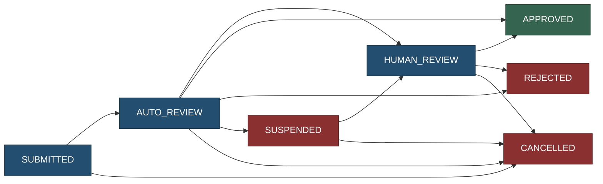

# 详细设计说明书

## 1. 设计输入与不变量

P0-BL-1，2026-11-12。范围依据[01](01-需求分析说明书.md)，模块依据[02](02-概要设计说明书.md)。以下是实现契约，不是已实现代码；业务代码必须通过[07](07-测试计划与用例.md)再报告完成。

| 不变量 | 定义 |
| --- | --- |
| INV-01 | 一份不可变版本只绑定一个发布流程；重提必须新版本/新流程 |
| INV-02 | 公开指针只能指向同一目标的APPROVED版本，且其绑定流程APPROVED |
| INV-03 | 生效治理限制优先于任何发布指针，父作品限制覆盖全部章节 |
| INV-04 | 原审裁决与正文永不覆盖；改判、修订均追加记录 |
| INV-05 | 同一身份不得申请自批、双审两席、原审处理申诉 |
| INV-06 | 数据状态、Outbox和审计同事务；提交响应与异步最终结果分离 |
| INV-07 | 用户输入、Agent输出和回调都不可信；角色/年龄从权威记录读取 |
| INV-08 | 机审未完成、供应商超时、输出无效均不得发布 |

## 2. 状态字典与完整迁移规则

### 2.1 作品与章节业务态

状态枚举DRAFT、ACTIVE、COMPLETED、REMOVED、TERMINATED。章节禁止COMPLETED。未列出的组合一律拒绝B2001并审计；同事件重放由幂等层返回原结果，不重复执行迁移。

| 当前 | 事件 | 目标 | 操作者与前提 |
| --- | --- | --- | --- |
| DRAFT | 首版发布成功 | ACTIVE | SYSTEM；版本与流程均APPROVED |
| ACTIVE | 完结申请生效 | COMPLETED | AUTHOR本人；仅作品；无未决发布流程；全部现有章节已发布 |
| COMPLETED | 恢复连载 | ACTIVE | AUTHOR本人；原因必填；非治理恢复 |
| DRAFT/ACTIVE/COMPLETED | 生效下架 | REMOVED | SYSTEM执行已核验治理措施；保存前态 |
| REMOVED | 临时措施独立申诉改判 | 记录的前态 | SYSTEM；所有生效限制均解除、版权有效、账户允许；重新校验指针 |
| DRAFT/ACTIVE/COMPLETED/REMOVED | 合同终止 | TERMINATED | SYSTEM执行两名LEGAL确认的终止决定 |
| TERMINATED | 任意发布/恢复 | 拒绝 | 不可恢复传播 |

终局违规使用REMOVED+FINAL_VIOLATION限制，不能恢复；并非把终局违规当可撤销临时下架。作品完结后禁止新增章节，但允许已存在章节修订。

### 2.2 草稿态

| 当前 | 事件 | 目标 | 约束 |
| --- | --- | --- | --- |
| EDITABLE | 保存 | EDITABLE | If-Match与lockVersion相同，递增版本 |
| EDITABLE | 提交 | SUBMITTED | 身份/年龄/版权有效，创建不可变版本及流程；同目标不得有另一个未结束流程 |
| EDITABLE | 作者放弃 | DISCARDED | 本人；软删 |
| SUBMITTED | 修改 | 拒绝 | 原草稿冻结；修订创建新草稿，引用原版本 |
| DISCARDED | 任意写入 | 拒绝 | 终态 |

退回后创建新的EDITABLE草稿，引用被退回版本；不将旧发布流程回退为草稿。workId必填，chapterId仅章节草稿必填。

### 2.3 内容版本与发布流程

版本态SUBMITTED、APPROVED、REJECTED、WITHDRAWN。公开版本是APPROVED并被publication_pointer引用，不再增加与流程混淆的“已发布版本态”。

| 流程当前 | 事件 | 流程目标 | 版本目标 |
| --- | --- | --- | --- |
| SUBMITTED | 机审任务成功领取 | AUTO_REVIEW | SUBMITTED |
| AUTO_REVIEW | 合格低风险自动PASS/LABEL/LIMIT | APPROVED | APPROVED |
| AUTO_REVIEW | 合格低风险自动REVISE | REJECTED | REJECTED |
| AUTO_REVIEW | 必人审/中高风险/低置信 | HUMAN_REVIEW | SUBMITTED |
| AUTO_REVIEW | 超时/契约无效/预算耗尽 | SUSPENDED | SUBMITTED |
| SUSPENDED | 成功重试且机审完成 | HUMAN_REVIEW | SUBMITTED |
| HUMAN_REVIEW | 有效最终PASS/LABEL/LIMIT | APPROVED | APPROVED |
| HUMAN_REVIEW | 有效最终REVISE/HIDE/REMOVE | REJECTED | REJECTED |
| SUBMITTED/AUTO_REVIEW/HUMAN_REVIEW/SUSPENDED | 本人撤销且无生效裁决 | CANCELLED | WITHDRAWN |
| APPROVED/REJECTED/CANCELLED | 任意迁移 | 拒绝 | 不变 |

SUSPENDED恢复始终进入人工队列，不再次自动放行。BAN和法律处置交独立治理，不由发布流程直接封账号。章节发布须父作品已有可见已通过版本；父作品未发布时停留HUMAN_REVIEW并提示先完成作品审核，不将不满足前提的审批提交成功。

### 2.4 审核、申诉与配置

| 实体 | 合法迁移 | 终态与约束 |
| --- | --- | --- |
| review_case | QUEUED→CLAIMED领取；CLAIMED→QUEUED首审租约超时；CLAIMED→WAITING_SECOND首审完成；WAITING_SECOND→CLAIMED独立二审领取；CLAIMED→WAITING_SECOND二审租约超时或分歧；CLAIMED→DECIDED有效最终裁决；QUEUED→DECIDED合法自动决定 | review_stage=1/2/3；阶段3仅未参与原裁决的新L2领取；同结果且同grade为双审一致；DECIDED不改；ESCALATE进入WAITING_SECOND并设阶段3，不记终局 |
| appeal | OPEN→IN_REVIEW→UPHELD/OVERTURNED | 两个终态；原审全体回避；终局违规/合同终止可复核程序但不能恢复传播 |
| restriction | PENDING→ACTIVE临时措施；ACTIVE→REVOKED临时改判；PENDING→REJECTED申请驳回 | FINAL_VIOLATION/CONTRACT_TERMINATED不可REVOKED；expireAt到期进入复核告警，不自动公开 |
| config_revision | DRAFT→IN_REVIEW→APPROVED→ACTIVE→SUPERSEDED；IN_REVIEW→REJECTED；APPROVED→CANCELLED | 回滚创建新修订重复审批，不修改历史；只有ACTIVE参与决策 |
| role_grant | PENDING→APPROVED/REJECTED | 与授予角色的互斥校验在审批时再次执行；高权授予需第二名ADMIN |
| rights_request | OPEN→PROCESSING→COMPLETED/HELD | HELD仅法律保全阻止匿名化；解除保全后回到PROCESSING |
| asset_upload | AWAITING_UPLOAD→CHECKING确认；AWAITING_UPLOAD→EXPIRED到期；CHECKING→COMPLETE检查通过；CHECKING→REJECTED检查失败 | CHECKING依赖故障保持原态并告警重试；COMPLETE/REJECTED/EXPIRED为终态；只有COMPLETE含正式assetId |

案件阶段1完成高风险首审后置阶段2；二审意见分歧置阶段3，由全新L2仲裁。每次领取在同一事务核验阶段、回避集合和租约，填写assignee_id；阶段3租约超时回WAITING_SECOND，阶段保持3；ESCALATE只有存在未参与的更高权限处理人才能受理，否则保持当前态并告警。最终PASS/LABEL/LIMIT必须含grade，其余决定禁止grade；BAN创建治理升级任务，发布流程保持HUMAN_REVIEW，不能直接封禁账号。申诉首次有效复核在事务内OPEN→IN_REVIEW→终态并记录两个迁移；无需客户端伪造处理人。临时、终局及解约提案均PENDING→ACTIVE，解约申请人和复核人必须都是不同LEGAL。

配置初建直接IN_REVIEW。同key保留唯一ACTIVE全量基线和至多一条ACTIVE灰度版本（rollout为1至9999）；按HMAC(固定策略种子,主体ID)分桶，未命中使用全量基线。访问保护及分类配置只允许10000；无全量基线不能启用灰度；并发激活锁config_key，替换对应槽位时旧版本置SUPERSEDED。灰度比例不可原地改，扩量需新审批提案，10000激活同时取代原全量及灰度；0比例不得激活。每次决策只绑定一个实际命中版本，不能将两个版本字段拼接。

## 3. 三态裁决纯函数

### 3.1 输入输出

VisibilityInput包含请求者effectiveAgeBand、accountStatus、目标业务态、父作品业务态、activeRestrictions、candidateVersion、boundWorkflow、pointerVersionId、activePolicyRevision。候选版本来自数据库公开指针，不接受客户端指定“已通过”版本。

VisibilityDecision输出allowed、reason、versionId、raiseIncident。allowed=false时versionId为空。函数不访问数据库、不发日志、不修改任何状态；调用服务按raiseIncident追加事件。

| 顺序 | 条件 | 返回 |
| --- | --- | --- |
| 1 | 权威数据读取失败/引用缺失/对象摘要不匹配 | DENY/INCONSISTENT，告警 |
| 2 | 有临时/终局/法律限制，目标或父作品REMOVED/TERMINATED，账户被禁止访问 | DENY/BLOCKED |
| 3 | 无发布指针，且尚无已发布事实 | DENY/NOT_PUBLISHED，不告警 |
| 4 | 指针目标、版本所属目标、流程绑定、审批规则版本不一致 | DENY/INCONSISTENT，告警 |
| 5 | 指针版本非APPROVED或绑定流程非APPROVED | DENY/INCONSISTENT，告警 |
| 6 | 目标/父作品DRAFT但指针存在 | DENY/INCONSISTENT，告警 |
| 7 | 请求者年龄不满足grade或A关闭/未确认 | DENY/AGE_RESTRICTED |
| 8 | 全部通过 | ALLOW，返回指针versionId |

最新版本指最新成功发布的revisionNo，不用updatedAt排序。v2待审时指针仍为v1；v2通过原子切换到v2；v2驳回不动v1。任何全局治理阻断同时隐藏v1/v2。旧已发布版本不对普通读者开放任意versionId直读入口。

## 4. 提交、发布与并发

### 4.1 保存与提交

1. 认证边界校验主体与请求体白名单；正文纯文本，1–100000字符，UTF-8≤400KiB；整请求≤512KiB。
2. 服务验证归属、年龄、监护同意、角色互斥、版权状态和发布配额。
3. 幂等作用域为subjectId+HTTP方法+规范化路径+Idempotency-Key；键UUID、保留24小时；同键不同请求摘要返回B2003/409。
4. 保存携带If-Match版本；缺失428，旧版本412，不覆盖其他端新内容。
5. 提交锁定draft行，校验lockVersion和EDITABLE；创建versionId，正文按content/{versionId}/{sha256}.txt写入私有对象并核对摘要。
6. 元数据事务写version、workflow、draft=SUBMITTED、Outbox、审计及幂等响应。失败不公开，重试回查同键结果；孤儿对象保留24小时后清理，审核/法律保留对象不清理。
7. 返回202只表示受理，客户端轮询GET workflow读取最终态；不显示“发布成功”。

提交时生成完整材料快照：固定对象键为targetType、workId、chapterId、title、synopsis、categoryId、tags、coverAssetSha256、bodySha256，不适用键取null；tags保持用户顺序，UUID为小写字符串。递归按键的Unicode码点排序，UTF-8无BOM紧凑JSON，换行统一LF，字符串按JSON标准转义，不额外去空白或做Unicode合并；对该字节串计算materialSha256。快照内容均从冻结版本及正式素材读取并与版本一并持久化，Agent必须使用同一快照；WORK无正文时仍有完整材料摘要，bodySha256只用于CHAPTER对象字节完整性。年龄和规则版本另外绑定，不由客户端或LLM改写。

### 4.2 发布事务

事件消费以workflowId+versionId+policyVersion核验；锁目标与workflow行；忽略有去重记录的重复事件。检查ACTIVE限制与最新身份策略，校验父作品发布条件；全部满足才把版本/流程置APPROVED，原子交换publication_pointer并追加ContentPublished。撤销后到达的审核结果记为过期，不恢复流程。

并发策略：同目标最多一个非终态发布流程；跨不同章节允许并行。同作品新增章节序号使用唯一约束；作品完结和新增章节获取相同作品行锁，避免完结后追加章节。

### 4.3 事件可靠性

Outbox扫描间隔1秒，投递确认后记deliveredAt；失败退避1/5/30秒，此后每60秒至24小时；超24小时进入人工处置，不删除事件。消费者事务内写inbox_receipt与领域更新；外部调用使用eventId派生幂等键。重复消息不重复发布/通知。状态事件乱序以aggregateRevision拒绝旧事件，缺号请求源端重建快照，不盲目覆盖。

### 4.4 私有素材与提案恢复

上传授权只对服务端唯一隔离对象键签发300秒PUT；COVER绑定本人作品，EVIDENCE绑定本人参与案件；大小1至5242880字节，JPEG/PNG，客户端不能上传BODY。确认时冻结对象versionId，核验原始hash、字节数、魔数和解码像素（上限2500万），去除EXIF后对净化字节重新计算正式sha256，经内容安全检查后复制到不可覆盖正式键并生成assetId。原始摘要保存在上传会话，不与净化后摘要混用；重新PUT不能替换已冻结版本。失败/过期对象无引用且无保全24小时后清理；CHECKING对象不按孤儿删除。完成确认在DB落CHECKING与可靠任务后返回，依赖失败保持CHECKING并告警；查询读最终状态。素材读取每次验证目标与当前阅卷权限，不提供公开桶或下载签名。

私有作者列表覆盖未发布作品、章节、草稿、流程，按归属分页；单作品详情返回ETag供取号和完结操作。监护、角色、治理、申诉、权利请求及配置列表/详情包含原始提案、revision和审批历史；敏感proofRef不以明文回显，保存加密原始请求，返回脱敏引用。审批记录独立追加，禁止仅保留最后审批人；刷新页面后只能读取授权范围，不能依赖客户端缓存补齐提案。

## 5. 机审工作流与成本

### 5.1 节点职责

| 节点 | 输入 | 规则/模型职责 | 输出 | 失败路径 |
| --- | --- | --- | --- | --- |
| N1加载 | ContentSubmitted | 规则检查服务身份、版本、摘要、政策版本 | 最小审核材料 | 校验失败SUSPENDED |
| N2预检 | 纯文本与元数据 | 规则+第三方全量机审；内容当数据而非指令 | 风险证据引用 | 超时SUSPENDED |
| N3辅助 | 材料及规则版本 | LLM分类与建议，不赋权限 | 结构化MachineReviewReport | 非法字段/越界置信度SUSPENDED |
| N4路由 | 机审报告、权威年龄、案件来源 | 确定规则执行；必人审优先 | AUTO_ACCEPT/AUTO_REVISE/HUMAN/HOLD | 缺任何证据HOLD |
| N5执行 | 路由结论 | 核心域状态机执行；Agent不写公开指针 | 裁决记录或人工任务 | 事务失败重试、告警 |
| N6通知 | 已提交最终事实 | 模板生成确定文案，不让模型自述成功 | 站内通知+审计 | 持久重试 |

### 5.2 状态变量

| 类别 | 字段 | 来源与不变量 |
| --- | --- | --- |
| 事实 | versionId、materialSha256、authorAgeBand、policyVersion、riskFlags | 源数据/核验报告；年龄不由LLM猜测覆盖 |
| 进度 | workflowState、caseState、attemptCount、leaseExpiresAt | 核心数据库；不能由回复文本推断 |
| 执行结果 | decisionId、publishedVersionId、notificationId | 对应事务提交证据；HTTP200不代替发布事实 |

此工作流无自由聊天回复和__NO_REPLY__语义；未来聊天Agent采用该哨兵时必须新增输出守卫，不在当前发布编排加入无用途聊天节点。

### 5.3 分级规则

必人审条件为authorAgeBand≠C3、风险包含MINOR/ILLEGAL/MONEY_DISPUTE、案件来源APPEAL；按逻辑OR组合，任何一项即人工。HIGH风险双人；MEDIUM人工单审并20%质检；LOW在confidence≥0.98、机审完成、校准有效时系统执行PASS/LABEL/LIMIT或REVISE；自动决定抽检5%。HIDE/REMOVE/BAN不自动作为终局治理裁决。质检用HMAC(policySeed,caseId)稳定采样，policySeed由Secret Manager提供，不能客户端挑选caseId逃避抽检。

机审每任务输入上限40000 token，输出2000 token，总时限120秒，单供应商30秒，最多2次重试；超长文本分片且所有片段完成才聚合，不能截断跳过尾部。日全量5000章节为规模锚点，不是拒绝超额业务的配额；LLM每日10000调用、预算使用80%告警、100%停用LLM自动路线，保留规则预检后人工队列。强/轻/规则路线只降成本，不降安全门槛。缓存键含正文摘要+元数据摘要+作者年龄层+规则版本+模型版本；任何变化不复用旧报告。

## 6. 治理与隐私

- 举报创建案件并关联目标；高风险信号立即加临时阻断，正式永久措施必须人工证据与独立复核。
- 申诉仅针对本人案件或核验监护关系；复核人不得出现在原案件任一裁决记录中。临时措施改判先重验版权、身份及其他限制，再解除措施；不能“申诉成功”直接把数据库改成ACTIVE。
- 合同终止与FINAL_VIOLATION可记录程序复核，但恢复请求始终B2005；不撤销不可恢复传播边界。
- 监护撤销立即禁止新公开发布，将该未成年作者公开内容置合规待复核阻断；不得自动删除历史内容。恢复必须新同意与人审复核。
- 注销立即撤销会话、停止发布，将作品显示作者改为匿名；解除公开个人关联。可识别内部关联进入受限保留区，注销后6个月完成匿名化；审计/IP设备6个月脱敏；法律保全优先，解除后续执行。
- Tier0审计写失败时高危事务回滚，不能业务成功而审计丢失。公开阅读的普通访问日志失败不阻塞阅读，但告警。

## 7. 错误与恢复

| 条件 | HTTP/业务码 | 客户端行为 |
| --- | --- | --- |
| 字段不合法 | 400/P1001 | 字段旁显示具体规则；不回显正文 |
| 未认证/令牌无效 | 401/A0001 | 重新登录，保留本地未提交编辑内存 |
| 无权限/年龄不符 | 403/A2001或A2002 | 隐藏不可执行操作并说明原因 |
| 资源不存在或不允许知道存在 | 404/B2004 | 相同文案，避免枚举草稿 |
| 非法迁移 | 409/B2001 | 刷新流程状态，不重发原写入 |
| 幂等键正文冲突 | 409/B2003 | 用户修改内容后生成新键 |
| 不可恢复传播 | 409/B2005 | 展示程序申诉通道，不展示恢复按钮 |
| 乐观锁冲突 | 412/B2002 | 并排展示本地与服务端版本，由本人合并 |
| 缺If-Match | 428/P1002 | 先读最新草稿 |
| 限流 | 429/A2003 | Retry-After，停止自动重试 |
| 依赖不可用 | 503/D2001 | 提示暂不可用；持原幂等键查询状态 |
| 状态不一致 | 503/D2002 | 内容不可用；incident告警，不泄露内部细节 |

> **口径澄清（2026-11-15，Owner授权）**：本表「非法迁移→B2001」与「不可恢复传播→B2005」是**两个层次**的口径——P0-A 纯状态机层（`PublicationStateMachine`）对全部未命中迁移（含 `TERMINATED` 的所有恢复/发布事件）按 docs/10 A.3.1「未命中一律 B2001」返回；B2005 的「不可恢复传播」治理语义由 **P0-B 服务层**在状态机拒绝结果之上按场景映射（合同终止 / FINAL_VIOLATION 的恢复请求先得到状态机 B2001 拒绝，服务层再按本节语义对外呈现 B2005 与程序申诉通道）。两层口径不冲突，§6 的「恢复请求始终B2005」指服务层对外口径。

## 8. 首批实施任务与验证顺序

本轮只完成设计。冻结后P0-A按以下独立可验收单元进入TDD，不一次性生成全部服务。

| 单元 | 目标位置 | 首先失败的测试 | 通过条件 |
| --- | --- | --- | --- |
| 年龄策略 | identity/domain/AgePolicy.java；identity/domain/AgePolicyTest.java | 13/14/15/16/17/18岁、C4、监护撤销、闰日矩阵 | T01–T03全绿 |
| 角色权限 | identity/domain/RolePolicy.java；RolePolicyTest.java | AUTHOR+REVIEWER拒绝；同主体双审拒绝；ADMIN不得裁决 | T04–T06全绿 |
| 三态纯函数 | publication/domain/VisibilityPolicy.java；VisibilityPolicyTest.java | v1通过v2待审仍读v1；全局下架拒绝；引用错配告警 | T13–T15穷举全绿 |
| 状态机 | publication/domain/PublicationStateMachine.java；PublicationStateMachineTest.java | 每状态×每事件含非法迁移 | 全组合拒绝默认生效 |
| 骨架契约 | contracts/p0.openapi.yaml；billing-reserved模型 | 交易路由不存在、模型引用完整、分币整数边界 | T38、T42全绿 |

每单元步骤固定：写失败用例→运行确认因缺行为失败→最小实现→全量回归与覆盖率→只读审查。提交必须另获用户逐批授权；本计划不授权git commit/push/tag。
