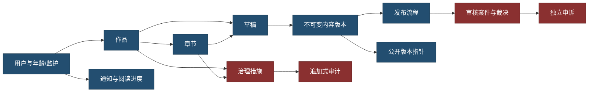

# 数据库设计说明书

## 1. 存储约定

P0-BL-1，2026-11-12。~~选定PostgreSQL17系列~~ **修订（2026-11-16，Owner裁决）：选定 MySQL 8.4 LTS 系列**（本机 MySQL84 服务实测 8.4.6）；原 PostgreSQL 表设计语义不变，按以下映射落为 MySQL 方言，本说明其余字段与约束描述仍为权威。P0-A 阶段不执行DDL；P0-B 起以版本化迁移脚本落地（`lumin-backend/lumin-bootstrap/src/main/resources/db/migration/`，当前 V1–V14 共 15 个脚本；`V7__ai_authoring.sql` 与 `V7__auth_session.sql` 重号，待合并重编）。

**MySQL 方言映射（工程裁决，迁移脚本头部同款登记）**：TIMESTAMPTZ→DATETIME(6)（统一存 UTC，连接时区强制 UTC）；JSONB→JSON；BYTEA→VARBINARY；UUID→CHAR(36)（小写规范形，服务端生成 UUIDv4，不用递增主键）；「NULLS NOT DISTINCT 唯一」与部分唯一索引（WHERE 条件）→ STORED 生成列 + 唯一索引模拟；TIMESTAMP 类型因 2038 上限一律改用 DATETIME(6)；VARCHAR 枚举白名单→CHECK 约束（MySQL 8.0.16+ 强制执行）；外键 ON DELETE RESTRICT；不使用触发器/存储过程。状态语义以[03](03-详细设计说明书.md)为准，HTTP模型以[05](05-接口设计文档.md)为准。

### 1.1 通用字段与类型

所有业务表必含id UUID主键、created_at TIMESTAMPTZ非空、updated_at TIMESTAMPTZ非空、created_by UUID非空、updated_by UUID非空、lock_version BIGINT非空默认1。系统行为使用固定且不可登录的服务主体ID，不使用空操作人。普通业务表含deleted_at TIMESTAMPTZ可空；审计、裁决、版本、事件、交易分录不含deleted_at，不支持删除。

ID由服务端生成UUIDv4，不暴露递增身份；客户端以字符串使用。跨分片预留以work_id/user_id聚合定位，不首日分片。时间存UTC，显示/自然日业务采用Asia/Shanghai。金额BIGINT分、币种CHAR(3)固定CNY；禁止浮点金额。JSONB只用于版本化规则、审计脱敏快照与结构化证据，不能代替核心外键。

字段缩写：NN=NOT NULL，N=允许NULL，U=唯一。下表未写默认值的业务字段必须显式赋值；VARCHAR枚举用CHECK约束完整白名单；状态枚举来源03，不设置“未知时通过”默认值。

### 1.2 数据分级

| 等级 | 字段实例 | 控制 |
| --- | --- | --- |
| PUBLIC | 已发布标题、分类、公开昵称 | 仍受内容可见性闸门 |
| INTERNAL | 流程、队列、规则版本、技术traceId | 工作角色授权、脱敏日志 |
| PERSONAL | oidc_subject、出生日期、用户设备 | 字段加密、用途限制、访问审计 |
| COMPLIANCE | 核验证据引用、监护关系、法律保全、未成年审查证据 | 独立权限和密钥、禁止批量导出 |

完整证件/人脸原件不进入业务库；proof_ref指向核验供应商的受控证据，不保存公开下载地址。

## 2. 实体关系

作品元数据也走内容版本审核；不能只审核章节正文却允许直接改作品标题、简介、封面。目标为WORK时chapter_id为空，为CHAPTER时chapter_id非空且必须属于work_id。

## 3. 身份与权限表

| 表/所有者 | 业务字段（除通用字段） | 约束与索引 |
| --- | --- | --- |
| user_profile / identity | oidc_issuer VARCHAR(200) NN；oidc_subject VARCHAR(200) NN；nickname VARCHAR(40) NN；birth_date_cipher BYTEA N；declared_age_band VARCHAR(2) NN；verified_age_band VARCHAR(2) N；effective_age_band VARCHAR(2) NN；age_verified_at TIMESTAMPTZ N；account_status VARCHAR(16) NN；policy_revision BIGINT NN；closed_at TIMESTAMPTZ N | U(issuer,subject)；age_band=C0/C1/C2/C3/C4；account_status=ACTIVE/SUSPENDED/CLOSED；闭户后按保留策略解除subject关联，不重用原ID |
| age_verification / identity | user_id UUID NN FK；provider VARCHAR(40) NN；proof_ref_cipher BYTEA NN；proof_digest CHAR(64) NN；method VARCHAR(20) NN；result VARCHAR(16) NN；age_band VARCHAR(2) NN；verified_at TIMESTAMPTZ NN；expires_at TIMESTAMPTZ NN | U(provider,proof_digest)；method=DOCUMENT/FACE/GUARDIAN；result=VERIFIED/REJECTED；索引(user_id,verified_at DESC,id)；不得用自述作为VERIFIED |
| guardian_consent / identity | guardian_id UUID NN FK；child_id UUID NN FK；proof_digest CHAR(64) NN；proof_ref_cipher BYTEA NN；scope VARCHAR(20) NN；granted_at TIMESTAMPTZ NN；revoked_at TIMESTAMPTZ N | scope=REGISTRATION/PUBLICATION/PUSH；guardian≠child；U(proof_digest)；有效同意部分唯一(guardian_id,child_id,scope) WHERE revoked_at IS NULL |
| role_assignment / identity | user_id UUID NN FK；role VARCHAR(32) NN；scope_type VARCHAR(16) NN；scope_id UUID N；expires_at TIMESTAMPTZ N；grant_id UUID NN FK | role见01，含LEGAL；scope_type=GLOBAL/WORK/QUEUE/CATEGORY；GLOBAL的scope_id必须NULL，非GLOBAL必填；未软删绑定采用U NULLS NOT DISTINCT(user_id,role,scope_type,scope_id)，过期续权更新既有绑定并审计；并发授予锁user行后校验互斥 |
| role_grant / identity | target_user_id UUID NN FK；role VARCHAR(32) NN；scope_type VARCHAR(16) NN；scope_id UUID N；expires_at TIMESTAMPTZ N；reason VARCHAR(500) NN；state VARCHAR(16) NN；requested_by UUID NN；reviewed_by UUID N；reviewed_at TIMESTAMPTZ N | requested_by≠reviewed_by；state=PENDING/APPROVED/REJECTED；索引(state,created_at,id) |
| rights_request / identity | user_id UUID NN FK；kind VARCHAR(16) NN；state VARCHAR(16) NN；due_at TIMESTAMPTZ NN；hold_id UUID N FK；result_ref_cipher BYTEA N | kind=ACCESS/EXPORT/CORRECT/ERASE；state见03；索引(user_id,created_at,id)、(state,due_at,id)；导出有效期24h，下载二次认证 |

## 4. 内容与发布表

| 表/所有者 | 业务字段 | 约束与索引 |
| --- | --- | --- |
| category / catalog | parent_id UUID N FK；name VARCHAR(40) NN；sort_order INTEGER NN；enabled BOOLEAN NN | 同父级name采用NULLS NOT DISTINCT唯一；禁止父子环；停用禁止新稿选用但保留历史关系、不下架既有内容；使用中分类不得删除；索引(parent_id,sort_order,id) |
| work / catalog | author_id UUID NN FK；business_state VARCHAR(16) NN；prior_state VARCHAR(16) N；copyright_status VARCHAR(16) NN；next_chapter_no INTEGER NN；completed_at TIMESTAMPTZ N | state见03；copyright_status=VALID/TERMINATED；索引(author_id,created_at DESC,id)、(business_state,updated_at DESC,id) |
| chapter / catalog | work_id UUID NN FK；sequence_no INTEGER NN；business_state VARCHAR(16) NN；prior_state VARCHAR(16) N | sequence_no>0；U(work_id,sequence_no)；state不含COMPLETED；索引(work_id,sequence_no,id) |
| draft / authoring | work_id UUID NN FK；chapter_id UUID N FK；target_type VARCHAR(8) NN；base_version_id UUID N FK；title VARCHAR(100) NN；synopsis VARCHAR(2000) N；category_id UUID N FK；tags JSONB NN；cover_asset_id UUID N；body_text TEXT N；state VARCHAR(16) NN | WORK必有synopsis/category_id且body_text为空；CHAPTER必有body_text且chapter_id非空；tags为≤5个非空字符串；同目标最多一个EDITABLE草稿；索引(work_id,state,updated_at DESC,id) |
| content_version / authoring | work_id UUID NN FK；chapter_id UUID N FK；target_type VARCHAR(8) NN；revision_no BIGINT NN；source_draft_id UUID NN FK；title VARCHAR(100) NN；synopsis VARCHAR(2000) N；category_id UUID N FK；tags JSONB NN；cover_asset_id UUID N；object_key VARCHAR(300) N；body_sha256 CHAR(64) N；material_snapshot JSONB NN；material_sha256 CHAR(64) NN；byte_length INTEGER N；state VARCHAR(16) NN；grade VARCHAR(8) N；policy_version BIGINT NN | U(source_draft_id)；WORK按work_id唯一revision，CHAPTER按chapter_id唯一revision；正文CHAPTER对象字段全非空；grade=G/PG_12/PG_16/A；正文/元数据不可更新，审核state/grade只允许状态机字段更新并审计 |
| publication_workflow / publication | version_id UUID NN FK U；target_type VARCHAR(8) NN；target_id UUID NN；state VARCHAR(20) NN；policy_version BIGINT NN；case_id UUID N；suspended_reason VARCHAR(40) N | 同目标非终态部分唯一；索引(state,updated_at,id)；case_id与review_case互链在服务事务内校验，不建循环立即外键 |
| publication_pointer / publication | target_type VARCHAR(8) NN；target_id UUID NN；version_id UUID NN FK；published_at TIMESTAMPTZ NN；publication_revision BIGINT NN | U(target_type,target_id)；服务校验目标一致；复合关联校验测试T14；读者列表以published_at,id稳定排序 |
| content_asset / authoring | owner_id UUID NN FK；kind VARCHAR(16) NN；work_id UUID N FK；case_id UUID N FK；object_key VARCHAR(300) NN U；object_version_id VARCHAR(200) NN；sha256 CHAR(64) NN；mime VARCHAR(40) NN；size_bytes INTEGER NN；review_state VARCHAR(16) NN | kind=COVER/BODY/EVIDENCE；COVER/BODY绑定work，EVIDENCE绑定case；mime限text/plain,image/jpeg,image/png；review_state=APPROVED/REJECTED；sha256为正式净化字节摘要；覆盖写禁止；COVER必须审核通过才可引用 |
| asset_upload / authoring | owner_id UUID NN FK；purpose VARCHAR(16) NN；work_id UUID N FK；case_id UUID N FK；request JSONB NN；quarantine_key VARCHAR(300) NN U；frozen_object_version_id VARCHAR(200) N；original_sha256 CHAR(64) NN；size_bytes INTEGER NN；content_type VARCHAR(40) NN；expires_at TIMESTAMPTZ NN；state VARCHAR(20) NN；asset_id UUID N FK；failure_reason VARCHAR(32) N | purpose=COVER/EVIDENCE；归属互斥见05；state见03；failure_reason=SIZE_MISMATCH/HASH_MISMATCH/TYPE_MISMATCH/UNSAFE_CONTENT/UPLOAD_EXPIRED/STORAGE_UNAVAILABLE；1≤size≤5242880；COMPLETE当且仅当asset_id非空；索引(owner_id,created_at,id)、(state,expires_at,id) |

正文不可变指object_key/sha256/title等内容字段不可覆盖，不妨碍受控版本状态从SUBMITTED变成APPROVED。数据库账号列级权限加Repository约束共同执行，不能仅依靠开发约定。

## 5. 审核与治理表

| 表/所有者 | 业务字段 | 约束与索引 |
| --- | --- | --- |
| review_case / moderation | version_id UUID N FK；workflow_id UUID N FK；work_id UUID NN FK；chapter_id UUID N FK；source VARCHAR(16) NN；risk VARCHAR(8) NN；priority VARCHAR(2) NN；state VARCHAR(20) NN；queue_id UUID NN；review_stage SMALLINT NN；assignee_id UUID N FK；lease_expires_at TIMESTAMPTZ N；response_due_at TIMESTAMPTZ NN；completion_due_at TIMESTAMPTZ NN；policy_version BIGINT NN | source=SUBMISSION/REPORT/APPEAL/INSPECTION/LEGAL；risk=LOW/MEDIUM/HIGH；priority=P0/P1/P2/P3；索引(queue_id,state,priority,completion_due_at,id)、(work_id,created_at,id)；非发布案件version/workflow为空 |
| machine_report / moderation | case_id UUID NN FK；provider VARCHAR(40) NN；model_version VARCHAR(80) NN；material_sha256 CHAR(64) NN；grade VARCHAR(8) N；policy_version BIGINT NN；risk VARCHAR(8) NN；flags JSONB NN；suggested_decision VARCHAR(16) NN；confidence NUMERIC(5,4) NN；evidence_refs JSONB NN；input_tokens INTEGER NN；output_tokens INTEGER NN；duration_ms INTEGER NN；completed_at TIMESTAMPTZ NN | 0≤confidence≤1；flags白名单；token非负；索引(case_id,created_at,id)；不能存模型自由文本指令为可执行动作 |
| review_decision / moderation | case_id UUID NN FK；actor_id UUID NN；actor_type VARCHAR(8) NN；decision VARCHAR(16) NN；grade VARCHAR(8) N；reason_code VARCHAR(40) NN；reason VARCHAR(1000) NN；evidence_refs JSONB NN；stage SMALLINT NN；policy_version BIGINT NN | actor_type=HUMAN/SYSTEM；decision=PASS/LABEL/LIMIT/REVISE/HIDE/REMOVE/BAN/ESCALATE；U(case_id,actor_id,stage)；append-only；同案件独立双审主体约束由事务再校验 |
| appeal / moderation | case_id UUID NN FK；applicant_id UUID NN FK；reason VARCHAR(1000) NN；evidence_refs JSONB NN；reviewer_id UUID N FK；state VARCHAR(16) NN；decision_reason VARCHAR(1000) N；accepted_due_at TIMESTAMPTZ NN；completed_due_at TIMESTAMPTZ NN | 同案件最多一条未终结申诉；索引(state,completed_due_at,id)；reviewer不属于原裁决actor集合 |
| report / governance | reporter_id UUID NN FK；work_id UUID NN FK；chapter_id UUID N FK；reason_code VARCHAR(40) NN；description VARCHAR(1000) NN；case_id UUID NN FK | 同主体同目标24h内相同reason_code去重；索引(reporter_id,created_at DESC,id)；高危信号不因普通配额丢弃，转安全受理通道 |
| restriction / governance | work_id UUID NN FK；chapter_id UUID N FK；kind VARCHAR(32) NN；state VARCHAR(16) NN；reason VARCHAR(1000) NN；case_id UUID NN FK；requested_by UUID NN；reviewed_by UUID N；effective_at TIMESTAMPTZ N；expires_at TIMESTAMPTZ N；revoked_at TIMESTAMPTZ N；appeal_id UUID N FK | kind=TEMPORARY/FINAL_VIOLATION/CONTRACT_TERMINATED/GUARDIAN_REVOKED；索引(work_id,state,chapter_id)；临时措施必有expires_at；终局/解约禁止REVOKED |
| legal_hold / governance | subject_type VARCHAR(16) NN；subject_id UUID NN；basis_ref_cipher BYTEA NN；state VARCHAR(16) NN；expires_at TIMESTAMPTZ NN；owner_id UUID NN | subject_type=USER/WORK/CASE；state=ACTIVE/RELEASED；索引(subject_type,subject_id,state)；所有保全读取留痕 |

### 5.1 配置与支撑数据

| 表/所有者 | 业务字段 | 约束与索引 |
| --- | --- | --- |
| config_revision / configuration | config_key VARCHAR(40) NN；revision BIGINT NN；base_revision BIGINT NN；schema_version INTEGER NN；payload JSONB NN；state VARCHAR(16) NN；reason VARCHAR(500) NN；requested_by UUID NN；approved_by UUID N；effective_at TIMESTAMPTZ NN；rollout_basis_points INTEGER NN；rollback_of UUID N FK | U(config_key,revision)；key=REVIEW_ROUTING/ACCESS_POLICY/NOTIFICATION_POLICY/CONTENT_CATALOG；1≤rollout≤10000；ACCESS_POLICY/CONTENT_CATALOG固定10000；同key唯一ACTIVE全量基线及至多一个ACTIVE灰度版本，两类部分唯一索引；审批绑定base_revision，旧基线上的提案激活拒绝；申请人与审批人不同 |
| reading_progress / engagement | user_id UUID NN FK；chapter_id UUID NN FK；version_id UUID NN FK；position_basis_points INTEGER NN；read_seconds INTEGER NN；client_updated_at TIMESTAMPTZ NN | U(user_id,chapter_id)；0≤position≤10000；read_seconds≥0；服务端拒绝未来超过5分钟时间；版本变化提示而不跨版本乱套位置 |
| notification / engagement | recipient_id UUID NN FK；category VARCHAR(24) NN；source_event_id UUID NN；title VARCHAR(100) NN；body VARCHAR(1000) NN；resource_type VARCHAR(16) NN；resource_id UUID NN；read_at TIMESTAMPTZ N | U(recipient_id,source_event_id,category)；category=REVIEW_RESULT/SAFETY/GUARDIAN/RIGHTS/UPDATE；UPDATE为P1；索引(recipient_id,created_at DESC,id) |
| audit_record / audit | actor_id UUID NN；role_context VARCHAR(32) NN；action VARCHAR(80) NN；resource_type VARCHAR(40) NN；resource_id UUID NN；before_redacted JSONB N；after_redacted JSONB N；reason VARCHAR(1000) NN；trace_id VARCHAR(64) NN；event_at TIMESTAMPTZ NN；digest CHAR(64) NN | append-only；索引(resource_type,resource_id,event_at,id)、(actor_id,event_at,id)；不记正文/令牌/证件；定期签名归档WORM |
| outbox_event / 各域经foundation端口 | event_id UUID NN U；aggregate_type VARCHAR(40) NN；aggregate_id UUID NN；aggregate_revision BIGINT NN；event_type VARCHAR(80) NN；schema_version INTEGER NN；payload JSONB NN；occurred_at TIMESTAMPTZ NN；delivered_at TIMESTAMPTZ N；attempts INTEGER NN；next_attempt_at TIMESTAMPTZ NN | U(aggregate_type,aggregate_id,aggregate_revision,event_type)；部分索引(next_attempt_at,id) WHERE delivered_at IS NULL；事件不能含原始PII |
| inbox_receipt / 消费域 | consumer_name VARCHAR(80) NN；event_id UUID NN；processed_at TIMESTAMPTZ NN | U(consumer_name,event_id)；不在未确认事件保留周期结束前清理 |
| idempotency_record / foundation适配器 | subject_id UUID NN；method VARCHAR(8) NN；path VARCHAR(300) NN；key UUID NN；request_digest CHAR(64) NN；response_code INTEGER NN；response_body JSONB NN；expires_at TIMESTAMPTZ NN | U(subject_id,method,path,key)；响应不含密钥/敏感全文；执行中由事务锁协调，不存伪成功结果 |

### 5.2 提案与审批追溯

监护同意、角色提案、限制、申诉、权利请求均增加request_cipher BYTEA NN保存加密原始请求；配置payload已冻结，不重复存请求全文。视图request由授权读取及脱敏映射生成，不回显可兑换凭证；审批字段不能只从当前行最后审批人推断。

| 表/所有者 | 业务字段 | 约束与索引 |
| --- | --- | --- |
| proposal_review / 各提案所属域 | resource_type VARCHAR(24) NN；resource_id UUID NN；actor_id UUID NN；action VARCHAR(24) NN；reason VARCHAR(1000) NN；evidence_refs JSONB NN；reviewed_revision BIGINT NN；event_at TIMESTAMPTZ NN | 类型=CONSENT/ROLE_GRANT/RESTRICTION/APPEAL/RIGHTS_REQUEST/CONFIG；action白名单见05 ReviewRecord；目标存在及作用域由拥有域事务校验；追加不可删；索引(resource_type,resource_id,event_at,id) |

案件review_stage限定1/2/3；机审和人工PASS/LABEL/LIMIT必须grade非空，其余grade为空。材料快照与material_sha256依03规范生成，与版本内容一同不可变。金额字段除settlement.net_minor允许负数，均按非负/正值约束且绝对值≤9007199254740991，与三端JSON精度一致。

## 6. 强制预留但不启用

### 6.1 P1关系

| 表 | 字段 | 不变量 |
| --- | --- | --- |
| bookmark | user_id UUID NN、work_id UUID NN、created_at | U(user_id,work_id)；无通知语义 |
| subscription | user_id UUID NN、work_id UUID NN、enabled BOOLEAN NN、quiet_start TIME NN、quiet_end TIME NN、push_enabled BOOLEAN NN | U(user_id,work_id)；UPDATE只来自新章节发布，每作品每接收者每自然日最多1条聚合通知 |
| notification_digest | recipient_id UUID NN、work_id UUID NN、local_date DATE NN、latest_chapter_id UUID NN、sent_at TIMESTAMPTZ N | U(recipient_id,work_id,local_date)；修订、作者公告不触发UPDATE |

三表仍继承1.1业务字段；P0无收藏/追更写HTTP入口，仅在契约/模型与去重设计上验收。

### 6.2 付费实体骨架

| 表 | 字段 | 约束 |
| --- | --- | --- |
| billing_account | owner_id UUID NN、kind VARCHAR(24) NN、currency CHAR(3) NN、enabled BOOLEAN NN默认false | kind=USER_CASH/COIN_LIABILITY/PLATFORM_REVENUE/AUTHOR_PAYABLE/TAX_PAYABLE/REFUND_RESERVE/CHARGEBACK_LOSS/INCENTIVE_EXPENSE/CHANNEL_COST；U(owner_id,kind,currency) |
| billing_order | buyer_id UUID NN、product_type VARCHAR(16) NN、product_id UUID NN、amount_minor BIGINT NN、currency CHAR(3) NN、idempotency_key UUID NN、state VARCHAR(16) NN | amount≥0；product=CHAPTER/BOOK/MEMBERSHIP/GIFT；state=CREATED/PAID/CANCELLED/REFUNDED；P0无创建者 |
| ledger_entry | transaction_id UUID NN、account_id UUID NN FK、direction VARCHAR(8) NN、amount_minor BIGINT NN、currency CHAR(3) NN、reversal_of UUID N FK | direction=DEBIT/CREDIT；amount>0；同事务借贷总额相等为B类写入门禁；append-only |
| revenue_share | order_id UUID NN FK、beneficiary_id UUID NN、rule_revision BIGINT NN、amount_minor BIGINT NN、state VARCHAR(16) NN | state=PENDING/SETTLED/FROZEN/REVERSED；P0仅schema |
| settlement | author_id UUID NN、period_start DATE NN、period_end DATE NN、net_minor BIGINT NN、state VARCHAR(16) NN | U(author_id,period_start,period_end)；state=DRAFT/APPROVED/PAID/FAILED；净额允许负值 |
| refund | order_id UUID NN FK、amount_minor BIGINT NN、reason VARCHAR(500) NN、state VARCHAR(16) NN、requested_by UUID NN、approved_by UUID N | state=REQUESTED/APPROVED/PAID/REJECTED；amount>0；禁止自批 |

付费权限BILLING_PROPOSE/BILLING_APPROVE/SETTLEMENT_EXECUTE仅登记字典、不授予、不暴露接口。角色矩阵与模型能容纳未来分离，不能把空表称为交易已可用。

## 7. 查询、约束与迁移

- 游标使用排序键+id+过滤条件摘要+主体作用域签名；默认20、最大100。过期游标15分钟；过滤器改变必须重新分页。书城按published_at DESC,id DESC；章节按sequence_no,id；队列按priority、completion_due_at、id。
- 草稿与未决流程的部分唯一索引使用固定终态集合，不依赖当前时间表达式。并发取号与角色授予锁聚合根行，默认READ COMMITTED，唯一约束兜底，死锁最多重试2次且保持幂等键。
- 外键ON DELETE RESTRICT；禁止级联删除业务记录。历史记录指向匿名用户ID仍保留，不泄露已擦除个人标识。
- P0-A新增迁移只建表与索引；索引需用代表性数据EXPLAIN(ANALYZE,BUFFERS)验证，不用“建了索引”代替查询预算。生产大表扩展用expand/contract，不在主事务里建阻塞索引。
- 回滚应用不删除数据表；已生效不可变版本、审计、事件不能用down脚本抹除。失误迁移采用前向修复，清理列前确认所有消费者已迁移。

## 8. 保留与销毁

| 数据 | 保留策略 | 例外与执行 |
| --- | --- | --- |
| 正文版本/裁决 | 服务存续期间保留；争议与法律保全优先 | 不因作者删稿删除已发布版本证据 |
| 原始草稿孤儿对象 | 未被引用且无保全≥24小时 | 定时扫描两次确认无引用后清理，仅限该类临时对象 |
| 个人识别关联 | 注销立即断开公开关联；6个月后匿名化内部关联 | 法律保全转HELD并限制访问，不无限静默保留 |
| 普通操作IP/设备字段 | 6个月后脱敏 | 审计事实不删除；脱敏通过分离PII关联表销毁密钥，不篡改审计正文 |
| 导出文件 | 24小时失效与清理 | 下载需二次认证与审计 |
| 幂等响应 | 24小时 | 财务骨架未来启用采用永久业务键，不能沿用短期去重 |
| Outbox/Inbox | 180天在线，长期归档事件摘要 | 归档前确认消费水位，人工重放必须保留去重依据 |

Tier0数据使用跨AZ同步副本与加密备份。期限是工程执行候选；法定要求更长时由法务备案覆盖并版本化，不自动缩短。
