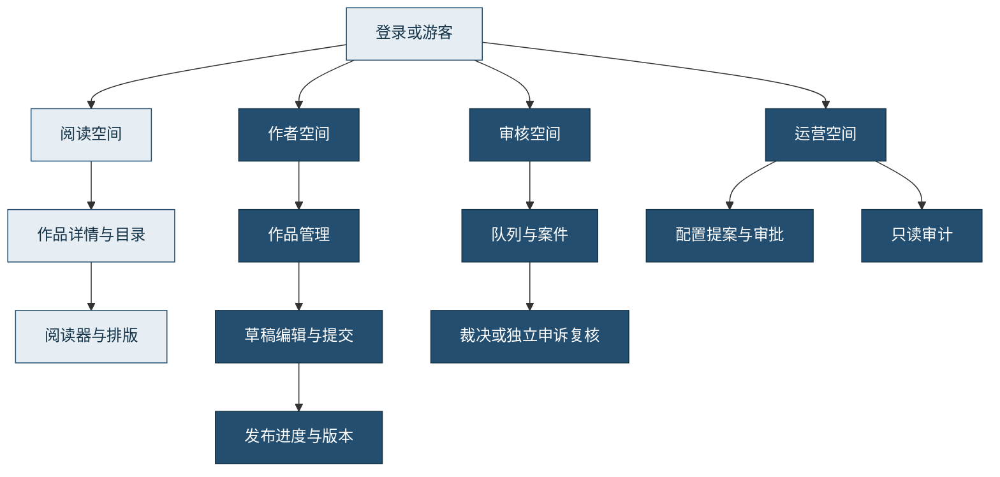

# 原型设计

## 1. 交付类型与设计方向

P0-BL-1，2026-11-12。本文件为页面结构、交互与视觉约束的可实施原型规格，不是已运行的HTML/原生应用；未进行浏览器或设备验收。产品范围依据[01](01-需求分析说明书.md)，接口依据[05](05-接口设计文档.md)。

选定“阅读目录与书页边注”方向：读者首页的第一任务是继续阅读与选择作品，不是营销大横幅；作者端围绕章节目录和稿件状态；治理端围绕案件事实与理由。辨识元素是章节边注轨道：只表达当前位置、版本变更和审核批注，不作无意义装饰编号。

### 1.1 设计令牌

| 令牌 | 值 | 使用 |
| --- | --- | --- |
| surface | #F5F8FA | 冷白阅读背景，不使用奶油纸张模板 |
| paper | #FFFFFF | 正文与表单表面 |
| ink | #172D3E | 主文字 |
| secondary | #4E6575 | 辅助说明，不用低对比浅灰正文 |
| accent | #245C75 | 主要操作、焦点、章节位置 |
| danger | #9C303B | 风险与不可恢复操作；不能只靠颜色传达 |
| border | #C2CFD8 | 非交互分隔；交互边界使用secondary |
| nightSurface/nightInk | #13202A / #E6EDF2 | 夜间阅读；保留清晰层级 |
| spacing | 4/8/12/16/24/32/48px | 统一间距，阅读器字体用rem |
| radius | 6px控件、8px弹层 | 不用大圆角堆叠卡片模拟内容 |
| focus | 3px accent实线，外偏移2px | 夜间用nightInk；不移除键盘焦点 |

显示标题用系统宋体栈Songti SC/Noto Serif CJK SC/serif，正文阅读用同栈但用户可切换系统无衬线；操作界面用PingFang SC/Microsoft YaHei/sans-serif；章节号/审核时长用系统等宽。P0不从境外CDN拉字体。标题28/24/20px，界面正文16px，辅助14px；阅读默认20px、行高1.8，可调16–32px、行高1.5–2.2、正文宽度32–44em。

### 1.2 自审取舍

放弃“巨大品牌标语+统计卡片+推荐轮播”的落地页模板；内容新鲜度、章节进度、审核事实才是此产品的信息。无循环自动轮播、无奖励诱导、无伪造排行榜与运营数字。动画仅用于面板切换120ms；prefers-reduced-motion时0ms，正文无滚动劫持。

## 2. 页面与入口

四类业务界面在Web与原生App按身份开放；不是给所有用户展示所有后台标签。原生审核/运营入口位于已授权工作空间，与读者导航隔离，保持可执行最小闭环；复杂表格在窄屏改为详情流，不转WebView充抵原生能力。

### 2.1 页面追踪表

| 页面ID/路由 | 页面单一目标 | API与需求 |
| --- | --- | --- |
| U01 /account | 登录、年龄状态和本人权限说明 | getMe/createProfile/verifyAge；R01 |
| U02 /account/guardians | 核验监护同意和撤回 | createConsent/revokeConsent；R01 |
| U03 /account/rights | 发起主体权利请求并查看处理状态 | createRightsRequest/getRightsRequest；R12 |
| R01 /library | 发现可读作品，继续阅读 | listWorks/listCategories；R09 |
| R02 /works/:id | 作品简介、等级、作者、章节目录 | getWork/listChapters；R09 |
| R03 /read/:id | 连续阅读、排版、进度、举报 | readChapter/getProgress/saveProgress/createReport；R09/R14 |
| A01 /studio | 查看本人作品及待处理稿件 | listMyWorks/listMyDrafts/listMyPublicationWorkflows/createWork/createDraft；R03 |
| A02 /studio/works/:id | 作品元数据、章节、完结、修订 | getMyWork/listMyChapters/createChapter/changeWorkLifecycle/createDraft；R03/R04 |
| A03 /studio/drafts/:id | 保存草稿与提交审核 | getDraft/saveDraft/submitDraft；R03/R04 |
| A04 /studio/workflows/:id | 查看机审/人工/挂起/退回/发布事实 | getWorkflow/cancelWorkflow；R05/R06 |
| M01 /review/queue | 领取授权案件，优先处理临期 | listCases/claimCase；R07 |
| M02 /review/cases/:id | 阅读受控材料并填写证据与裁决 | getCase/getReviewContent/decideCase；R07 |
| M03 /appeals/:id | 查看申诉或执行独立复核 | getAppeal/reviewAppeal；R08 |
| O01 /operations/content | 查询治理措施、提出下架、查看状态 | requestRestriction/reviewRestriction；R08 |
| O02 /operations/config | 对比、提案、独立审批、激活、回滚 | listConfigRevisions/createConfigRevision/reviewConfigRevision/activateConfigRevision；R10 |
| O03 /operations/access | 权限提案与独立审批 | requestRoleGrant/reviewRoleGrant；R02 |
| O04 /operations/audit | 脱敏审计检索 | listAuditRecords；R12 |
| N01 /notifications | 阅读审核、保护和权利处理通知 | listNotifications/markNotificationRead；R11 |

恢复操作的补充入口：U02使用listGuardianConsents/getGuardianConsent，U03使用listRightsRequests；M03使用listAppeals/createAppeal及详情复核；O01使用listRestrictions/getRestriction；O02使用getConfigRevision；O03使用listRoleGrants/getRoleGrant。列表先按授权范围读取，审批前重新读详情及ETag；不能从通知ID直接盲批。

A02封面与M03证据使用createAssetUpload/getAssetUpload/completeAssetUpload/getAssetContent；显示上传中、检查中、已就绪、失败/过期五态；只有COMPLETE后将assetId写入对应草稿/案件引用。封面P0只在作者/审核私有空间展示，读者侧使用排版占位，不虚构公开素材分发。刷新丢失上传会话时允许重选文件新建会话，不把旧未完成对象当正式素材。

未来P1书架收藏/追更、搜索框、推荐干预页面不在P0展示空壳入口。

## 3. 关键页面布局

### 3.1 读者与阅读器

桌面≥1024px：左侧240px目录，主栏最大44em，右侧仅必要排版开关；目录显示章节标题和当前章，不用大面积封面墙挤压阅读。手机<768px：单栏正文、顶部返回/标题、底部目录/排版/举报菜单；安全区内按钮≥44×44px。平板768–1023px目录为可关闭抽屉。

作品列表每项显示标题、作者、简介摘要、内容等级、连载/完结；不显示虚构评分。详情主操作“开始阅读”或“继续阅读”。没有已发布章节时提示“暂无可阅读章节”，不链接到草稿。下架后返回“内容暂不可访问”，不暴露违规证据。

阅读位置在滚动停止2秒后保存，前台最密5秒一次，退出时提交一次；游客只保留会话内进度，不伪装为跨设备同步。版本改变提示“本章已修订”，用户确认后从章首定位；不把旧百分比强行写进新版本。后台/断网不产生虚假有效阅读时长。

### 3.2 作者工作空间

桌面：作品/章节导航、正文编辑、保存与流程侧栏；手机：章节列表→全屏编辑→独立发布确认页。编辑区不采用富HTML输入，纯文本粘贴保留换行。顶部展示“尚未保存 / 保存中 / 已保存 / 保存失败”，与发布状态分开。

“保存草稿”不会公开。“提交审核”确认页展示目标版本、内容字数、年龄/监护与版权资格、发布后修改须新版本的说明。202后的明确文案为“已提交审核”，只有公开指针回读吻合才显示“已发布”。未成年限制直接解释，不以隐藏按钮作为唯一权限控制。

乐观锁冲突不自动覆盖：保留本地编辑内存，展示本地/最新版本对比，用户复制合并后重新保存。刷新/关闭前有未保存提示；P0不承诺离线持久草稿。

### 3.3 审核空间

队列列为优先级、风险、年龄层、来源、剩余SLA、状态；窄屏逐案卡片但保持同一排序。领取失败显示“该案件已被领取，请刷新”，不覆盖他人租约。

案件详情显示最少材料、版本差异、规则版本、证据、原裁决。姓名/证件/完整生日不展示。正文区域带当前审核身份与时间水印，查看即审计；不显示复制全文/下载按钮，但不声称技术能绝对阻止截屏。

裁决表单有结果、理由码、理由、证据引用；PASS/LABEL/LIMIT必须填写等级。高风险首审后显示“等待独立复核”，不显示“已通过”。双人分歧显示“需要新的L2裁决”。申诉复核视图只在后端确认回避通过后开放。

### 3.4 运营与配置

运营侧只能提案，不出现“直接修改审核结论”。配置页展示当前值、提案差异、生效时间、灰度比例、提出人、审批人、审计链。审批通过后仍展示“待生效”；只有读取ACTIVE版本后显示“已生效”。回滚操作创建新提案，不直接把数据库旧值覆盖回来。

高危确认显示具体对象、影响范围、原因与复核要求；不用通用“确定吗”隐藏后果。ADMIN工作空间不包含内容裁决按钮。审计只读，无删除按钮与隐藏删除快捷键。

## 4. 四态、异常与恢复

| 场景 | 加载态 | 空态 | 错误态 | 成功态 |
| --- | --- | --- | --- | --- |
| 书城 | 保留布局骨架，读屏提示加载 | 暂无适龄已发布作品 | 重试入口，不回退展示未过滤缓存 | 可读作品列表 |
| 草稿 | 禁止重复提交，保存指示 | 引导创建章节 | 412保留本地，503查询原请求 | 已保存时间与revision |
| 提交 | 按钮忙碌且同幂等键 | 无目标时不允许提交 | 年龄/权限说明；超时先查状态 | 已提交审核+进度入口 |
| 审核 | 领取/裁决中锁按钮 | 当前队列暂无案件 | 租约过期重新领取，不能继续裁决 | 已记录裁决或等待二审 |
| 申诉 | 上传/受理中 | 无新证据提示要求 | 原审回避、重复申诉提示 | 受理时限与跟踪入口 |
| 配置 | 对比/审批中 | 无变更提案 | 版本冲突刷新；不能降弱底线 | 待生效/已生效分别显示 |
| 通知 | 加载占位 | 暂无通知 | 保留原列表并标明刷新失败 | 已读态由服务回读确认 |

通知、安全和内容变化通过aria-live polite通告；P0危险阻断使用明确文本与焦点管理，不刷屏重复播报。被下架内容的旧视图收到刷新/失效事件后停止拉取，已下载文本无法保证撤销。

## 5. 无障碍与跨端验收

- Web语义标题、main/nav、跳到正文、全部键盘可达；弹窗焦点进入/封闭/关闭恢复，Escape退出非强制对话。
- 常规文字对比≥4.5:1，大字≥3:1；焦点、控件边界≥3:1。色值只是设计输入，必须用实际合成背景重新测量。
- 字号200%和320px视口无正文水平滚动；表格转详情列表；错误不只红色，必须有文本。
- NVDA/Chrome、VoiceOver/Safari+iOS、TalkBack/Android覆盖登录、阅读、编辑提交、审核裁决、申诉、配置审批。
- 原生支持Dynamic Type/系统字体缩放、系统返回、安全区、平台读屏标签；触控目标iOS≥44pt，Android≥48dp。
- 夜间、高对比度、字号、行高、正文宽度独立可调；设置仅体验层，可本地保存，不影响后端年龄/权限政策。

## 6. 原型评审退出条件

Owner确认阅读方向和四端页面范围；所有页面有对应API与四态；安全审核确认无正文/身份泄漏入口；移动端负责人确认原生可实现。该规格评审通过仍不等同于视觉效果确认，P0-B必须提交真实运行截图、交互步骤与读屏记录，禁止用本文件代替浏览器或设备验证。
