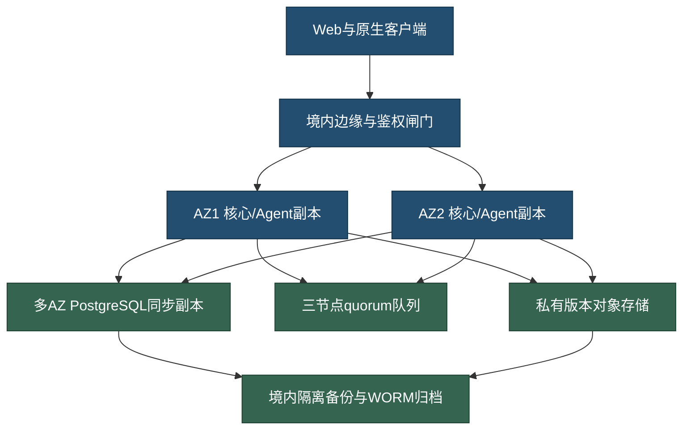

# 部署与运维手册

## 1. 状态与适用范围

P0-BL-1，2026-11-12。本文是上线前必须实现和演练的运行规程，不代表已有云资源、流水线、证书、告警或容灾副本。当前只完成文档；禁止据此直接操作生产。依据[02架构](02-概要设计说明书.md)、[07验收](07-测试计划与用例.md)。

## 2. 环境与部署拓扑

| 环境 | 用途 | 数据与权限 |
| --- | --- | --- |
| local | 开发与单测/集成 | 合成数据、独立容器；无生产密钥 |
| preview | 每PR四端Web预览及契约验证 | 临时合成数据，生命周期随PR；原生测试产物单独分发 |
| staging | 真实供应商沙箱、性能、灾备、设备回归 | 合成/合法脱敏数据；独立Secret Manager项目 |
| prod | 境内正式服务 | 最小权限、审批发布、多AZ、真实审计 |

生产核心最少2副本跨2AZ；消息3副本跨3故障域；数据库Tier0同步提交跨AZ确认。具体云区域、机型、镜像digest在预发前通过容量与合规评审，不在文档里捏造已购买资源。

### 2.1 容量与扩容

初始设计锚点3000读并发，峰值验收15000并发；CDN命中率目标>90%。核心服务CPU连续5分钟>60%或读P95连续3分钟>250ms触发读副本扩容，冷却5分钟；队列积压年龄>60秒告警。副本数2–20为初始策略，预发压测校准，不保证20副本自动覆盖100倍增长。

写/审核首日采用人工扩容，目标一个工作日内增加容量：值班人确认瓶颈→核对数据库/队列余量→审批扩副本/审核席位→观察30分钟→回写容量记录；不得只增API副本把数据库压垮。

## 3. 配置和密钥清单

下表仅键名/含义，不含值。密钥由Secret Manager注入，模型/日志不得读取正文。配置变更走评审，本轮不修改实际权限或CI设置。

| 键 | 类型 | 归属与校验 |
| --- | --- | --- |
| APP_ENV | 非密钥 | local/preview/staging/prod，未知值拒绝启动 |
| PUBLIC_ORIGIN | 非密钥 | 环境唯一HTTPS域，不用通配CORS |
| OIDC_ISSUER/OIDC_AUDIENCE | 非密钥 | 精确白名单；不从请求动态解析issuer |
| AGENT_ISSUER/AGENT_AUDIENCE | 非密钥 | 与用户令牌隔离，只授予内部报告scope |
| DATABASE_DSN | 密钥 | 最小权限业务账号；非DDL账号 |
| MIGRATION_DSN | 密钥 | 仅审批迁移任务短期使用，不给运行服务 |
| REDIS_DSN/RABBITMQ_DSN | 密钥 | TLS、独立账号、域级队列权限 |
| OBJECT_STORAGE_ENDPOINT | 非密钥 | 境内固定服务域，防SSRF |
| OBJECT_STORAGE_CREDENTIAL | 密钥 | 仅私有桶必要前缀；禁止公开策略 |
| IDENTITY_PROVIDER_SECRET | 密钥 | 核验供应方沙箱/生产分离 |
| MODERATION_PROVIDER_SECRET/LLM_PROVIDER_SECRET | 密钥 | 任务预算、固定厂商域、境内数据处理合同 |
| DATA_ENCRYPTION_KEY_REF | 密钥引用 | KMS标识，轮换与旧数据解密双版本窗口 |
| CURSOR_SIGNING_KEY_REF/POLICY_SAMPLE_KEY_REF | 密钥引用 | 游标签名与稳定抽样，禁止客户端控制 |
| OTEL_EXPORTER_ENDPOINT | 非密钥 | 境内内部观测接收端，字段脱敏 |

业务规则不通过随意环境变量覆盖；年龄/审核/通知参数由configuration已审批版本读取。紧急禁用自动放行仍需留痕，不能禁用全量机审前置。

## 4. CI与制品准入

### 4.1 六阶段

1. 格式化/lint：Java Spotless/Checkstyle，Python ruff，Web ESLint/Prettier，原生各平台lint。
2. 编译/类型：Maven、mypy、TypeScript strict、Swift/Kotlin原生编译。
3. 单元/集成/契约：07覆盖率、状态穷举、依赖无环、consumer/provider契约。
4. SAST/依赖/秘密扫描：高危漏洞或泄密阻断，不用忽略文件静默放行。
5. 构建：锁文件/BOM、SBOM、镜像摘要、签名、原生签名产物；不使用latest镜像。
6. 预览/预发：启动、实际HTTP、浏览器与设备操作、故障/性能必要回归。

精确依赖和镜像摘要在P0-A构建前锁定并评审。此清单不是已存在的CI流水线；实际创建/修改CI、发布、云资源变更须另行授权。

### 4.2 本机工具证据

2026-11-12命令实测：Java21.0.6、Maven3.9.15、Python3.11.9、Node24.15.0、npm11.5.2。Docker命令存在但daemon/容器未验证；Gradle命令存在但Android SDK未验证；未找到swift/kotlinc/xcodebuild命令。iOS编译与签名必须在macOS/Xcode上执行，Windows不能替代该证据。

2026-11-15复核（Git Bash）：Java21.0.6、Maven3.9.15、Python3.11.9、Node24.15.0、npm11.12.1——与2026-11-12记录一致，仅npm小版本不一致；2026-11-12在另一终端实测到的Node v22.22.2 / Python 3.13.14（09 §4.3 W-07）判断为终端/PATH环境差异，非环境漂移。结论：npm小版本漂移按W-07持续跟踪，所有依赖版本锁定一律以lockfile / BOM为准，不以终端快照为准。

## 5. 指标、告警与审计

| 指标/告警 | 初始阈值 | 处理 |
| --- | --- | --- |
| 月可用性 | ≥99.95% | 月度错误预算；超预算冻结非必要功能发布 |
| 读API P95 | <300ms；连续5分钟超标 | 检查缓存、慢查询、连接池，再扩容 |
| 首屏P95 | <1000ms | 分边缘/聚合/数据/渲染定位，不混入后台接口 |
| 下架传播 | 目标5秒；30秒积压告警；60秒硬门槛 | 关闭相关读入口缓存租约、回源校验；无法证明安全则拒绝展示 |
| 三态不一致 | 任意1例 | 自动不可见+P1事件；涉及违法/未成年升级P0 |
| 审核SLA | P0即时；P1 30min/2h；P2 2h/24h；P3 24h/72h | 分队列报警、增审查产能；不自动跳审 |
| 审计写入失败 | 任意1次 | 高危业务回滚，值班处理 |
| 消费死信 | 任意1条契约错/越权 | 隔离、保留证据、检查版本兼容，禁止盲目重放 |
| Agent成本 | 80%预警、100%停自动路线 | 规则预检后人审；不得放行未机审内容 |
| 可疑批量正文访问 | 单审核账号>120次/分钟 | 限流、暂停会话、人工核查，不暴露案件内容到告警 |

### 5.1 配额

| 路径类别 | 用户桶 | IP桶 | 超限 |
| --- | --- | --- | --- |
| 公开目录/阅读 | 登录用户300次/分钟 | 游客120次/分钟 | 429与Retry-After，不绕过年龄 |
| 草稿保存 | 60次/分钟 | 300次/分钟 | 保留编辑，不自动覆盖 |
| 发布提交 | 10次/小时、50次/日 | 100次/小时 | 429；幂等重放不重复扣配额 |
| 举报 | 10次/日 | 100次/日 | 普通重复429；MINOR_SAFETY/ILLEGAL_CONTENT转受控安全受理队列，仍做反刷 |
| 申诉 | 同案1条在途，5次/日 | 50次/日 | 409在途重复/429频控，展示受理路径 |
| 审核材料 | 120次/分钟 | 内网/身份双控 | 429、审计告警 |

账号盗用风险信号进入复核，不以设备指纹替代身份；指纹按个人数据最小化保留。初始阈值可通过批准配置上调，不能移除未成年/法律强制保护。

## 6. 发布、回滚与变更

### 6.1 发布准入

必须已有Owner手动批准、≥1评审通过、CI全绿、T01–T49适用项通过、法务/安全checkpoint、原生双端设备证据、迁移与回滚演练。未达到任何一项，产物只能称预览，不称可上线。

发布步骤：核对当前版本与审批→验证制品签名/digest→执行兼容新增迁移→部署5%流量观察30分钟→10%观察30分钟→逐步全量→回读实际制品版本和规则版本→保存监控/责任人记录。原生审核发布不与后端强耦合：API保持兼容直到两端新版本覆盖，禁止为了后端上线让旧端崩溃。

### 6.2 回滚触发

安全/P0泄露立即阻断相关入口；5分钟错误率>0.05%、读P95≥300ms持续5分钟、下架超过60秒、三态错配任意1例均停止放量。回退到上一验证制品，目标5分钟内完成应用回退；数据库只执行已演练的兼容策略，不删新版本/账务/审计记录。

配置回滚追加新修订并独立审批；紧急暂停危险自动路线可先限时阻断并补复核，但不能自动放宽年龄/审核。客户端缓存与CDN同步失效后回读，不能只以部署命令退出0宣称恢复。

### 6.3 Git边界

计划采用main保护、短命feat/fix/chore分支、Conventional Commits、squash合入；当前尚无Git仓库。本轮不init、不commit、不push、不tag；后续每次提交/发布按用户授权范围执行。未配置远端保护就不称合并门禁已经生效。

## 7. 灾备与故障处置

### 7.1 备份与恢复

| 数据级别 | 机制 | 恢复验收 |
| --- | --- | --- |
| Tier0审计/实名/合规及未来账务 | 跨AZ同步副本；每日加密全备；连续binlog（MySQL，原书写WAL）；WORM证据归档 | 已确认事务不丢失，RPO≈0；AZ故障RTO≤5分钟 |
| Tier1作品/章节/用户 | 每日全备+WAL归档最长间隔5分钟；正文版本复制 | RPO≤15分钟、RTO≤4小时；元数据/正文sha与指针一致 |
| Tier2缓存/搜索/推荐投影 | 从权威事实和版本化事件重建 | 重建期间拒绝不确定可见性，不返回未经校验缓存 |

备份在线35天、月备12个月；法律保全对象独立保留，不随周期销毁。每月抽样恢复，每季度完整故障演练。跨AZ同步不是跨地域灾难零丢失承诺；区域级事故需单独评估与法务允许的境内备份区域。

### 7.2 故障运行手册

| 故障 | 立即动作 | 恢复与回读 |
| --- | --- | --- |
| 机审供应商超时 | 流程SUSPENDED，告警；不跳审 | 查原任务避免重复计费；重试成功后人审，回读版本/流程 |
| 队列积压 | 检查消费者和数据库，保留消息 | 扩消费者、确认Inbox去重；逐步重放死信，校验最终事实 |
| 错误下架/规则误判 | 暂停危险规则，维持保护，独立复核 | 临时措施可改判；终局/解约不借恢复工具绕过；全入口检查 |
| 数据库故障 | 高危写停止，权威读不可得则拒绝 | 主备切换后校验审计/指针/Outbox一致，再开放流量 |
| 凭证泄露 | 撤销受影响凭证与会话，限制访问 | Secret Manager轮换；检查审计，不把秘密复制到工单 |
| 孤儿正文对象 | 禁止公开访问，标记待清理 | 满24h两次无引用检查且无保全才清理 |

## 8. 本阶段交付与已知问题

本轮交付是P0开发基线；无实际应用、生产服务、真实供应商或原生签名产物。剩余阻断分别归属：Owner冻结工程候选；法务确认敏感清单/核验与生日规则；技术锁定镜像和环境；移动端提供设备与macOS；QA执行07。

复盘：原文顶层决策和历史正文混排容易把交易、后审和Web优先带入首期；通过01的DEC差异表和07追溯矩阵集中约束。撤销条件是Owner批准的版本化范围变更，不能由实现人员自行降低安全护栏。
