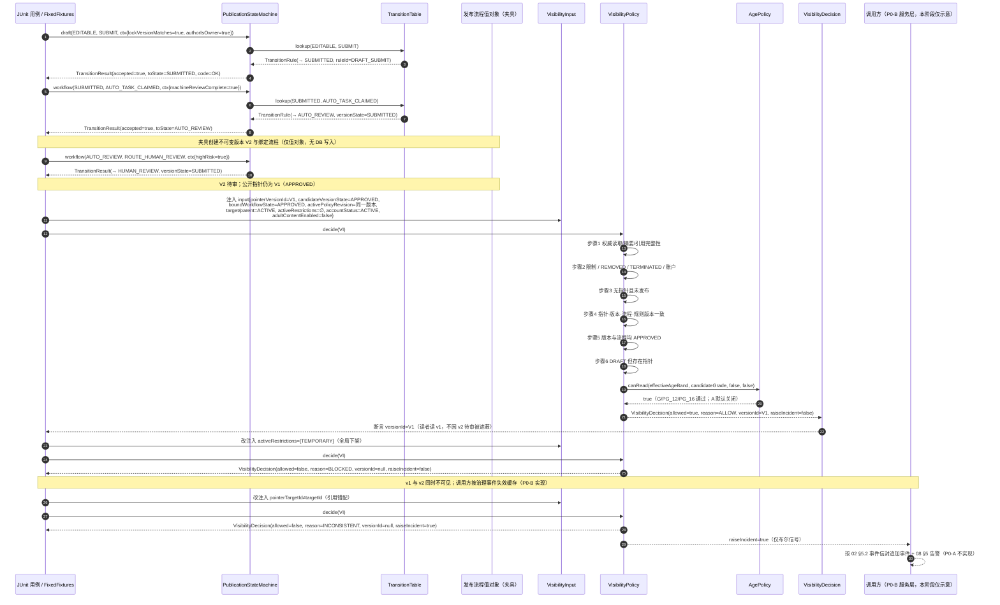
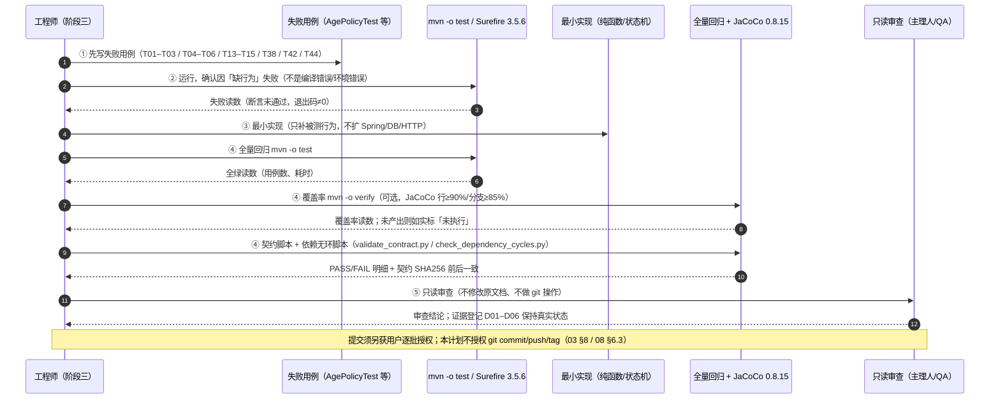
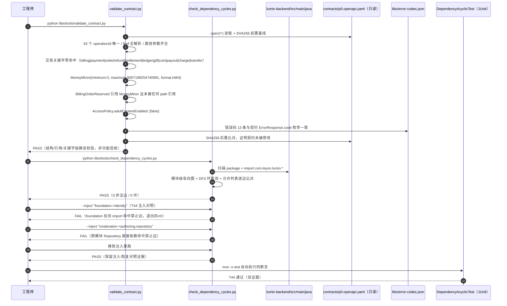

# 10 P0-A 增量设计与任务分解（阶段二 · 架构师）

> **文档定位**：本文是 `docs/09-阶段规划解读.md` 之后、阶段三编码之前的**增量工程设计与施工分解**，只针对编码批次 1「P0-A 年龄、角色、状态内核与契约骨架」。它是**衍生设计文档**，不新增产品权威、不覆盖 `docs/01–08`、`contracts/p0.openapi.yaml` 与三份根文档；冲突一律以权威原文为准（09 §文档定位、01 §1）。
> **唯一交付物**：按主理人本轮约束，阶段二**只新建本文一篇**，不修改 `docs/09`、`docs/01–08`、三份根文档、`contracts/p0.openapi.yaml`，不另建 `docs/system_design.md` 与独立 `.mermaid` 文件；`classDiagram` / `sequenceDiagram` / 任务依赖图完整内嵌于 A.3 / A.4 / B.4，源码可直接抽出复用并供 07 §5 D02（Mermaid 8.8.3 解析）校验。
> **状态诚实声明**：本阶段**只交付设计，不产生任何业务代码与测试运行结果**。T01–T06 / T13–T15 / T38 / T42 / T44 仍为计划用例、尚未执行；D01–D06 证据未登记；覆盖率读数未产出，不得预填成功（07 §1、§5.1）。本文列出的全部文件是**阶段三应创建的施工图**，不是已存在文件。
> **语言**：全文简体中文。
> **修订记录（2026-11-15 口径对齐，Owner 授权批量修订）**：① 全文 7 处「74 个 `operationId`」按只读契约原文实测改为 **63**（唯一性不变，`createProfile … listAuditRecords` 含 1 个 `receiveMachineReport`；契约 SHA256 未变）；② A.2 合计「新建 57 个文件」按逐项求和 7+17+9+7+6+10 改为 **56**；③ §0.2 版本口径按实际交付修订：Spring Boot 4.0.9（`lumin-backend/pom.xml`）、TypeScript ~6.0.3 / Vite ^8.3.6（`lumin-frontend/package.json`）；④ 全文历史路径前缀 `services/core/**` 按 2026-11-13 仓库整理改为 `lumin-backend/**`；⑤ §0.4 补 2026-11-15 环境复核行（Python 3.11.9 / Node v24.15.0，与 08 §4.2 一致）；⑥ B.1「明确不引入」按领域包口径澄清。原文事实错误一律就地改正并在此登记，不改动 2026-11-12 的历史实测记录语义。

---

## 0. 输入、权威顺序、范围与环境实测

### 0.1 已亲自通读的输入

| 类别 | 文件 | 本文取用的关键章节 |
| --- | --- | --- |
| 阶段一产出 | `docs/09-阶段规划解读.md`（368 行全文） | §3 约束清单、§4 分期、§5 P0-A 五单元、§6 UI 关卡、§7 待确认、§8 一致性结论 |
| 工程权威 | `docs/01-需求分析说明书.md` | §3.2 年龄分层 C0–C4、§3.3 角色矩阵、§6.2 编码四批次、§7 checkpoint |
| 工程权威 | `docs/02-概要设计说明书.md` | §2/§2.1 版本锁定、§3.1 11 域唯一所有权与允许同步依赖、§3.2 两跳影响面、§4 目录职责、§5.2 事件信封 |
| 工程权威 | `docs/03-详细设计说明书.md` | §1 INV-01–08、§2.1–§2.3 状态字典与迁移、§3.1 三态裁决八步、§4 提交发布、§7 错误码、§8 首批实施任务 |
| 工程权威 | `docs/04-数据库设计说明书.md` | §1.1 通用字段与时间、§3 身份表、§5.2 金额边界、§6.1 P1 关系、§6.2 付费实体骨架 |
| 工程权威 | `docs/05-接口设计文档.md` | §2 全局协议、§4.4 结果信封、§5 错误码全集、§6 契约门禁、§7 非目标 |
| 工程权威 | `docs/07-测试计划与用例.md` | §1.1 固定夹具、§1.2 覆盖率、§2.1–2.4 T01–T15/T38/T42/T44、§5 证据登记 |
| 工程权威 | `docs/08-部署与运维手册.md` | §4.1 依赖锁定、§4.2 本机工具证据、§6.3 Git 边界、§8 已知问题 |
| 机器契约 | `contracts/p0.openapi.yaml`（1300 行，只读） | `info`、`paths`（53 个 `/api/v1` + 1 个 `/internal/v1`）、63 个 `operationId`、`components.schemas`（`AgeBand`/`Grade`/`Role`/`WorkflowState`/`ErrorResponse`/`MoneyMinor`/`BillingOrderReserved`/`AccessPolicy`） |

### 0.2 权威顺序与三条执行口径（沿用 09 结论）

1. **权威顺序**：《启明书院_设计方案》第 1 章决策基线（最高）> 第 3 章 > 第 5 章（历史演进，不作分期依据）；工程权威 = `docs/01–08` + `contracts/p0.openapi.yaml`；通用规约 = 团队守则；项目特有约定 = 项目基线；`docs/09` 与本文均为解读/设计性衍生文档。
2. **版本口径**：以 **02 §2 / §2.1** 实际锁定为准（Java 21 + Spring Boot + Maven；Python 3.11 + FastAPI 0.162.5；React 19.3.1 / TypeScript / Vite 8.x；PG17 / Redis7.4 / RabbitMQ4 quorum），不采项目基线 §4.1 的「示例版本」。02 §2.1 只是只读官方声明兼容性，**不宣称集成通过**。**2026-11-15 修订**：按实际交付对齐——后端模块 `lumin-backend/pom.xml` 采用 `spring-boot-starter-parent` **4.0.9**（原锁定书写 4.1.2）；前端 `lumin-frontend/package.json` 为 React `^19.3.1` / TypeScript `~6.0.3` / Vite `^8.3.6`（本机实际安装 8.3.8；原锁定书写 TS 7.0.2 / Vite 8.3.8）。FastAPI / PG / Redis / RabbitMQ 尚未进入落地批次，维持原锁定声明；升级或回切须走评审。
3. **分期口径**：以 **01 §3.1 + DEC-06 + 01 §6.2** 为准，不采设计方案第 5 章历史排期；治理措辞以 **01 §7「禁止以逾期默认跳过合规否决点」** 为准（K-07）。

### 0.3 本阶段范围与硬边界

| 项 | 结论 |
| --- | --- |
| 当前批次 | **P0-A**（01 §6.2 批次 1），退出证据 = 纯函数穷举、契约校验、依赖无环（01 §6.2；03 §8；09 §4.2） |
| 本批次交付 | 4 个纯函数/状态机内核（AgePolicy / RolePolicy / VisibilityPolicy / PublicationStateMachine）+ 契约骨架只读校验 + billing-reserved 只读模型 + 依赖无环校验 |
| **不在本批次** | P0-B（草稿/存储/机审/人审/发布阅读）、P0-C（举报下架/申诉/配置/审计通知）、P0-D（安全/无障碍/性能/灾备/上线复核）；任何 Spring 运行时、数据库、消息中间件、HTTP 服务器、外部供应商、Controller / Repository / Service 实现 |
| **前端** | **P0-A 不产生任何前端代码**（详见 A.6） |
| 提交 | 不做 `git init` / `commit` / `push` / `tag`；每批提交须另获用户逐批授权（03 §8、08 §6.3、N-04） |
| 五单元固定步骤 | 写失败用例 → 运行确认**因缺行为失败** → 最小实现 → 全量回归与覆盖率 → 只读审查（03 §8） |

### 0.4 主理人实测 + 本文复核的环境证据（只读探测，纳入可行性判断）

| 项 | 实测值 | 对设计的约束 |
| --- | --- | --- |
| JDK | `java version "21.0.6" 2025-01-21 LTS`（Oracle JDK 21） | `maven.compiler.release=21`，可用 Java `record` / `sealed` / `switch` 表达式 |
| Maven | `Apache Maven 3.9.15` | 与 08 §4.2 一致；可 `mvn -o test` 离线执行 |
| 本地缓存 JUnit | `junit-jupiter` **5.12.2**（聚合 / api / params / engine 各 5.12.2 齐全）、`junit-platform-launcher` **1.12.2**（engine/commons 1.12.2 齐全）、`opentest4j 1.3.0`、`apiguardian-api 1.1.2` | **唯一第三方测试依赖锁定 5.12.2 + 1.12.2**，支持 `@ParameterizedTest` / `@MethodSource` 穷举 |
| 本地缓存插件 | `maven-surefire-plugin` **3.5.6**（+ `surefire-junit-platform` 3.5.6 provider；另有 3.2.5）、`maven-compiler-plugin` **3.13.0**（另有 3.14.0/3.14.1/3.15.0）、`maven-resources-plugin 3.3.1`、`maven-jar-plugin 3.4.2` | pom 全部显式钉版本，禁止浮动版本（项目基线 §4.2、A-09） |
| 本地缓存覆盖率 | `jacoco-maven-plugin` **0.8.15**（jar/pom + `org.jacoco.agent-0.8.15-runtime.jar` + `org.jacoco.core` + `org.jacoco.report` 齐全） | 可离线 `mvn -o verify` 产 JaCoCo 报告，对齐 07 §1.2 行≥90%/分支≥85%；`mvn -o test` 仍是主验收命令 |
| 本地缓存 Mockito | `mockito-core 5.11.0 / 5.17.0 / 5.20.0 / 5.23.0` 可用 | **P0-A 不引入**：纯函数无需 mock；Mockito 属后续服务层（07 §1.2） |
| Python | **3.13.14**；`import yaml` **失败（PyYAML 未安装）**；`re/json/pathlib/hashlib` 标准库可用 | 契约/依赖校验脚本**只用 Python 3 标准库**，做纯文本 + 正则 + 缩进级校验，不假设 PyYAML |
| Node | v22.22.2（主理人实测） | **P0-A 完全不需要 Node**，不纳入依赖 |
| 环境复核（2026-11-15，Git Bash） | Java 21.0.6 / Maven 3.9.15 / **Python 3.11.9** / **Node v24.15.0** / npm 11.12.1，与 08 §4.2 记录一致（仅 npm 小版本有差） | 上方 Python/Node 实测值与本次复核不一致，判断为终端/PATH 环境差异所致（09 §4.3 W-07）；版本锁定一律以 lockfile / BOM 为准，校验脚本仅依赖 Python 标准库、不受该差异影响 |
| 仓库 | 复核确认**无 `.git` 目录** | 不做任何 git 操作；契约 `p0.openapi.yaml` 只读基线 SHA256 = `278151636eb16e96a28cbe7058bd665f549a5fff21471fbccc849a88ec147602`（脚本校验前后比对，证明未修改） |

> **可行性结论**：P0-A 采用「单 Maven 模块 + Java 21 + 唯一第三方依赖 JUnit 5.12.2 + 已缓存插件」可以完全离线 `mvn -o test` 真实跑通，**不下载 Spring Boot 全家桶、不联网**（2026-11-12 口径）。**2026-11-15 修订注记**：2026-11-13 仓库整理后，领域内核与 Spring Boot Web 运行时合并进同一 Maven 模块 `lumin-backend`（父 POM `spring-boot-starter-parent` 4.0.9），首次构建需联网拉取父 POM，缓存就绪后可离线；领域包 `com.leyon.lumin.*` 仍零 Spring 依赖（架构测试与 `-Pcoverage` 复核）。02 §2 锁定的 Spring Boot / FastAPI / React / PG / Redis / RabbitMQ 是**整个 P0 的技术栈锁定**，P0-A 领域内核不引入 Spring 运行时依赖。

---

# Part A 系统设计

## A.1 实现方案与技术难点

### A.1.1 总体方案

- **架构模式**：`领域层纯函数 + 不可变值对象（Java `record`）+ 显式枚举白名单 + 表驱动状态机`。全部实现落在 `02 §4` 约定的 `lumin-backend/src/main/java/com/leyon/lumin/{domain}/...`，**只启用 `domain` 层**；`api/service/repository/event/config` 五层在 P0-A **仅保留包路径语义、不创建实现类**（A-04 六层分层约束在后续批次落地）。
- **运行形态**：无 Spring 上下文、无 DI、无数据库、无消息中间件、无 HTTP 服务器、无对象存储 SDK、无 OIDC 客户端。所有类的入口是 `public static` 纯函数，输入为不可变 `record`，输出为不可变 `record`；时间一律通过 `java.time.Clock` 参数注入。
- **依赖方向**：业务域 → `foundation`（含 `foundation.values`），单向；`foundation` 不反向绑定任何业务域。P0-A 唯一真实的跨业务域同步边是 `publication → identity`（`VisibilityPolicy` 复用 `AgePolicy.canRead`），该边在 02 §3.1 允许列表内，正好让 T44 依赖无环校验有真实边可验（详见 A.7）。
- **模块布局**：按 02 §4 顶层 `lumin-backend/pom.xml`、`lumin-backend/src/main/java/com/leyon/lumin/...`、`lumin-backend/src/test/java/com/leyon/lumin/...`；`libs/` 放错误码字典与契约校验工具；`contracts/p0.openapi.yaml` 为唯一机器契约、**只读校验不得修改**。
- **技术栈不套用默认**：本项目不采用 Vite + React + MUI + Tailwind，也不采用 Python 后端；P0-A 是纯 Java 21 领域内核（主理人硬边界 1）。

### A.1.2 难点与对策（逐条可核对）

| # | 难点 | 对策 | 依据 |
| --- | --- | --- | --- |
| D-1 | **纯函数穷举 + 非法默认拒绝** | `TransitionTable` 把 03 §2.1/§2.2/§2.3 全部合法迁移写成静态表；`PublicationStateMachine` 对 `(state × event × context)` 全组合查表，**未命中一律 `B2001` + `auditRequired=true`**；`MatrixFactory` 提供全状态×全事件与 5×4×7×5×4=2800 组合的 `@MethodSource` | 03 §2.1、§8；07 §2.2 T13/T15；09 §3.1 A-08 |
| D-2 | **年龄边界秒级精确 + 闰日规则** | 周岁计算取 `clock.instant().atZone(Asia/Shanghai).toLocalDate()`，可注入「生日 00:00:00+08:00 前 1 秒 / 当日 / 后 1 秒」；`2/29` 出生且观察年非闰年时法定生日按 `3/1`；边界 14/16/18 岁生日当天升级；`C4` 无核验、**自报成年不得升 C3**；`declared` 比已核验更严格时取更严格值并置 `requiresReverify` | 01 §3.2；07 §1.1/§2.1 T01；09 §3.3 S-09 |
| D-3 | **监护撤销立即降级** | `AgeEvidence.guardianRevokedAt != null` 且 ≤ 业务时钟 → `effectiveAgeBand` 降级为 `C4`、`canPublish=false`、`blockedByGuardianRevocation=true`、`requiresHumanReview=true`；**不自动删除历史内容**（历史删除属 P0-C 服务层） | 03 §6；01 §3.2；07 §2.1 T03 |
| D-4 | **三态裁决八步顺序不可交换** | `VisibilityPolicy.decide` 用短路 `if` 严格按 03 §3.1 顺序 1→8 判定；`allowed=false` 时 `versionId=null`；步骤 1/4/5/6 置 `raiseIncident=true`，步骤 2/3/7 为 `false`；函数不访问 DB、不发日志、不改状态；**不接受客户端指定版本**（`candidateVersionId` 标注来自 DB 指针） | 03 §3.1；09 §3.1 A-08；主理人硬边界 3 |
| D-5 | **角色默认拒绝 + INV-05** | `RolePolicy` 表驱动：账号维度 `AUTHOR/OPERATOR × REVIEWER_L1/REVIEWER_L2` 互斥；对象维度申请人=审批人拒绝、双审两席同主体拒绝、原审人参与申诉复核拒绝；`ADMIN` 不得裁决内容/删审计/申请自批；`AUDITOR` 只读审计；**未列组合一律 `allowed=false` + `A2001` + `ruleId=DEFAULT_DENY`** | 01 §3.3；03 INV-05；07 §2.1 T04–T06 |
| D-6 | **依赖无环可执行校验** | `libs/tools/check_dependency_cycles.py`（源码 `import` 扫描 + 02 §3.1 允许列表 + DFS 环检测 + `--inject` 非法边注入对照）+ `DependencyAcyclicTest`（`mvn test` 内自动执行）双证据；明确能验证/不能替代的边界 | 02 §3.1/§3.2；07 §2.4 T44；主理人硬边界 8 |
| D-7 | **契约只读校验（无 PyYAML）** | `libs/tools/validate_contract.py` 用 Python 3 标准库做行级正则 + 缩进解析：63 个 `operationId` 唯一、`$ref` 全部可解析、路径参数齐全、**交易关键字零命中**、`MoneyMinor` 边界、`BillingOrderReserved` 未被任何 path 引用、`AccessPolicy.adultContentEnabled: [false]`；脚本只读并前后比对契约 SHA256 | 05 §6；07 §2.4 T38/T42；主理人环境说明 |
| D-8 | **billing-reserved 只读骨架不越界** | 6 张表以 Java `record`/常量静态建模（字段、约束、枚举白名单），`MoneyMinor` 强制 `0 ≤ x ≤ 9007199254740991`（分整数、`long`）、负数仅 `settlement.net_minor`；`hasHttpEntry()` / `isTradingEnabled()` 恒 `false`；权限三码仅登记字典**不授予**；**不执行 DDL、不建表、不暴露交易入口** | 04 §6.2/§5.2；01 DEC-04/DEC-06；主理人硬边界 7 |
| D-9 | **离线可跑** | pom 所有依赖/插件钉到 A.0.4 已缓存版本；`mvn -o test` 为唯一主命令；`mvn -o verify` 可选产 JaCoCo 报告；脚本零第三方依赖 | 主理人环境说明；08 §4.1；项目基线 §4.2 |

### A.1.3 与 03 §8 五个 TDD 单元的对应

| 03 §8 单元 | 本文主文件 | 首失败测试 | 完成判据 |
| --- | --- | --- | --- |
| ① 年龄策略 | `identity/domain/AgePolicy.java` + `AgePolicyTest.java` | 13/14/15/16/17/18 岁、C4、监护撤销、闰日矩阵 | T01–T03 全绿 |
| ② 角色权限 | `identity/domain/RolePolicy.java` + `RolePolicyTest.java` | AUTHOR+REVIEWER 拒绝、同主体双审拒绝、ADMIN 不得裁决 | T04–T06 全绿 |
| ③ 三态纯函数 | `publication/domain/VisibilityPolicy.java` + `VisibilityPolicyTest.java` | v1 通过 v2 待审仍读 v1、全局下架拒绝、引用错配告警 | T13–T15 穷举全绿 |
| ④ 状态机 | `publication/domain/PublicationStateMachine.java` + `PublicationStateMachineTest.java` | 每状态×每事件含非法迁移 | 全组合拒绝默认生效 |
| ⑤ 骨架契约 | `contracts/p0.openapi.yaml`（只读）+ `billing_reserved/` 模型 | 交易路由不存在、模型引用完整、分币整数边界 | T38、T42 全绿 |

---

## A.2 完整文件列表（精确到相对路径；原为阶段三施工清单，现已全部交付）

> 路径相对仓库根 `lumin-academy/`；**2026-11-15 修订**：原书写的 `lumin-backend/**` 前缀按 2026-11-13 仓库整理改为 `lumin-backend/**`，包名 `com.leyon.lumin` 不变。「既有只读」= 本阶段不创建也不修改；「新建」= 阶段三按本文实现（已完成）。任务归属见 B.2。

### A.2.1 顶层配置、脚本、文档与骨架模型

| # | 相对路径 | 类型 | 任务 | 说明 |
| --- | --- | --- | --- | --- |
| F01 | `lumin-backend/pom.xml` | 配置/新建 | T01 | 单模块 Maven；Java 21；JUnit 5.12.2 + platform-launcher 1.12.2（test）；surefire 3.5.6 / compiler 3.13.0 / resources 3.3.1 / jacoco 0.8.15 全部钉版本。**2026-11-15 修订**：2026-11-13 整理后合并进 `lumin-backend` 单模块——新增 Spring Boot 父 POM 4.0.9 + `spring-boot-starter-webmvc` + MyBatis 4.0.1 + MySQL 驱动，`junit-jupiter` / `junit-platform-launcher` 版本改由 Boot BOM 管理，`surefire` 加 `@{argLine}`，JaCoCo 移入可选 `coverage` profile |
| F02 | `lumin-backend/README.md` | 文档/新建 | T01 | 离线命令、脚本命令、P0-A 边界声明。**2026-11-15 修订**：2026-11-13 整理后为 `lumin-backend/README.md`；原「本模块不是 Spring Boot 应用」改为「模块内含 Spring Boot Web 运行时（启动类 `LuminBackendApplication`），`com.leyon.lumin.*` 领域包零 Spring 依赖」 |
| F03 | `libs/error-codes.json` | 字典/新建 | T01 | 机器可读错误码字典：05 §5 全集 14 条（`OK` + 13 错误码），每条 `{code, http, message}`，与契约 `ErrorResponse.code` 枚举一致 |
| F04 | `libs/README.md` | 文档/新建 | T01 | 错误码字典维护规约（禁止散落硬编码；团队守则 §2.4 / 05 §5） |
| F05 | `libs/tools/validate_contract.py` | 脚本/新建 | T01 | T38/T42 契约静态校验，Python 3 标准库，只读 + SHA256 前后比对 |
| F06 | `libs/tools/check_dependency_cycles.py` | 脚本/新建 | T01 | T44 依赖无环校验，`import` 扫描 + 允许列表 + 环检测 + `--inject` 注入对照 |
| F07 | `libs/tools/README.md` | 文档/新建 | T01 | 两个脚本的用法、退出码、PASS/FAIL 含义、**静态校验的能力边界与不替代项** |
| F08 | `contracts/p0.openapi.yaml` | 契约/**既有只读** | — | 唯一机器契约，**只读校验，禁止修改**；SHA256 基线见 0.4 |
| F09 | `docs/10-P0A-设计与任务分解.md` | 文档/**本阶段已交付** | — | 本文 |

### A.2.2 `foundation` 共享值域（`lumin-backend/src/main/java/com/leyon/lumin/`）

> 统一寄放于 `foundation`（02 §3.1「标识、时间、错误码、事件信封、端口接口」的只读值域延伸），避免 `identity ↔ publication` 双向依赖；**只放枚举/常量/纯工具，不含业务判定、不反向 import 业务域**。

| # | 相对路径（前缀 `lumin-backend/src/main/java/com/leyon/lumin/`） | 类型 | 任务 | 说明 |
| --- | --- | --- | --- | --- |
| F10 | `foundation/ErrorCodes.java` | enum/新建 | T01 | `ErrorCode` 枚举 14 个（`OK, P1001, P1002, A0001, A2001, A2002, A2003, B2001, B2002, B2003, B2004, B2005, D2001, D2002`），含 `httpStatus` 与 05 §5 稳定文案 |
| F11 | `foundation/BusinessTime.java` | 工具类/新建 | T01 | `ZoneId ASIA_SHANGHAI`、`FIXTURE_INSTANT`、`Clock fixedBusinessClock()`、`toUtc(Instant)`、`localDate(Clock)`；周岁边界与闰日工具常量 |
| F12 | `foundation/ServicePrincipals.java` | 常量/新建 | T01 | `SYSTEM_ID` 固定 UUID（04 §1.1 固定不可登录服务主体）；**SYSTEM 不是 `RoleCode` 成员**（见 A.5 差异 2） |
| F13 | `foundation/values/AgeBand.java` | enum/新建 | T01 | `C0/C1/C2/C3/C4` + `restrictionRank()`（`C0=0, C1=1, C4=1, C2=2, C3=3`）+ `readingBand()`（C4→C1） |
| F14 | `foundation/values/Grade.java` | enum/新建 | T01 | `G / PG_12 / PG_16 / A`（契约 `Grade`、04 §4） |
| F15 | `foundation/values/RoleCode.java` | enum/新建 | T01 | 契约 `Role` 的 **9 个人类角色**：`READER, AUTHOR, GUARDIAN, REVIEWER_L1, REVIEWER_L2, OPERATOR, ADMIN, AUDITOR, LEGAL` |
| F16 | `foundation/values/AccountStatus.java` | enum/新建 | T01 | `ACTIVE / SUSPENDED / CLOSED`（04 §3、契约 `Me.accountStatus`） |
| F17 | `foundation/values/BusinessState.java` | enum/新建 | T01 | 03 §2.1 **5 态**：`DRAFT, ACTIVE, COMPLETED, REMOVED, TERMINATED` |
| F18 | `foundation/values/DraftState.java` | enum/新建 | T01 | 03 §2.2 **3 态**：`EDITABLE, SUBMITTED, DISCARDED` |
| F19 | `foundation/values/VersionState.java` | enum/新建 | T01 | 03 §2.3 **4 态**：`SUBMITTED, APPROVED, REJECTED, WITHDRAWN` |
| F20 | `foundation/values/WorkflowState.java` | enum/新建 | T01 | 03 §2.3 / 契约 `WorkflowState` **7 态**：`SUBMITTED, AUTO_REVIEW, HUMAN_REVIEW, APPROVED, REJECTED, SUSPENDED, CANCELLED` |
| F21 | `foundation/values/VisibilityReason.java` | enum/新建 | T01 | 03 §3.1 五种返回：`INCONSISTENT, BLOCKED, NOT_PUBLISHED, AGE_RESTRICTED, ALLOW` |
| F22 | `foundation/values/PublicationEvent.java` | enum/新建 | T01 | 03 §2.1–§2.3 状态机事件枚举（英文名 + 中文原文对照，见 B.3），含 `UNDEFINED` 供非法迁移注入 |
| F23 | `foundation/values/DomainEventType.java` | enum/新建 | T01 | 02 §5.2 九个事件名常量（`IDENTITY_POLICY_CHANGED_V1` … `AUDIT_RECORDED_V1`），**仅作白名单对照，P0-A 不写事件发布代码** |
| F24 | `foundation/values/TargetType.java` | enum/新建 | T01 | `WORK / CHAPTER`（03 §4.1、04 §4） |
| F25 | `foundation/values/ScopeType.java` | enum/新建 | T01 | `GLOBAL / WORK / QUEUE / CATEGORY`（04 §3 role_assignment） |
| F26 | `foundation/values/RestrictionKind.java` | enum/新建 | T01 | `TEMPORARY / FINAL_VIOLATION / CONTRACT_TERMINATED / GUARDIAN_REVOKED`（04 §5 restriction） |

### A.2.3 `identity/domain`（年龄与角色内核）

| # | 相对路径（同前缀） | 类型 | 任务 | 说明 |
| --- | --- | --- | --- | --- |
| F27 | `identity/domain/AgeEvidence.java` | record/新建 | T02 | 已核验记录输入：`UUID subjectId, LocalDate birthDate, AgeBand declaredAgeBand, AgeBand verifiedAgeBand, boolean verificationValid, boolean guardianConsentActive, Instant guardianRevokedAt, AccountStatus accountStatus`；**不接受自报结论字段** |
| F28 | `identity/domain/AgeAssessment.java` | record/新建 | T02 | `AgeBand effectiveAgeBand, boolean canPublish, boolean requiresGuardianConsent, boolean requiresHumanReview, boolean blockedByGuardianRevocation, boolean requiresReverify, ErrorCode denialCode` |
| F29 | `identity/domain/AgePolicy.java` | 纯函数/新建 | T02 | `ageBandAt` / `assess` / `canRead`；03 §8 单元① |
| F30 | `identity/domain/RoleAssignment.java` | record/新建 | T03 | `UUID userId, RoleCode role, ScopeType scopeType, UUID scopeId, Instant expiresAt` |
| F31 | `identity/domain/Action.java` | enum/新建 | T03 | 见 B.3 动作白名单（读/写/裁决/审批等），与 01 §3.3 能力/禁止项一一对应 |
| F32 | `identity/domain/AuthorizationContext.java` | record/新建 | T03 | 主体、生效角色集、动作、资源归属、申请人/审批人、原审裁决人集合、审核阶段、高险标志、租约到期、`Clock now` |
| F33 | `identity/domain/AuthorizationDecision.java` | record/新建 | T03 | `boolean allowed, ErrorCode denialCode, String ruleId`；默认拒绝 `ruleId=DEFAULT_DENY` |
| F34 | `identity/domain/RoleSetValidation.java` | record/新建 | T03 | `boolean compatible, Set~String~ conflictRuleIds` |
| F35 | `identity/domain/RolePolicy.java` | 纯函数/新建 | T03 | `validateRoleSet` / `canAssign` / `authorize` / `canApproveRoleGrant` / `canDecideCase` / `canReviewAppeal`；03 §8 单元② |

### A.2.4 `publication/domain`（三态裁决与状态机）

| # | 相对路径（同前缀） | 类型 | 任务 | 说明 |
| --- | --- | --- | --- | --- |
| F36 | `publication/domain/VisibilityInput.java` | record/新建 | T04 | 03 §3.1 字段展开（见 A.3.3）；`candidateVersion*` 来自 DB 公开指针，**不接受客户端指定版本** |
| F37 | `publication/domain/VisibilityDecision.java` | record/新建 | T04 | `boolean allowed, VisibilityReason reason, String versionId, boolean raiseIncident`；`allowed=false → versionId=null` |
| F38 | `publication/domain/VisibilityPolicy.java` | 纯函数/新建 | T04 | `decide(VisibilityInput): VisibilityDecision`；八步短路；03 §8 单元③ |
| F39 | `publication/domain/TransitionContext.java` | record/新建 | T04 | 03 §2.1–2.3「操作者与前提」列的布尔条件，全部由调用方从权威记录注入，状态机不查询 |
| F40 | `publication/domain/TransitionResult.java` | record/新建 | T04 | `boolean accepted, ErrorCode code, Enum<?> fromState, Enum<?> toState, VersionState versionState, boolean auditRequired, boolean terminal, String ruleId`；`isReject()` 派生方法 |
| F41 | `publication/domain/TransitionTable.java` | 表驱动/新建 | T04 | 03 §2.1/2.2/2.3 合法迁移静态表 + `allStateEventPairs()` 穷举源 |
| F42 | `publication/domain/PublicationStateMachine.java` | 纯函数/新建 | T04 | `business` / `draft` / `workflow` / `allEvents` / `replay`；03 §8 单元④ |

### A.2.5 `billing_reserved`（只读骨架模型，无 DDL / 无入口 / 无授权）

| # | 相对路径（同前缀） | 类型 | 任务 | 说明 |
| --- | --- | --- | --- | --- |
| F43 | `billing_reserved/MoneyMinor.java` | 值对象/新建 | T05 | `long` 分整数；`MAX=9007199254740991L`；`ofNonNegative` / `ofSigned`（仅 settlement 净额）/ `zero`；禁止浮点 |
| F44 | `billing_reserved/BillingColumnSpec.java` | record/新建 | T05 | 字段名、`sqlType`、`nullable`、`appendOnly`、`enumWhitelist`、`checkConstraint` |
| F45 | `billing_reserved/BillingTableSpec.java` | record/新建 | T05 | `tableName, columns, constraints, exposedViaHttp=false, ddlAllowed=false, creatorPresent=false` |
| F46 | `billing_reserved/BillingPermission.java` | enum/新建 | T05 | `BILLING_PROPOSE / BILLING_APPROVE / SETTLEMENT_EXECUTE`，**仅登记字典不授予** |
| F47 | `billing_reserved/BillingModelRegistry.java` | 只读注册/新建 | T05 | 04 §6.2 六张表字段与约束；`allTables()` / `table(name)` / `registeredPermissions()` / `hasHttpEntry()`=false / `isTradingEnabled()`=false |
| F48 | `billing_reserved/README.md` | 文档/新建 | T05 | 「空表 ≠ 交易已可用」声明；不执行 B1–B6 / R1–R10 / A4（01 DEC-06、07 §6） |

### A.2.6 测试（`lumin-backend/src/test/java/com/leyon/lumin/`）

| # | 相对路径（前缀 `lumin-backend/src/test/java/com/leyon/lumin/`） | 类型 | 任务 | 覆盖 |
| --- | --- | --- | --- | --- |
| F49 | `support/FixedFixtures.java` | 夹具/新建 | T01 | 07 §1.1 固定夹具（见「测试与验收映射」） |
| F50 | `support/MatrixFactory.java` | 生成器/新建 | T01 | 2800 组合、全状态×全事件、注入非法事件与非法组合 |
| F51 | `foundation/ErrorCodesTest.java` | 单测/新建 | T01 | 14 条错误码与 `libs/error-codes.json`、契约 `ErrorResponse.code` 三方一致 |
| F52 | `identity/domain/AgePolicyTest.java` | 单测/新建 | T02 | **T01–T03**：13/14/15/16/17/18 岁边界秒级、C4、监护撤销、闰日矩阵 |
| F53 | `identity/domain/RolePolicyTest.java` | 单测/新建 | T03 | **T04–T06**：9 角色×本人/他人/队列外、互斥、自批、双审、原审回避、默认拒绝 |
| F54 | `publication/domain/VisibilityPolicyTest.java` | 单测/新建 | T04 | **T13–T15 前半**：≥2800 组合、v1/v2、全局下架、引用错配、八步顺序 |
| F55 | `publication/domain/PublicationStateMachineTest.java` | 单测/新建 | T04 | **T15**：每状态×每事件全组合、非法 `B2001`、终态不回退、章节禁 COMPLETED、重放 |
| F56 | `billing_reserved/BillingModelTest.java` | 单测/新建 | T05 | **T38**：6 表字段/约束、金额 0/1/MAX/MAX+1/负数边界、无入口、权限未授予 |
| F57 | `contracts/ContractSkeletonTest.java` | 单测/新建 | T05 | **T38/T42**：契约只读、63 个 operationId 唯一、无交易路由、`MoneyMinor` 边界、骨架模型引用完整 |
| F58 | `architecture/DependencyAcyclicTest.java` | 架构测试/新建 | T05 | **T44**：源码 import 扫描 + 允许列表 + 注入非法边必失败 + 恢复合法必通过 |

> 合计：新建 **56** 个文件（7+17+9+7+6+10；F01–F07、F10–F58 共 56 项；**2026-11-15 修订**：原汇总误写 57，逐项求和无第 57 个文件，如实改正），既有只读 1 个（F08），本设计文档 1 个（F09）。P0-A 领域内核**不创建任何 `mobile/`、`infra/`、`services/agent/`、`*.sql`、Controller / Repository / Service 文件**；前端演示应用 `lumin-frontend/`（原 `web/`）由独立授权任务同步 `ui-demo/index.html` 定稿基线，不在本文施工清单内（见仓库根 README 整理记录）。

---

## A.3 数据结构与接口（classDiagram）

```mermaid
classDiagram
    %% ---------- foundation 共享值域 ----------
    class ErrorCode {
        <<enum>>
        OK
        P1001
        P1002
        A0001
        A2001
        A2002
        A2003
        B2001
        B2002
        B2003
        B2004
        B2005
        D2001
        D2002
        +int httpStatus
        +String message
        +httpStatus() int
        +message() String
    }
    class BusinessTime {
        <<pure>>
        +ZoneId ASIA_SHANGHAI
        +Instant FIXTURE_INSTANT
        +Clock fixedBusinessClock()
        +LocalDate localDate(Clock clock)
        +Instant toUtc(Instant instant)
        +LocalDate legalBirthday(LocalDate birthDate, int onYear)
        +int fullYears(LocalDate birthDate, LocalDate onDate)
    }
    class ServicePrincipals {
        <<pure>>
        +UUID SYSTEM_ID
        +boolean isSystem(UUID subjectId)
    }
    class AgeBand {
        <<enum>>
        C0
        C1
        C2
        C3
        C4
        +int restrictionRank
        +restrictionRank() int
        +readingBand() AgeBand
        +isVerifiedAdult() boolean
    }
    class Grade {
        <<enum>>
        G
        PG_12
        PG_16
        A
    }
    class RoleCode {
        <<enum>>
        READER
        AUTHOR
        GUARDIAN
        REVIEWER_L1
        REVIEWER_L2
        OPERATOR
        ADMIN
        AUDITOR
        LEGAL
        +boolean isReviewRole()
        +boolean isAccountMutexWithReview()
    }
    class AccountStatus {
        <<enum>>
        ACTIVE
        SUSPENDED
        CLOSED
    }
    class BusinessState {
        <<enum>>
        DRAFT
        ACTIVE
        COMPLETED
        REMOVED
        TERMINATED
        +boolean isTerminal()
    }
    class DraftState {
        <<enum>>
        EDITABLE
        SUBMITTED
        DISCARDED
        +boolean isTerminal()
    }
    class VersionState {
        <<enum>>
        SUBMITTED
        APPROVED
        REJECTED
        WITHDRAWN
    }
    class WorkflowState {
        <<enum>>
        SUBMITTED
        AUTO_REVIEW
        HUMAN_REVIEW
        APPROVED
        REJECTED
        SUSPENDED
        CANCELLED
        +boolean isTerminal()
    }
    class VisibilityReason {
        <<enum>>
        INCONSISTENT
        BLOCKED
        NOT_PUBLISHED
        AGE_RESTRICTED
        ALLOW
    }
    class PublicationEvent {
        <<enum>>
        FIRST_VERSION_PUBLISHED
        COMPLETE_REQUESTED
        RESUME_SERIAL
        TAKEDOWN_EFFECTIVE
        TEMPORARY_APPEAL_UPHELD
        CONTRACT_TERMINATED
        SAVE
        SUBMIT
        DISCARD
        AUTO_TASK_CLAIMED
        AUTO_PASS
        AUTO_REVISE
        ROUTE_HUMAN_REVIEW
        SUSPEND
        RETRY_TO_HUMAN
        HUMAN_FINAL_PASS
        HUMAN_FINAL_REJECT
        WITHDRAW
        UNDEFINED
    }
    class TargetType {
        <<enum>>
        WORK
        CHAPTER
    }
    class ScopeType {
        <<enum>>
        GLOBAL
        WORK
        QUEUE
        CATEGORY
    }
    class RestrictionKind {
        <<enum>>
        TEMPORARY
        FINAL_VIOLATION
        CONTRACT_TERMINATED
        GUARDIAN_REVOKED
    }
    class DomainEventType {
        <<enum>>
        IDENTITY_POLICY_CHANGED_V1
        CONTENT_SUBMITTED_V1
        REVIEW_RESOLVED_V1
        CONTENT_PUBLISHED_V1
        CONTENT_BLOCKED_V1
        GOVERNANCE_CHANGED_V1
        POLICY_ACTIVATED_V1
        NOTIFICATION_CREATED_V1
        AUDIT_RECORDED_V1
    }

    %% ---------- identity / domain ----------
    class AgeEvidence {
        <<record>>
        +UUID subjectId
        +LocalDate birthDate
        +AgeBand declaredAgeBand
        +AgeBand verifiedAgeBand
        +boolean verificationValid
        +boolean guardianConsentActive
        +Instant guardianRevokedAt
        +AccountStatus accountStatus
    }
    class AgeAssessment {
        <<record>>
        +AgeBand effectiveAgeBand
        +boolean canPublish
        +boolean requiresGuardianConsent
        +boolean requiresHumanReview
        +boolean blockedByGuardianRevocation
        +boolean requiresReverify
        +ErrorCode denialCode
    }
    class AgePolicy {
        <<pure>>
        +AgeBand ageBandAt(LocalDate birthDate, LocalDate onDate)
        +AgeAssessment assess(AgeEvidence evidence, Clock businessClock)
        +boolean canRead(AgeBand effectiveBand, Grade grade, boolean adultContentEnabled, boolean adultEntryConfirmed)
    }
    class RoleAssignment {
        <<record>>
        +UUID userId
        +RoleCode role
        +ScopeType scopeType
        +UUID scopeId
        +Instant expiresAt
        +boolean isActiveAt(Instant now)
    }
    class Action {
        <<enum>>
        READ_PUBLIC
        READ_PRIVATE_DRAFT
        WRITE_DRAFT
        SUBMIT_DRAFT
        DECIDE_CASE
        CLAIM_CASE
        APPROVE_ROLE_GRANT
        REVIEW_CONFIG
        REVIEW_RESTRICTION
        REVIEW_APPEAL
        MANAGE_ROLES
        READ_AUDIT
        DELETE_AUDIT
        SYSTEM_PUBLISH
    }
    class AuthorizationContext {
        <<record>>
        +UUID subjectId
        +Set~RoleCode~ activeRoles
        +Action action
        +UUID resourceOwnerId
        +ScopeType scopeType
        +UUID scopeId
        +UUID applicantId
        +UUID approverId
        +Set~UUID~ originalDecisionActorIds
        +int reviewStage
        +boolean highRisk
        +UUID secondSeatActorId
        +Instant roleExpiresAt
        +Instant now
    }
    class AuthorizationDecision {
        <<record>>
        +boolean allowed
        +ErrorCode denialCode
        +String ruleId
    }
    class RoleSetValidation {
        <<record>>
        +boolean compatible
        +Set~String~ conflictRuleIds
    }
    class RolePolicy {
        <<pure>>
        +RoleSetValidation validateRoleSet(Set~RoleCode~ roles)
        +boolean canAssign(Set~RoleCode~ current, RoleCode candidate)
        +AuthorizationDecision authorize(AuthorizationContext ctx)
        +boolean canApproveRoleGrant(UUID applicantId, UUID approverId, Set~RoleCode~ approverRoles, RoleCode candidateRole)
        +boolean canDecideCase(UUID actorId, Set~RoleCode~ actorRoles, Set~UUID~ originalDecisionActorIds, boolean highRisk, int reviewStage, UUID secondSeatActorId)
        +boolean canReviewAppeal(UUID reviewerId, Set~RoleCode~ reviewerRoles, Set~UUID~ originalDecisionActorIds)
    }

    %% ---------- publication / domain ----------
    class VisibilityInput {
        <<record>>
        +AgeBand requesterEffectiveAgeBand
        +AccountStatus accountStatus
        +TargetType targetType
        +String targetId
        +BusinessState targetBusinessState
        +BusinessState parentWorkBusinessState
        +Set~RestrictionKind~ activeRestrictions
        +String candidateVersionId
        +VersionState candidateVersionState
        +Grade candidateGrade
        +String boundWorkflowId
        +WorkflowState boundWorkflowState
        +String workflowBoundVersionId
        +long boundPolicyRevision
        +long activePolicyRevision
        +String pointerVersionId
        +String pointerTargetId
        +String versionTargetId
        +boolean materialSha256Matches
        +boolean authoritativeReadOk
        +boolean everPublished
        +boolean adultContentEnabled
        +boolean adultEntryConfirmed
    }
    class VisibilityDecision {
        <<record>>
        +boolean allowed
        +VisibilityReason reason
        +String versionId
        +boolean raiseIncident
    }
    class VisibilityPolicy {
        <<pure>>
        +VisibilityDecision decide(VisibilityInput input)
    }
    class TransitionContext {
        <<record>>
        +TargetType targetType
        +boolean authorIsOwner
        +boolean noPendingWorkflow
        +boolean allExistingChaptersPublished
        +String reason
        +boolean legalConfirmationsPresent
        +boolean priorStateRecorded
        +boolean allRestrictionsLifted
        +boolean copyrightValid
        +boolean accountAllows
        +boolean pointerRechecked
        +boolean machineReviewComplete
        +boolean noEffectiveDecision
        +boolean parentWorkHasVisibleApprovedVersion
        +boolean isGovernanceRestoration
        +boolean lockVersionMatches
        +boolean idempotentReplay
    }
    class TransitionResult {
        <<record>>
        +boolean accepted
        +ErrorCode code
        +Enum fromState
        +Enum toState
        +VersionState versionState
        +boolean auditRequired
        +boolean terminal
        +String ruleId
        +boolean isReject()
    }
    class TransitionTable {
        <<pure>>
        +Map RULES
        +TransitionRule lookup(Enum state, PublicationEvent event)
        +List~StateEventPair~ allStateEventPairs()
        +Set~PublicationEvent~ allEvents()
    }
    class PublicationStateMachine {
        <<pure>>
        +TransitionResult business(BusinessState current, PublicationEvent event, TransitionContext ctx)
        +TransitionResult draft(DraftState current, PublicationEvent event, TransitionContext ctx)
        +TransitionResult workflow(WorkflowState current, PublicationEvent event, TransitionContext ctx)
        +Set~PublicationEvent~ allEvents()
        +TransitionResult replay(TransitionResult original)
    }

    %% ---------- billing_reserved ----------
    class MoneyMinor {
        <<record>>
        +long minor
        +long MAX
        +MoneyMinor ZERO
        +MoneyMinor ofNonNegative(long minor)
        +MoneyMinor ofSigned(long minor)
        +MoneyMinor zero()
        +boolean withinJsSafeInteger()
    }
    class BillingColumnSpec {
        <<record>>
        +String name
        +String sqlType
        +boolean nullable
        +boolean appendOnly
        +String enumWhitelist
        +String checkConstraint
    }
    class BillingTableSpec {
        <<record>>
        +String tableName
        +List~BillingColumnSpec~ columns
        +List~String~ constraints
        +boolean exposedViaHttp
        +boolean ddlAllowed
        +boolean creatorPresent
    }
    class BillingPermission {
        <<enum>>
        BILLING_PROPOSE
        BILLING_APPROVE
        SETTLEMENT_EXECUTE
    }
    class BillingModelRegistry {
        <<pure>>
        +List~String~ TABLE_NAMES
        +List~BillingTableSpec~ allTables()
        +BillingTableSpec table(String name)
        +Set~BillingPermission~ registeredPermissions()
        +boolean hasHttpEntry()
        +boolean isTradingEnabled()
    }

    %% ---------- 测试支撑 ----------
    class FixedFixtures {
        <<test>>
        +Clock BUSINESS_CLOCK
        +UUID A
        +UUID B
        +UUID G
        +UUID L1a
        +UUID L1b
        +UUID L2a
        +UUID L2b
        +UUID O
        +UUID X
        +UUID Y
        +UUID J
        +UUID K
        +UUID Z
        +UUID S
        +UUID W
        +UUID C
        +UUID V1
        +UUID V2
        +LocalDate birthDateC0()
        +LocalDate birthDateC1()
        +LocalDate birthDateC2()
        +LocalDate birthDateC3()
        +LocalDate birthDateC4()
        +String SYNTHETIC_BODY
    }
    class MatrixFactory {
        <<test>>
        +Stream~Arguments~ visibilityMatrix()
        +Stream~Arguments~ stateEventMatrix()
        +Stream~Arguments~ illegalTransitions()
    }

    %% ---------- 关系（明确标注） ----------
    AgeEvidence *-- AgeBand : declared / verified
    AgeEvidence *-- AccountStatus : accountStatus
    AgeAssessment *-- AgeBand : effectiveAgeBand
    AgeAssessment *-- ErrorCode : denialCode
    AgePolicy ..> AgeEvidence : 读取（纯）
    AgePolicy ..> AgeAssessment : 产出（纯）
    AgePolicy ..> BusinessTime : 周岁与闰日
    AgePolicy ..> AgeBand : 分层
    AgePolicy ..> Grade : canRead
    AgePolicy ..> ErrorCode : 拒绝码

    RoleAssignment *-- RoleCode : role
    RoleAssignment *-- ScopeType : scopeType
    AuthorizationContext *-- Action : action
    AuthorizationContext o-- RoleCode : activeRoles
    AuthorizationDecision *-- ErrorCode : denialCode
    RolePolicy ..> AuthorizationContext : 读取（纯）
    RolePolicy ..> AuthorizationDecision : 产出（纯）
    RolePolicy ..> RoleSetValidation : 产出（纯）
    RolePolicy ..> RoleCode : 互斥判定
    RolePolicy ..> ServicePrincipals : SYSTEM 特判
    RolePolicy ..> ErrorCode : A2001

    VisibilityInput o-- RestrictionKind : activeRestrictions
    VisibilityInput *-- BusinessState : target / parent
    VisibilityInput *-- VersionState : candidateVersionState
    VisibilityInput *-- WorkflowState : boundWorkflowState
    VisibilityInput *-- Grade : candidateGrade
    VisibilityInput *-- AgeBand : requesterEffectiveAgeBand
    VisibilityInput *-- AccountStatus : accountStatus
    VisibilityDecision *-- VisibilityReason : reason
    VisibilityPolicy ..> VisibilityInput : 读取（纯）
    VisibilityPolicy ..> VisibilityDecision : 产出（纯）
    VisibilityPolicy ..> AgePolicy : 复用 canRead（publication→identity 允许边）
    VisibilityPolicy ..> BusinessState : 阻断判定

    TransitionResult *-- ErrorCode : code
    TransitionResult o-- VersionState : 流程双目标
    TransitionTable ..> PublicationEvent : 迁移键
    PublicationStateMachine ..> TransitionTable : 查表（未命中 B2001）
    PublicationStateMachine ..> TransitionContext : 前提（纯数据）
    PublicationStateMachine ..> TransitionResult : 产出（纯）
    PublicationStateMachine ..> BusinessState : 业务态
    PublicationStateMachine ..> DraftState : 草稿态
    PublicationStateMachine ..> WorkflowState : 流程态

    BillingTableSpec *-- BillingColumnSpec : 字段
    BillingModelRegistry *-- BillingTableSpec : 六张只读表
    BillingModelRegistry ..> MoneyMinor : 金额边界
    BillingModelRegistry o-- BillingPermission : 仅登记不授予
    MoneyMinor ..> MoneyMinor : ofNonNegative / ofSigned

    FixedFixtures ..> BusinessTime : 固定 Clock
    FixedFixtures ..> AgeBand : C0–C4
    MatrixFactory ..> VisibilityInput : 2800 组合
    MatrixFactory ..> PublicationEvent : 全事件
    AgePolicyTest ..> AgePolicy : T01–T03
    RolePolicyTest ..> RolePolicy : T04–T06
    VisibilityPolicyTest ..> VisibilityPolicy : T13–T14
    PublicationStateMachineTest ..> PublicationStateMachine : T15
    BillingModelTest ..> BillingModelRegistry : T38
    BillingModelTest ..> MoneyMinor : T38 边界
    ContractSkeletonTest ..> BillingModelRegistry : T38/T42
    DependencyAcyclicTest ..> TransitionTable : T44 扫描
    ErrorCodesTest ..> ErrorCode : 字典一致
```

> 类图中方法签名精确到可直接实现；`record` 以 `<<record>>` 标注、枚举以 `<<enum>>` 标注、纯函数类以 `<<pure>>` 标注。包名见 A.2。`Set~X~` / `List~X~` 为 Mermaid 泛型写法。**为兼容 Mermaid 8.8.3，类图省略 `static` 分类器标记（所有纯函数方法均为 `public static`），`Enum` 的实际 Java 类型为 `Enum<?>`，`Map` 的实际类型为 `Map<TransitionKey, TransitionRule>`；这两处精确类型见 A.3.1 与 `TransitionTable` 说明**。



> 图中 `AgePolicyTest` / `RolePolicyTest` / `VisibilityPolicyTest` / `PublicationStateMachineTest` / `BillingModelTest` / `ContractSkeletonTest` / `DependencyAcyclicTest` / `ErrorCodesTest` 为测试类（F51–F58），未在类体内重复声明方法，其断言矩阵见「测试与验收映射」。

### A.3.1 关键算法约定（补类图之不足，供工程师直接实现）

**`AgePolicy.ageBandAt(LocalDate birthDate, LocalDate onDate)`**
1. `birthDate == null` → 视为「未核实」，由 `assess` 走 C4 分支；本方法对 null 抛 `IllegalArgumentException`。
2. `legalBirthday = BusinessTime.legalBirthday(birthDate, onDate.getYear())`：若 `birthDate` 为 `02-29` 且观察年非闰年 → `onYear-03-01`；否则 `onYear` 的同月同日。
3. `age = onDate.getYear() - birthDate.getYear() - (onDate.isBefore(legalBirthday) ? 1 : 0)` → **生日当天即已 +1**（边界 14/16/18 岁生日当天生效）。
4. 分层：`age<14 → C0`；`<16 → C1`；`<18 → C2`；`≥18 → C3(年龄候选)`。

**`AgePolicy.assess(AgeEvidence, Clock)`**（`onDate = BusinessTime.localDate(clock)`）
1. `verificationValid == false || verifiedAgeBand == null` → `effective=C4`，`canPublish=false`（自报成年**不得升级**；`declaredAgeBand=C3` 不参与升级）。
2. 否则 `computed = ageBandAt(birthDate, onDate)`；`effective = stricter(computed, verifiedAgeBand, declaredAgeBand)`，按 `AgeBand.restrictionRank()` 取最小（更严格）；`declared` 更严格时额外 `requiresReverify=true`（01 §3.2「声明比已核验记录更严格时按更严格结果限制并触发复核」）。
3. `guardianRevokedAt != null && !guardianRevokedAt.isAfter(clock.instant())` → 立即降级 `effective=C4`、`canPublish=false`、`blockedByGuardianRevocation=true`、`requiresHumanReview=true`（03 §6）。
4. `canPublish`：`C0/C1/C4 → false`；`C2 → verificationValid && guardianConsentActive && accountStatus==ACTIVE` 且 `requiresHumanReview=true`（每件必人审）；`C3 → accountStatus==ACTIVE`（作者资质/角色冲突另由 `RolePolicy` 判）；`accountStatus != ACTIVE → false`。
5. `canRead(effective, grade, adultContentEnabled, adultEntryConfirmed)`：`readingBand = effective.readingBand()`（C4→C1）；`C0/C1 → {G, PG_12}`；`C2 → {G, PG_12, PG_16}`；`C3 → {G, PG_12, PG_16}`，`A` 仅在 `adultContentEnabled && adultEntryConfirmed` 为真时允许（P0 契约 `AccessPolicy.adultContentEnabled: [false]` 恒 false → **A 默认关闭**）；`grade == null → false`（默认拒绝）。

**`RolePolicy.authorize(AuthorizationContext)`**（表驱动，短路顺序）
1. `subjectId == ServicePrincipals.SYSTEM_ID` → 仅 `SYSTEM_PUBLISH` 可放行，其余拒绝（SYSTEM 不模拟人类审核员，01 §3.3）。
2. `validateRoleSet(activeRoles)` 不兼容 → `A2001 / ROLE_MUTEX_ACCOUNT`；`roleExpiresAt` 已过 → `A2001 / ROLE_EXPIRED`。
3. `applicantId != null && applicantId.equals(approverId)` → `A2001 / SELF_APPROVAL`（INV-05）。
4. `reviewStage == 2 && secondSeatActorId.equals(firstSeatActorId)` → `A2001 / DOUBLE_REVIEW_SAME_SUBJECT`（INV-05）。
5. `originalDecisionActorIds.contains(subjectId)` 且动作为 `REVIEW_APPEAL` → `A2001 / ORIGINAL_REVIEWER_RECURSION`（INV-05）。
6. `activeRoles` 含 `ADMIN` 且动作 ∈ `{DECIDE_CASE, REVIEW_RESTRICTION, REVIEW_APPEAL, DELETE_AUDIT}` → `A2001 / ADMIN_NO_CONTENT_DECISION`。
7. `AUDITOR` 仅 `READ_AUDIT`；`READER` 不得写草稿；`OPERATOR` 仅提案类；`REVIEWER_L1/L2` 不得兼任 `AUTHOR/OPERATOR`；私有资源动作要求 `resourceOwnerId == subjectId`。
8. **未列组合 → `allowed=false, denialCode=A2001, ruleId=DEFAULT_DENY`**。

**`VisibilityPolicy.decide` 八步短路（顺序不可交换，03 §3.1）**

| 步 | 条件 | 返回 |
| --- | --- | --- |
| 1 | `!authoritativeReadOk` 或 `candidateVersionId/boundWorkflowId` 缺失 或 `!materialSha256Matches` 或 `everPublished && pointerVersionId == null` | `DENY / INCONSISTENT`, `raiseIncident=true` |
| 2 | `activeRestrictions` 非空 或 目标/父作品 ∈ `{REMOVED, TERMINATED}` 或 `accountStatus != ACTIVE` | `DENY / BLOCKED`, `raiseIncident=false` |
| 3 | `pointerVersionId == null && !everPublished` | `DENY / NOT_PUBLISHED`, `raiseIncident=false`（不告警） |
| 4 | `pointerTargetId != targetId` 或 `versionTargetId != targetId` 或 `!workflowBoundVersionId.equals(pointerVersionId)` 或 `!candidateVersionId.equals(pointerVersionId)` 或 `boundPolicyRevision != activePolicyRevision` | `DENY / INCONSISTENT`, `raiseIncident=true` |
| 5 | `candidateVersionState != APPROVED` 或 `boundWorkflowState != APPROVED` | `DENY / INCONSISTENT`, `raiseIncident=true` |
| 6 | 目标或父作品 `DRAFT` 但指针存在 | `DENY / INCONSISTENT`, `raiseIncident=true` |
| 7 | `!AgePolicy.canRead(...)` | `DENY / AGE_RESTRICTED`, `raiseIncident=false` |
| 8 | 全部通过 | `ALLOW`, `versionId = pointerVersionId` |

`allowed=false` 时 `versionId=null`；`v2` 待审时指针仍为 `v1`（步骤 4/5 只校验指针所指版本，不因存在 v2 而失败）；全局治理阻断同时隐藏 v1/v2（步骤 2）。`raiseIncident` 为**布尔信号**，具体事件类型由调用方按 02 §5.2 事件信封与 08 §5「三态不一致告警」通道追加，**P0-A 不写事件发布代码、不臆造事件名**。

**`PublicationStateMachine`**：三张合法迁移表完整覆盖 03 §2.1（业务态 5 态，章节禁 `COMPLETED`，`TERMINATED` 不可恢复传播）、§2.2（草稿 3 态，`SUBMITTED`/`DISCARDED` 写入拒绝）、§2.3（版本态 4 + 流程态 7，`SUSPENDED` 恢复只进 `HUMAN_REVIEW`，`APPROVED/REJECTED/CANCELLED` 任意迁移拒绝，章节发布须父作品已有可见已通过版本否则停留 `HUMAN_REVIEW`）。`TransitionContext` 承载「操作者与前提」列全部布尔条件，由调用方注入（纯数据、不查询）。**未命中一律 `B2001` + `auditRequired=true`**；终态 `terminal=true` 不可回退；`replay(original)` 只返回原 `TransitionResult` 不执行迁移（03 §2.1「同事件重放由幂等层返回原结果」，真正的 24h 幂等键去重属 P0-B 服务层，P0-A 不实现）。

---

## A.4 程序调用流程（sequenceDiagram）

### A.4.1 主流程：提交草稿 → 创建版本与流程 → 三态判定 → 读者可见

> **诚实边界**：P0-A 无服务层 / DB / HTTP / 消息中间件。下图驱动者为 JUnit 测试与固定夹具；`VisibilityInput` 由夹具**注入**（对应 P0-B 中「从数据库公开指针读取」，本阶段不查询）；状态机只做纯映射，不产生 APPROVED 公开指针、不执行任何迁移决策。



### A.4.2 测试驱动执行顺序（03 §8 五单元固定步骤）



### A.4.3 静态校验与依赖无环（T38 / T42 / T44）



---

## A.5 待明确事项与假设

| # | 事项 | 本文处置 / 假设 | 依据与影响 |
| --- | --- | --- | --- |
| U-01 | **付费骨架表数量口径差异**：主理人摘要写「04 §6.2 的 7 张表」，但 04 §6.2 原文实际列出 **6 张**（`billing_account / billing_order / ledger_entry / revenue_share / settlement / refund`） | **以权威原文 6 张为准**，`BillingModelRegistry.TABLE_NAMES` 恰好 6 项，**不臆造第 7 张表**。04 §6.1 另有 3 张 P1 关系表（bookmark / subscription / notification_digest），属 P1 收藏追更、非付费骨架，本批次不建模。请主理人确认该口径 | 04 §6.2 / §6.1；09 §1.3；T38 |
| U-02 | **「九类角色」与 01 §3.3 表格 10 行**：契约 `Role` 枚举为 **9 个人类角色**，01 §3.3 第 10 行 `SYSTEM` 是服务主体 | `RoleCode` 严格取契约 9 值；`SYSTEM` 以 `ServicePrincipals.SYSTEM_ID` 固定 UUID 表达（04 §1.1「固定且不可登录的服务主体ID」），**不是可授予角色**、在 `RolePolicy` 中特判为「只执行确定系统动作、不模拟人类审核员」 | 契约 `components.schemas.Role`；01 §3.3；04 §1.1；T04 |
| U-03 | **业务态 5 态 vs 契约公开投影 3 态**：03 §2.1 内部业务态含 `REMOVED/TERMINATED`，契约 `AuthorWorkView.state` 仅 `DRAFT/ACTIVE/COMPLETED`、`WorkView.businessState` 仅 `ACTIVE/COMPLETED` | `BusinessState` 枚举取 03 §2.1 的 **5 态**（内部权威状态机全集）；契约的 3 态是**可见性过滤后的公开投影**，由 P0-B 服务层映射，P0-A 不改契约、不把投影当全集 | 03 §2.1；契约 `AuthorWorkView` / `WorkView` |
| U-04 | **`AgeBand.restrictionRank` 偏序与监护撤销降级到 C4** 为工程解释（01 §3.2 未给出可比较的严格度数值） | 采用 `C0=0, C1=1, C4=1, C2=2, C3=3`（数值越小越严格）；撤销 → `C4`（最保守、核验关系失效）。**法务 W-01 冻结前不开放年龄升级**（K-02），本阶段只实现纯函数行为，不启用公开注册/发布 | 01 §3.2 / §7；09 §7.1 W-01；S-09 |
| U-05 | **`raiseIncident` 的具体事件类型**：03 §3.1 只给布尔语义，02 §5.2 事件表无「三态不一致」专用事件名 | `VisibilityDecision.raiseIncident` 保持 `boolean`（与 03 原文一致）；调用方按 `VisibilityReason` 决定按 02 §5.2 信封追加事件或按 08 §5 告警。**P0-A 不写事件发布代码、不新增事件名** | 03 §3.1；02 §5.2；08 §5 |
| U-06 | **幂等层归属**：03 §2.1「同事件重放由幂等层返回原结果」 | `PublicationStateMachine.replay` 只返回原 `TransitionResult`（不重复执行迁移）；`subjectId+method+path+Idempotency-Key` 24h 去重、Inbox 去重属 **P0-B 服务层**，P0-A 不实现 | 03 §2.1 / §4.1；05 §2；C-06 |
| U-07 | **T06 的 HTTP 404/403、正文脱敏、水印、查看留痕** | P0-A 只产出 `AuthorizationDecision`（默认拒绝）；HTTP 状态映射、审稿最小字段/水印/审计留痕属 P0-B 服务层。**不得把纯函数拒绝断言当作 T06 完整验收**（N-05） | 07 §2.1 T06；05 §1；N-05 |
| U-08 | **覆盖率工具**：JaCoCo 0.8.15 主构件已缓存，`org.jacoco.ant` 未确认 | `mvn -o test` 为主验收命令（纯函数全绿）；`mvn -o verify` 可选产 JaCoCo 报告对齐 07 §1.2（行≥90%/分支≥85%）。若离线 report mojo 缺件**不阻断 `mvn test`**，覆盖率证据须如实标「未产出」，不得预填成功 | 07 §1.2 / §5.1；08 §4.1 |
| U-09 | **精确依赖/镜像摘要锁定（K-04 / 08 §4.1）** 仍为 P0-A 开工前待办 | 本设计**不连接真实依赖、不生成生产部署清单、不锁镜像 digest**；P0-A 只用已缓存的 JUnit 与 Maven 插件，不触发 K-04 的「预发接真实依赖」门槛 | 08 §4.1；09 §3.5 K-04；W-05 |
| U-10 | **输出文件形态**：系统模板要求额外 `docs/system_design.md` 与两个 `.mermaid` 文件 | 按主理人「唯一交付物」约束，只交付本文；两份 Mermaid 图完整内嵌 A.3 / A.4、任务图内嵌 B.4，可直接抽出供 D02 解析 | 主理人本轮指令 |
| U-11 | **草稿态数量口径差异**：主理人摘要写「03 §2.2 草稿 4 态」，但 03 §2.2 原文与契约 `DraftView.state` 均为 **3 态**（`EDITABLE / SUBMITTED / DISCARDED`） | `DraftState` 严格取 3 态；摘要中的「第 4 态」应指 03 §2.2 末段「退回后创建新的 EDITABLE 草稿，引用被退回版本」的**流程说明**（新建草稿实例，不是新状态枚举）。**不臆造第 4 个枚举值**；`SUBMITTED` 修改与 `DISCARDED` 任意写入按 03 §2.2 拒绝 | 03 §2.2；契约 `DraftView.state`；07 §2.1 T08 |

---

## A.6 P0-A 与展示层边界（主理人硬边界 9）

| 项 | 结论 |
| --- | --- |
| **P0-A 不产生任何前端代码** | 不创建 `web/`、`mobile/ios/`、`mobile/android/`、`*.html`、任何 React/TS/CSS/静态 demo 文件；A.2 文件清单中零前端文件 |
| UI demo 归属 | **阶段四独立交付**：静态 HTML 设计 demo，供 Owner 评审；**确认前禁止启动前端实现**（09 §6、06 §6、用户本轮指令）。不属于本设计范围 |
| 契约关系 | `contracts/p0.openapi.yaml` 是三端共享的唯一机器契约（02 §4、团队守则 §2.3）；展示层服务类型将来从契约生成，**不共享业务判定**（A-10：端侧共享接口、不共享业务规则） |
| 后端边界 | 本文 4 个纯函数/状态机只暴露 Java 级静态 API，**无 HTTP 端点、无 Controller、无 DTO 序列化**；服务层/可见性闸门/受控正文读取在 P0-B 落地（05 §2、02 §6） |
| 体验设置 | 字号/排版/夜间/读屏等仅本地体验设置，**不影响后端年龄/权限政策**（09 §8 第 7 条）；`AccessPolicy.adultContentEnabled` 在契约中恒 `[false]` |
| 禁止 | 不以 Web 演示充抵 iOS/Android 双端验收（N-07）；不在 demo 中引入业务规则、未锁定 UI 库或境外 CDN 字体（09 §6.1） |

> **协作边界补充**：阶段一延伸交付已另行产出 `docs/09-附录A-UI-Demo规格.md`（供 Owner 评审的单个静态 `ui-demo/index.html` 规格）。本文**不引用其实现细节、不修改该文件、不创建 `ui-demo/` 目录**；该附录归阶段四 UI demo 关卡，与本文 A.2 文件清单（零前端文件）互不重叠。P0-A 后端纯函数与该 demo 之间**无任何代码或数据耦合**。

---

## A.7 依赖无环可执行校验方案（T44）

### A.7.1 校验对象与算法

- **输入**：`lumin-backend/src/main/java/**/*.java` 的 `package com.leyon.lumin.X...;` 与全部 `import com.leyon.lumin.Y...;`。
- **模块归一**：取包名第 4 段为模块名（`com.leyon.lumin.{module}`），`foundation.values` 归入 `foundation`；包内自引用与 `java.*` / `org.junit.*` 忽略。
- **两道判定**：
  1. **环检测**：构造模块级有向图，DFS 求环；任一环 → FAIL 并打印环路径。
  2. **允许列表逐边比对**：每条边必须命中下表允许集合；`foundation → 任何业务域`、`任意域 → 其它域的 repository 包`、`moderation → authoring.repository` 命中**显式禁止边**即 FAIL。
- **注入对照（07 §2.4 T44 原文要求）**：脚本支持 `--inject "foundation->identity"` 与 `--inject "moderation->authoring.repository"`，把非法边写入内存图（**不改源码、不落盘**）验证「注入必失败、恢复合法必通过」，输出可登记的注入/对照证据。
- **双证据**：`libs/tools/check_dependency_cycles.py`（可注入、可 CLI 独立运行）+ `DependencyAcyclicTest.java`（`mvn -o test` 内自动执行相同断言），退出码非 0 即失败。

### A.7.2 允许 / 禁止的同步依赖边（严格取 02 §3.1 / §3.2）

| 源模块 | 允许的同步依赖目标（02 §3.1） | P0-A 实际存在的边 |
| --- | --- | --- |
| `identity` | `foundation` | `identity → foundation`（AgePolicy 用 `BusinessTime`/枚举） |
| `catalog` | `foundation` | 无（本批次不建 catalog） |
| `authoring` | `catalog, identity, foundation` | 无 |
| `moderation` | `foundation`（材料经 `ContentSubmitted` 快照 + 受控读取适配器） | 无 |
| `publication` | `authoring, catalog, identity, foundation` | `publication → foundation`、`publication → identity`（`VisibilityPolicy` 复用 `AgePolicy.canRead`） |
| `governance` | `catalog, identity, foundation` | 无 |
| `configuration` | `identity, foundation` | 无 |
| `engagement` | `publication, identity, foundation` | 无 |
| `audit` | `foundation` | 无 |
| `billing_reserved` | `foundation` | `billing_reserved → foundation`（`MoneyMinor` 边界常量、`ErrorCode`） |
| `foundation` | **无领域依赖** | 无（必须保持零出边到业务域） |

| 显式禁止边（注入对照） | 出处 |
| --- | --- |
| `foundation → 任意业务域`（反向 import） | 02 §3.1 末段、09 §3.1 A-05/A-06、T44 |
| `moderation → authoring.repository`（直接 Repository 依赖） | 02 §3.1 末段、§3.2、T44 |
| `任意业务域 → 其它域的 repository 包`（跨模块直接 Repository 访问） | 02 §3.2、团队守则 §1.1 |
| `任意模块 → 自身形成环`（DFS 环检测） | 09 §3.1 A-06 |

### A.7.3 能验证到什么、不能替代什么（诚实边界）

**能验证**：当前已落地的纯 Java 源码中全部**显式 `import`** 的模块方向合法；模块图无环；`foundation` 未反向绑定业务域；P0-A 唯一跨域边 `publication → identity` 命中允许列表；注入非法边后校验确实失败（负向证据）。

**不能替代**：运行时依赖注入 / Spring Bean 装配关系；反射、字符串类名、注解处理器生成的隐式依赖；跨服务**异步消息耦合**（02 §3.2 两跳影响面、事件 schemaVersion 兼容性）；P0-B/C 才会出现的 `api/service/repository/event/config` 六层真实装配；反射式 `@PreAuthorize` 授权切面；07 §1.2 架构测试在 CI 中的最终门禁与 consumer/provider 契约测试。本校验是**结构级静态证据**，与 N-05「不把结构校验当功能验收」一致。

---

## A.8 契约与骨架静态校验方案（T38 / T42）

- **实现**：`libs/tools/validate_contract.py`，**仅 Python 3 标准库**（`re / json / pathlib / hashlib / sys`），实测 PyYAML 未安装故不依赖；对 `contracts/p0.openapi.yaml` 全程 `open(..., 'r')`，**校验前后比对 SHA256**（基线 `27815163…4740991…` 见 0.4），证明契约未被修改。
- **校验项**：
  1. `openapi: 3.0.3` 与 `info` 存在；
  2. **63 个 `operationId` 唯一**（`createProfile … listAuditRecords`，含 1 个 `receiveMachineReport`）；
  3. 所有 `#/components/...` `$ref` 可解析到已定义键（正则抽取 + 定义键集合比对）；
  4. 路径 `{id}` 占位与 `components.parameters.Id` / path 级 `parameters` 声明对应；
  5. **交易路由不存在**：`paths` 中不含 `billing|payment|order|refund|settlement|ledger|gift|coin|payout|charge|transfer`（大小写不敏感）；`BillingOrderReserved` 未被任何 path 的 request/response schema 引用（防止误暴露交易入口）；
  6. `MoneyMinor`：`type: integer`、`format: int64`、`minimum: 0`、`maximum: 9007199254740991`；`BillingOrderReserved` 字段与 `MoneyMinor` 引用完整、枚举与 04 §6.2 一致；
  7. `AccessPolicy.adultContentEnabled: [false]`；
  8. `ErrorResponse.code` 13 个错误码与 `libs/error-codes.json` 逐条一致（含 05 §5 稳定文案）。
- **局限（必须写入脚本输出）**：行级正则 + 缩进解析，**不是完整 YAML 语义解析**；不校验 `oneOf` / `additionalProperties` 语义、不生成三端类型、不执行 HTTP 运行断言、不覆盖 consumer/provider 契约测试。按 05 §6「P0 代码尚未实现时仅能完成结构校验」，本脚本输出一律标注「结构校验 PASS，非接口联调/功能验收」（N-05）。
- **Java 侧双证据**：`ContractSkeletonTest` + `BillingModelTest` 在 `mvn -o test` 内对同一批断言做 JUnit 覆盖（含 `MoneyMinor` 0/1/MAX/MAX+1/负数边界），脚本与单测任一失败即 T38/T42 不通过。

---

# Part B 任务分解

## B.1 所需依赖包（含已缓存版本号）

> `lumin-backend/pom.xml` 为**单模块**，所有版本显式钉死、禁止浮动版本（项目基线 §4.2、A-09）。全部构件已在 `~/.m2/repository` 复核存在，可 `mvn -o test` 离线执行。

| 依赖 / 插件 | 版本 | scope / 阶段 | 用途 | 缓存实测 |
| --- | --- | --- | --- | --- |
| JDK | **21.0.6**（`maven.compiler.release=21`） | 编译 | Java `record` / `switch` 表达式 / `Stream` | ✅ 实测 |
| Apache Maven | **3.9.15** | 构建 | 与 08 §4.2 一致 | ✅ 实测 |
| `org.junit.jupiter:junit-jupiter` | **5.12.2** | test | 聚合 api/params/engine；`@ParameterizedTest` + `@MethodSource` 穷举 | ✅ api/params/engine 5.12.2 齐全 |
| `org.junit.platform:junit-platform-launcher` | **1.12.2** | test | Surefire JUnit Platform provider 显式依赖 | ✅ launcher/engine/commons 1.12.2 齐全 |
| `org.apache.maven.plugins:maven-surefire-plugin` | **3.5.6** | 插件 | 执行 `mvn -o test`（provider `surefire-junit-platform:3.5.6`） | ✅ 齐全（另有 3.2.5 备选） |
| `org.apache.maven.plugins:maven-compiler-plugin` | **3.13.0** | 插件 | Java 21 编译 | ✅ 齐全（另有 3.14.0/3.14.1/3.15.0） |
| `org.apache.maven.plugins:maven-resources-plugin` | **3.3.1** | 插件 | 默认生命周期 | ✅ 齐全 |
| `org.apache.maven.plugins:maven-jar-plugin` | **3.4.2** | 插件 | 默认生命周期（`mvn test` 不触发打包） | ✅ 齐全 |
| `org.jacoco:jacoco-maven-plugin` | **0.8.15** | 插件（可选） | `mvn -o verify` 产覆盖率，对齐 07 §1.2 行≥90%/分支≥85% | ✅ plugin/agent-runtime/core/report 齐全 |
| Python | **3.13.14** 标准库 | 脚本 | `validate_contract.py` / `check_dependency_cycles.py` | ✅ `re/json/pathlib/hashlib` 可用；**PyYAML 未安装，明确不依赖**；2026-11-15 复核为 3.11.9（终端差异见 §0.4），脚本仅用标准库不受影响 |

**明确不引入（2026-11-15 澄清：约束对象为领域包 `com.leyon.lumin.*`）**：领域包不引入任何 Spring 运行时注解/依赖、PostgreSQL/JDBC/MyBatis、RabbitMQ/Redis 客户端、HTTP 服务器/客户端、OIDC/对象存储/机审供应商 SDK、`Mockito`（缓存可用但纯函数无需 mock）、`PyYAML`、任何 Node/npm 依赖、任何前端依赖。2026-11-13 仓库整理后，`lumin-backend` 模块级的 Web 运行时依赖（`spring-boot-starter-parent` 4.0.9 + `spring-boot-starter-webmvc` + MyBatis 4.0.1 + MySQL 驱动）由启动类与后续批次使用，**领域包零 Spring 依赖由架构测试与 `-Pcoverage` 复核**。02 §2 的全栈版本锁定对整个 P0 有效。

---

## B.2 任务列表（5 个任务，按依赖排序；第一个为项目基础设施）

> 分组原则：按功能模块/层次分组；T02–T05 **均只结构依赖 T01**，避免长线性依赖链；每任务 ≥3 个相关文件；总任务数 = 5（硬性上限）。

### T01 — 项目基础设施、共享值域、校验脚本与固定夹具

| 项 | 内容 |
| --- | --- |
| **Task ID** | **T01** |
| **名称** | 项目基础设施（pom + 目录骨架 + 错误码字典 + 契约/依赖校验脚本 + 共享值域 + 固定夹具） |
| **涉及文件** | `lumin-backend/pom.xml`(F01)、`lumin-backend/README.md`(F02)、`libs/error-codes.json`(F03)、`libs/README.md`(F04)、`libs/tools/validate_contract.py`(F05)、`libs/tools/check_dependency_cycles.py`(F06)、`libs/tools/README.md`(F07)、`foundation/ErrorCodes.java`(F10)、`foundation/BusinessTime.java`(F11)、`foundation/ServicePrincipals.java`(F12)、`foundation/values/*.java`(F13–F26 共 14 个枚举)、`support/FixedFixtures.java`(F49)、`support/MatrixFactory.java`(F50)、`foundation/ErrorCodesTest.java`(F51) |
| **依赖** | 无 |
| **优先级** | **P0** |
| **完成判据** | ① `mvn -o test` 可离线编译并执行 `ErrorCodesTest` 全绿（零业务实现时仅结构用例）；② `python libs/tools/validate_contract.py` 输出结构校验 PASS + 契约 SHA256 前后一致；③ `python libs/tools/check_dependency_cycles.py` 输出 PASS（骨架阶段 0 非法边 / 0 环）；④ 14 条错误码与 05 §5 / 契约 `ErrorResponse.code` / `F03` 三方一致；⑤ `FixedFixtures.BUSINESS_CLOCK` = `2026-11-12T00:00:00+08:00`，固定 UUID 全部独立且为合成值 |
| **对应 Txx** | **T42**（契约结构校验，等价 07 §5 D03 静态部分）、**T44**（依赖无环骨架）、错误码字典一致性（T42 辅助） |
| **禁止** | 不创建 Spring Boot 主类、不创建 Controller/Repository/Service、不执行任何 git 命令、不修改契约文件 |

### T02 — 年龄策略内核（03 §8 单元①）

| 项 | 内容 |
| --- | --- |
| **Task ID** | **T02** |
| **名称** | AgePolicy 纯函数与年龄分层穷举测试 |
| **涉及文件** | `identity/domain/AgeEvidence.java`(F27)、`identity/domain/AgeAssessment.java`(F28)、`identity/domain/AgePolicy.java`(F29)、`identity/domain/AgePolicyTest.java`(F52) |
| **依赖** | **T01** |
| **优先级** | **P0** |
| **完成判据** | T01–T03 全绿：13/14/15/16/17/18 岁边界（生日前 1 秒 / 当日 / 后 1 秒）、2/29 非闰年 2/28 与 3/1、C4 自报 20 岁不得升 C3、监护授权/撤销全链路、`declared` 更严格触发复核；`assess` 不读 `Instant.now()`、全部时间由 `Clock` 注入 |
| **对应 Txx** | **T01、T02、T03**（07 §2.1；R01；01 §3.2） |
| **禁止** | 不接身份核验供应商、不启用公开注册/发布、不以模拟核验替代（K-02 / N-01） |

### T03 — 角色权限内核（03 §8 单元②）

| 项 | 内容 |
| --- | --- |
| **Task ID** | **T03** |
| **名称** | RolePolicy 纯函数与九类角色授权穷举测试 |
| **涉及文件** | `identity/domain/RoleAssignment.java`(F30)、`identity/domain/Action.java`(F31)、`identity/domain/AuthorizationContext.java`(F32)、`identity/domain/AuthorizationDecision.java`(F33)、`identity/domain/RoleSetValidation.java`(F34)、`identity/domain/RolePolicy.java`(F35)、`identity/domain/RolePolicyTest.java`(F53) |
| **依赖** | **T01** |
| **优先级** | **P0** |
| **完成判据** | T04–T06 全绿：9 个人类角色 × 本人/他人/队列外 × 读/写/裁决/审批矩阵、`AUTHOR+REVIEWER` 与 `OPERATOR+REVIEWER` 互斥拒绝、`X` 提案 `X` 审批拒绝、`L1a` 双审两席拒绝、原审 `L1a` 复核申诉拒绝、`ADMIN` 不得裁决内容/删审计、`AUDITOR` 只读、SYSTEM 特判、**未列组合默认拒绝** |
| **对应 Txx** | **T04、T05、T06**（07 §2.1；R02；03 INV-05） |
| **禁止** | 不产生 HTTP 响应/视图脱敏/水印/审计留痕（属 P0-B，见 A.5 U-07）；不把纯函数拒绝断言称为 T06 完整验收 |

### T04 — 发布内核：三态裁决 + 状态机（03 §8 单元③④）

| 项 | 内容 |
| --- | --- |
| **Task ID** | **T04** |
| **名称** | VisibilityPolicy 八步纯函数 + PublicationStateMachine 全组合穷举 |
| **涉及文件** | `publication/domain/VisibilityInput.java`(F36)、`publication/domain/VisibilityDecision.java`(F37)、`publication/domain/VisibilityPolicy.java`(F38)、`publication/domain/TransitionContext.java`(F39)、`publication/domain/TransitionResult.java`(F40)、`publication/domain/TransitionTable.java`(F41)、`publication/domain/PublicationStateMachine.java`(F42)、`publication/domain/VisibilityPolicyTest.java`(F54)、`publication/domain/PublicationStateMachineTest.java`(F55) |
| **依赖** | **T01**（并可复用 T02 的 `AgePolicy.canRead`，该复用边在 02 §3.1 允许列表内） |
| **优先级** | **P0** |
| **完成判据** | T13–T15 全绿：业务态 5 × 版本态 4 × 流程态 7 × 年龄 5 × 等级 4 = **≥2800 组合**；v1 通过 v2 待审仍读 v1；全局下架同时隐藏 v1/v2；指针/摘要/流程/规则版本错配均 `INCONSISTENT` + `raiseIncident=true`；`allowed=false → versionId=null`；03 §2.1/2.2/2.3 每状态×每事件（含 `UNDEFINED`）全组合，非法一律 `B2001` + `auditRequired=true`；终态不可回退；章节禁 `COMPLETED`；`TERMINATED` 任意发布/恢复拒绝 |
| **对应 Txx** | **T13、T14、T15**（07 §2.2；R04/R05；03 §3 / INV-01/02/03） |
| **禁止** | 不访问 DB、不发日志、不改状态、不产生 APPROVED 公开指针、不实现机审路由/自动放行阈值（K-03 / N-02）、不实现幂等键持久化（U-06） |

### T05 — 骨架契约、依赖无环与全量回归（03 §8 单元⑤ + 集成验证）

| 项 | 内容 |
| --- | --- |
| **Task ID** | **T05** |
| **名称** | billing-reserved 只读骨架 + 契约/模型静态校验 + 依赖无环双证据 + 全量回归与只读审查 |
| **涉及文件** | `billing_reserved/MoneyMinor.java`(F43)、`billing_reserved/BillingColumnSpec.java`(F44)、`billing_reserved/BillingTableSpec.java`(F45)、`billing_reserved/BillingPermission.java`(F46)、`billing_reserved/BillingModelRegistry.java`(F47)、`billing_reserved/README.md`(F48)、`billing_reserved/BillingModelTest.java`(F56)、`contracts/ContractSkeletonTest.java`(F57)、`architecture/DependencyAcyclicTest.java`(F58) |
| **依赖** | **T01**（逻辑上在 T02–T04 完成后执行全量回归，但不作为结构阻塞，见 B.4 虚线） |
| **优先级** | **P0** |
| **完成判据** | T38 / T42 / T44 全绿：04 §6.2 六张表字段与约束完整、金额边界 `0/1/9007199254740991/9007199254740992/-1/-MAX` 精确、负数仅 `settlement.net_minor`、`hasHttpEntry()=false`、`isTradingEnabled()=false`、三权限仅登记未授予；契约 63 个 operationId 唯一、`$ref` 全解析、**交易路由不存在**、`BillingOrderReserved` 未被 path 引用；`DependencyAcyclicTest` 注入 `foundation→identity` 与 `moderation→authoring.repository` 必失败、恢复合法必通过；`mvn -o test` 全量回归全绿，`mvn -o verify`（可选）覆盖率行≥90%/分支≥85%；完成 03 §8 第 5 步只读审查 |
| **对应 Txx** | **T38、T42、T44**（07 §2.4；R13/R15；04 §6.2；02 §3.2） |
| **禁止** | 不执行 DDL/建表/写库、不暴露交易入口、不授予 `BILLING_*`/`SETTLEMENT_EXECUTE`、不执行 B1–B6/R1–R10/A4、不把空表称为交易已可用、不执行 git 操作 |

---

## B.3 共享知识（跨文件约定，工程师必须遵守）

### B.3.1 包名与命名

| 项 | 约定 |
| --- | --- |
| 主代码包名 | `com.leyon.lumin.foundation` / `com.leyon.lumin.foundation.values` / `com.leyon.lumin.identity.domain` / `com.leyon.lumin.publication.domain` / `com.leyon.lumin.billing_reserved`（模块逻辑名 `billing-reserved` 的 Java 包按下划线，02 §3.1 / §4） |
| 测试包名 | 镜像主代码 + `com.leyon.lumin.support` / `.contracts` / `.architecture` |
| 类命名 | 纯函数策略 `XxxPolicy`；状态机 `PublicationStateMachine`；输入 `XxxInput` / `XxxContext` / `XxxEvidence`；输出 `XxxDecision` / `XxxAssessment` / `XxxResult` / `XxxValidation`；全部用 Java `record`（不可变） |
| 纯函数类 | `final class` + 私有构造 + 仅 `public static` 方法；无实例字段、无静态可变状态、无 IO、无网络、无 `Spring` 注解、无 `System.currentTimeMillis()` / `Instant.now()` |

### B.3.2 枚举白名单（**所有状态枚举、错误码、事件名严格与 03 / 05 / 契约原文一致，禁止魔法值**）

| 枚举 | 值 | 出处 |
| --- | --- | --- |
| `AgeBand` | `C0, C1, C2, C3, C4` | 01 §3.2；契约 `AgeBand` |
| `Grade` | `G, PG_12, PG_16, A` | 04 §4；05 §4.3；契约 `Grade` |
| `RoleCode` | `READER, AUTHOR, GUARDIAN, REVIEWER_L1, REVIEWER_L2, OPERATOR, ADMIN, AUDITOR, LEGAL`（9 类） | 01 §3.3；契约 `Role` |
| `AccountStatus` | `ACTIVE, SUSPENDED, CLOSED` | 04 §3；契约 `Me.accountStatus` |
| `BusinessState` | `DRAFT, ACTIVE, COMPLETED, REMOVED, TERMINATED`（5 态，**章节禁 COMPLETED**） | 03 §2.1 |
| `DraftState` | `EDITABLE, SUBMITTED, DISCARDED` | 03 §2.2；契约 `DraftView.state` |
| `VersionState` | `SUBMITTED, APPROVED, REJECTED, WITHDRAWN` | 03 §2.3 |
| `WorkflowState` | `SUBMITTED, AUTO_REVIEW, HUMAN_REVIEW, APPROVED, REJECTED, SUSPENDED, CANCELLED`（7 态） | 03 §2.3；契约 `WorkflowState` |
| `VisibilityReason` | `INCONSISTENT, BLOCKED, NOT_PUBLISHED, AGE_RESTRICTED, ALLOW` | 03 §3.1 八步返回 |
| `ErrorCode` | `OK, P1001, P1002, A0001, A2001, A2002, A2003, B2001, B2002, B2003, B2004, B2005, D2001, D2002`（14 条） | 05 §5；契约 `ErrorResponse.code`（13 条错误码） |
| `PublicationEvent` | 英文名 ↔ 03 §2.x 中文原文：`FIRST_VERSION_PUBLISHED`=首版发布成功、`COMPLETE_REQUESTED`=完结申请生效、`RESUME_SERIAL`=恢复连载、`TAKEDOWN_EFFECTIVE`=生效下架、`TEMPORARY_APPEAL_UPHELD`=临时措施独立申诉改判、`CONTRACT_TERMINATED`=合同终止、`SAVE/SUBMIT/DISCARD`=保存/提交/作者放弃、`AUTO_TASK_CLAIMED`=机审任务成功领取、`AUTO_PASS/AUTO_REVISE`=合格低风险自动 PASS·LABEL·LIMIT / REVISE、`ROUTE_HUMAN_REVIEW`=必人审/中高风险/低置信、`SUSPEND`=超时/契约无效/预算耗尽、`RETRY_TO_HUMAN`=成功重试且机审完成、`HUMAN_FINAL_PASS/HUMAN_FINAL_REJECT`=有效最终裁决、`WITHDRAW`=本人撤销且无生效裁决、`UNDEFINED`=未定义事件（非法迁移注入用） | 03 §2.1–§2.3（**枚举为工程标识，不新增事件语义**） |
| `DomainEventType` | `IDENTITY_POLICY_CHANGED_V1, CONTENT_SUBMITTED_V1, REVIEW_RESOLVED_V1, CONTENT_PUBLISHED_V1, CONTENT_BLOCKED_V1, GOVERNANCE_CHANGED_V1, POLICY_ACTIVATED_V1, NOTIFICATION_CREATED_V1, AUDIT_RECORDED_V1`（仅白名单对照，不发布） | 02 §5.2 |
| `TargetType` | `WORK, CHAPTER` | 03 §4.1；04 §4 |
| `ScopeType` | `GLOBAL, WORK, QUEUE, CATEGORY` | 04 §3 |
| `RestrictionKind` | `TEMPORARY, FINAL_VIOLATION, CONTRACT_TERMINATED, GUARDIAN_REVOKED` | 04 §5 |
| `BillingPermission` | `BILLING_PROPOSE, BILLING_APPROVE, SETTLEMENT_EXECUTE`（仅登记不授予） | 04 §6.2 |

### B.3.3 错误码、纯函数、时间与金额约定

- **错误码**：全部经 `foundation.ErrorCodes.ErrorCode` 枚举引用，**禁止字符串字面量散落**；文案取 05 §5 稳定文案；非法迁移一律 `B2001`、幂等冲突 `B2003`、乐观锁 `B2002`、状态不一致 `D2002`、越权/无权 `A2001`、年龄/监护不符 `A2002`；`OK` 仅用于成功语义。
- **纯函数约束**：不访问数据库、不发日志、不改状态、不读当前系统时间；`VisibilityPolicy` 八步顺序不可交换；`RolePolicy` 与 `PublicationStateMachine` **默认拒绝**；`allowed=false` 时 `VisibilityDecision.versionId=null`；`raiseIncident` 仅布尔信号，事件由调用方追加。
- **时间处理**：业务自然日 `ZoneId.of("Asia/Shanghai")`；存储/事件时间 UTC `Instant`；固定业务时钟 `2026-11-12T00:00:00+08:00` = `2026-11-11T16:00:00Z`；周岁按公历生日当天变更，`2/29` 出生非闰年按 `3/1`；**所有测试必须注入 `Clock.fixed(...)`**，禁止 `Clock.systemDefaultZone()`。
- **金额**：一律 `long` 分整数（BIGINT），`0 ≤ x ≤ 9007199254740991`（2^53−1，与三端 JSON 精度一致，04 §5.2 末句 / 契约 `MoneyMinor`）；负数仅 `settlement.net_minor` 且 `|x| ≤ MAX`；币种固定 `CNY`；**禁止 `double` / `float` / 小数 `BigDecimal`**。
- **禁止魔法值**：边界 `14/16/18`、金额上限 `9007199254740991`、授权租约 `15s`、下架 `60s`、`AgeBand.restrictionRank` 偏序、终态集合、允许/禁止依赖边，全部集中为常量（`BusinessTime` / `ErrorCodes` / `MoneyMinor.MAX` / `TransitionTable` / 脚本 `ALLOWED_EDGES` / `FORBIDDEN_EDGES`）。
- **依赖方向**：业务域 → `foundation`（含 `.values`）单向；`foundation` 零出边到业务域；禁止跨模块 Repository 直接访问；P0-A 无 `api/service/repository/event/config` 实现类。
- **测试数据**：仅合成/脱敏（固定 UUID、合成正文 `"第一段\n第二段"`、`MINOR/ILLEGAL` 仅标签）；**禁止真实证件、真实有害/未成年敏感材料、生产数据**（N-06、07 §1.1）。

---

## B.4 任务依赖图

```mermaid
graph TD
    T01["T01 项目基础设施<br/>pom + 目录骨架 + 错误码字典<br/>+ 契约/依赖校验脚本 + 共享值域 + 夹具<br/>【T42 结构校验 / T44 骨架】"]
    T02["T02 年龄策略内核<br/>AgePolicy + AgeEvidence/Assessment + Test<br/>【T01–T03】"]
    T03["T03 角色权限内核<br/>RolePolicy + Context/Decision + Test<br/>【T04–T06】"]
    T04["T04 发布内核<br/>VisibilityPolicy 八步 + PublicationStateMachine<br/>【T13–T15】"]
    T05["T05 骨架契约与集成验证<br/>billing-reserved 6 表只读模型 + 静态校验<br/>+ 依赖无环双证据 + 全量回归/只读审查<br/>【T38 / T42 / T44】"]

    T01 --> T02
    T01 --> T03
    T01 --> T04
    T01 --> T05
    T02 -. 全量回归（非结构阻塞） .-> T05
    T03 -. 全量回归（非结构阻塞） .-> T05
    T04 -. 全量回归（非结构阻塞） .-> T05
    T04 -. 复用 AgePolicy.canRead（允许边） .-> T02

    classDef base fill:#234E70,stroke:#153449,color:#fff;
    classDef core fill:#356451,stroke:#214334,color:#fff;
    classDef final fill:#8A3030,stroke:#652222,color:#fff;
    class T01 base;
    class T02,T03,T04 core;
    class T05 final;
```

> 依赖链最短：T02/T03/T04/T05 **均只结构依赖 T01**；虚线为逻辑顺序或允许的代码复用，不作为任务阻塞条件。

---

# 测试与验收映射

## M.1 用例 → 测试类 / 脚本 覆盖表

| 用例 ID | 07 §2 要求 | 覆盖文件 | 关键断言 |
| --- | --- | --- | --- |
| **T01** | 生日 13/14/15/16/17/18/19 边界，每个日前 1 秒/当日/后 1 秒；2/29 非闰年 2/28 与 3/1；≥21 常规 + 2 闰日断言；无核验不能自动升 C3 | `AgePolicyTest.java`(F52) + `FixedFixtures`(F49) | `ageBandAt` 与 `assess` 逐条符合 01 §3.2；`Clock.fixed` 秒级注入；`C4` 自报 20 岁仍 C4 |
| **T02** | C4 自报成年、篡改 proofRef 主体、过期/重放核验凭证各 1 次 | `AgePolicyTest.java`(F52) | `verificationValid=false` → C4、`canPublish=false`；策略不读取任何自报结论字段；`declared=C3` 不升级 |
| **T03** | C2 无同意提交 → G 授权 → 再提交 → G 撤回 → 读旧内容与新提交 | `AgePolicyTest.java`(F52) | 无同意 `canPublish=false`；授权后 `requiresHumanReview=true`（每件必人审）；撤回 → `blockedByGuardianRevocation=true` + 降级 C4 + `requiresHumanReview=true` |
| **T04** | 9 个人类角色 × 本人/他人/队列外 × 读/写/裁决/审批；AUTHOR+REVIEWER、OPERATOR+REVIEWER 并发授予拒绝 | `RolePolicyTest.java`(F53) | 矩阵与 01 §3.3 一致；`validateRoleSet` 冲突；`canAssign` 拒绝；默认拒绝 |
| **T05** | X 提案 X 审批、L1a 双审两次、原审 L1a 复核申诉全部拒绝；Y 或独立 L2 可完成 | `RolePolicyTest.java`(F53) | `SELF_APPROVAL` / `DOUBLE_REVIEW_SAME_SUBJECT` / `ORIGINAL_REVIEWER_RECURSION` / `ADMIN_NO_CONTENT_DECISION` 命中 |
| **T06** | B 读 A 草稿；未分配审核员读全文；领取审核员读材料 | `RolePolicyTest.java`(F53)（**仅授权决策部分**） | 越权 `allowed=false` + `A2001`；**HTTP 404/403、正文脱敏、水印、查看留痕属 P0-B，本阶段不宣称覆盖**（A.5 U-07 / N-05） |
| **T13** | 业务态 5 × 版本态 4 × 流程态 7 × 年龄 5 × 等级 4 ≥ 2800 组合；章节 COMPLETED 按非法处理 | `VisibilityPolicyTest.java`(F54) + `MatrixFactory`(F50) | `@ParameterizedTest @MethodSource("visibilityMatrix")`，逐组合断言 `allowed / reason / versionId / raiseIncident`；只有明确合法组合可见 |
| **T14** | 指针错目标、缺 workflow、sha 不符、父作品 DRAFT 但有指针 | `VisibilityPolicyTest.java`(F54) | 各例 `INCONSISTENT` + `raiseIncident=true` + `versionId=null`；不回退静默展示 |
| **T15** | 03 每条状态 × 所有事件，再输入未定义事件；所有未列迁移 B2001；终态不回退；重复事件不重复审计业务动作 | `PublicationStateMachineTest.java`(F55) + `VisibilityPolicyTest.java`(F54) + `MatrixFactory`(F50) | `stateEventMatrix()` 全组合；`illegalTransitions()` 含 `UNDEFINED` 与终态迁移；`B2001` + `auditRequired=true`；`replay` 返回原结果 |
| **T38** | 付费实体/权限骨架，金额 0/1/最大安全整数/负数；枚举所有 HTTP 路由；无交易创建/打款/积分/礼物端点，权限未授予 | `BillingModelTest.java`(F56) + `ContractSkeletonTest.java`(F57) + `validate_contract.py`(F05) | 6 表字段/约束；`MoneyMinor` 边界；`hasHttpEntry()=false`；`registeredPermissions()` 仅登记；契约 paths 交易关键字零命中；不执行 B1–B6/R1–R10 |
| **T42** | 全部 operationId 生成合法/非法请求；变更必填/枚举/删除字段时契约失败能阻断 | `validate_contract.py`(F05) + `ContractSkeletonTest.java`(F57) + `ErrorCodesTest.java`(F51) | 63 个 operationId 唯一、`$ref` 全解析、路径参数齐全、严格 schema 关键字存在、错误码字典三方一致；**仅结构级，不执行 HTTP 运行断言**（05 §6 / N-05） |
| **T44** | 注入 foundation 反向 import、moderation→authoring Repository 直接依赖 → 架构测试失败；恢复合法后通过；保留注入/对照证据 | `check_dependency_cycles.py`(F06) + `DependencyAcyclicTest.java`(F58) | 允许列表逐边比对 + DFS 环检测；`--inject` 两组非法边必 FAIL、恢复必 PASS；脚本与 JUnit 双证据 |

## M.2 07 §1.1 固定夹具在纯 Java 单元测试中的落地

**`FixedFixtures`（F49）集中定义，全套件共用、彼此独立、均为合成值**：

| 夹具 | 落地方式 |
| --- | --- |
| 固定业务时钟 | `BUSINESS_CLOCK = Clock.fixed(Instant.parse("2026-11-11T16:00:00Z"), ZoneId.of("Asia/Shanghai"))` → 等价 `2026-11-12T00:00:00+08:00`；所有 `assess` / `authorize` / 状态机前提时间由此注入 |
| C0 / C1 / C2 / C3 | 相对固定时钟反推生日：`C0=2013-11-12`（13 岁）、`C1=2011-11-12`（15 岁）、`C2=2009-11-12`（17 岁）、`C3=2006-11-12`（20 岁，`verifiedAgeBand=C3, verificationValid=true`） |
| C4 | 同 `2006-11-12` 自报 20 岁，但 `verifiedAgeBand=null, verificationValid=false, declaredAgeBand=C3` → `assess` 必须返回 `C4` |
| 边界秒级 | 14/16/18 岁生日当天用 `Clock.offset(BUSINESS_CLOCK, Duration.ofSeconds(-1/0/+1))` 或独立 `Clock.fixed` 构造「生日 `00:00:00+08:00` 前 1 秒 / 当日 / 后 1 秒」，验证「生日当天即升级」 |
| 闰日矩阵 | `2012-02-29` 出生：非闰年 `2025-02-28`（未到 3/1，仍 12 岁）/ `2025-03-01`（法定生日，满 13）；`2004-02-29` 出生在非闰年 `2018-03-01` 满 14；闰年 `2020-02-29` 当天满 16 |
| 固定 UUID | 全部小写 UUID 字面常量，彼此独立且**不对应任何真实主体**：`A`(作者)、`B`(其他作者，无访问权)、`G`(已核验成年监护人)、`L1a/L1b`(审核 L1)、`L2a/L2b`(审核 L2)、`O`(运营)、`X/Y`(管理员)、`J/K`(法务)、`Z`(审计)、`S`(服务主体 SYSTEM)、`W`(作品)、`C`(章节归 W)、`V1`(已通过并公开)、`V2`(待审核)。示例形态 `00000000-0000-4000-8000-0000000000NN`（NN=01…18），由 `FixedFixtures` 单一来源定义，测试中禁止另写字面量 |
| 作品/章节/版本 | `W` 归 `A`、`C` 归 `W`；`V1` 已发布（`VersionState=APPROVED` + 指针 `V1` + `WorkflowState=APPROVED`）；`V2` 待审（`SUBMITTED`/`HUMAN_REVIEW`）；`B` 无访问权 |
| 固定正文 | `SYNTHETIC_BODY = "第一段\n第二段"`；`MINOR/ILLEGAL` 仅作标签常量，**无真实有害细节**（07 §1.1 / N-06） |
| 独立性 | 每个用例自建 `AgeEvidence` / `AuthorizationContext` / `VisibilityInput`，不共享可变状态、不依赖测试运行顺序（07 §1.1） |

**`MatrixFactory`（F50）**：`visibilityMatrix()` 生成 5×4×7×5×4 = **2800** 组 `VisibilityInput`（`targetType=CHAPTER` 时 `COMPLETED` 组合按非法处理）；`stateEventMatrix()` 生成 03 §2.1/2.2/2.3 每状态 × 每事件全组合；`illegalTransitions()` 生成 `UNDEFINED` 事件与终态迁移负向样本。全部以 `@MethodSource` 供 `@ParameterizedTest` 使用，避免手写 2800 个用例。

> **验收诚实声明**：以上全部通过**只证明纯函数与状态机在合成夹具下的行为正确**，不等于接口联调、三平台旅程或上线验收（07 §1、05 §1、N-05）；覆盖率、D01–D06 证据按 07 §5.1 如实登记，未执行保持「未执行」。

---

# 合规与越界防线

## C.1 逐条对照 N-01 – N-07（09 §1.4）

| 编号 | 禁止动作 | 本设计如何不触碰 |
| --- | --- | --- |
| **N-01** | 真实供应商接入（身份/核验/机审/对象存储/图片安全检查）与公开注册、公开发布 | pom **零供应商 SDK**；无 OIDC 客户端、无对象存储/HTTP 客户端；`AgePolicy` 只接收**已核验记录**（纯数据），不回查 proofRef；无 Controller，故无公开注册/发布端点 |
| **N-02** | 启用自动放行（分级自动决策）；机审不可跳过 | 状态机虽按 03 §2.3 定义 `AUTO_REVIEW → APPROVED/REJECTED` 的**合法迁移映射**，但那只做 `(state,event,ctx) → (targetState, versionState)` 纯映射，**不含置信度阈值/风险分级/必人审路由、不接机审、不产生公开指针**；自动放行校准门禁 T48 未执行、K-03 未通过，P0-A 不实现任何自动决策 |
| **N-03** | 创建云资源、CI 流水线、生产库或执行 DDL/迁移/写库 | 无 DB 依赖、无 `*.sql`、无 JDBC/Repository 实现；`billing_reserved` 仅 Java 静态模型 + 文本校验，`ddlAllowed=false` 恒真断言；脚本与单测只读；不创建 `infra/` 或 CI 定义 |
| **N-04** | `git init/commit/push/tag`；提交须另获逐批授权 | 复核确认仓库无 `.git`；本文不含任何 git 命令；03 §8 五单元固定步骤末明确「提交须另获用户逐批授权」；`lumin-backend/README.md` 同步声明 |
| **N-05** | 把文档语法校验、OpenAPI schema 校验、HTTP 200、截图当功能验收 | A.8 脚本输出强制标注「结构校验 PASS，非接口联调/功能验收」；05 §6「P0 代码未实现时仅能完成结构校验」；本批次退出证据是**纯函数穷举 + 结构校验 + 依赖无环**；T06/T42 的 HTTP 运行断言明确推迟 P0-B（A.5 U-07） |
| **N-06** | 真实证件、真实有害/未成年敏感材料、生产数据入测试 | 全部夹具为合成固定 UUID 与 `"第一段\n第二段"`；`MINOR/ILLEGAL` 仅标签；无 `birth_date_cipher` 真实值、无证件/人脸原件；07 §1.1 / §5.4 |
| **N-07** | 以 Web 演示充抵 iOS/Android 双端验收；以「逾期默认」跳过合规否决点 | P0-A **零前端代码**（A.6）；不产生任何双端证据；治理措辞全程以 01 §7 末句 / K-07 为准，U-04 的年龄升级明确「法务冻结前不开放」，不以逾期默认推进 |

## C.2 逐条对照 K-01 – K-07（09 §3.5 / 01 §7）

| checkpoint | 状态 | 本设计处置 |
| --- | --- | --- |
| **K-01** | DEC-01–DEC-10 及工程选型冻结（编码前） | 用户本轮指令视为 Owner 冻结与编码授权（09 §4.3）；本设计落在 K-01 之后，不做产品定位重开 |
| **K-02** | 敏感题材清单、年龄核验供应方、生日规则（真实用户接入前） | 生日规则（14/16/18 当天、2/29 非闰年 3/1）明确标注 **工程候选**（01 §3.2 / W-01）；`AgePolicy` 为纯函数，不启用公开注册/发布、不用模拟核验替代、不开放年龄升级；U-04 列入待明确 |
| **K-03** | 自动放行校准集与阈值（启用前） | 不实现机审路由/阈值/抽检；T48 未执行；N-02 已说明状态机迁移表≠自动放行 |
| **K-04** | 境内云区域、供应商合同、镜像摘要（接真实依赖前） | 不连接真实依赖、不生成生产部署清单、不锁镜像 digest；U-09 说明 08 §4.1 精确依赖锁定仍属开工前待办但本设计不触发该门槛 |
| **K-05** | iOS/Android 设备与签名环境（P0-B 验收前） | P0-A 无前端、无原生产物；不声称任何设备证据；不以 Web 充抵双端 |
| **K-06** | T01–T49 适用项 + 法务/安全/Owner 上线复核（上线前） | 仅执行本批次适用子集（T01–T06/T13–T15/T38/T42/T44）；上线复核未执行；产物**只能称预览**，不称可上线（08 §6.1） |
| **K-07** | 禁止以「逾期默认」跳过合规否决点 | 01 §7 末句为全程口径（09 §3.5 差异提示 / §7.2）；本文所有待明确项（U-04/U-09）均标为「缺证据即阻断对应阶段」，不降级门槛 |

## C.3 验收边界总声明（07 §1、05 §1、N-05）

> **测试通过只证明纯函数行为，不等于接口联调 / 三平台旅程 / 上线验收。**
>
> - P0-A 没有任何 HTTP 端点、数据库事务、消息投递、缓存失效、对象存储、真实供应商、Controller/Service/Repository 实现，因此**无法**验证 05 §6 的 HTTP 状态与响应 schema、07 §2.3 的阅读/下架 60 秒全入口、07 §2.4 的 T39–T41 双端无障碍、T43 的 Outbox/Inbox 崩溃恢复、T45–T49 的性能/限流/灾备/成本。
> - 契约校验（T42）在本阶段**只能完成结构校验**（operationId 唯一、`$ref` 解析、路径参数、交易路由缺失、金额边界），不能生成三端类型、不能执行 consumer/provider 契约测试、不能做 HTTP 运行断言（05 §6）。
> - 依赖无环（T44）在本阶段**只能验证已落地源码的显式 import**，不能替代运行时装配、异步消息耦合与 CI 最终门禁（A.7.3）。
> - 覆盖率（07 §1.2 行≥90%/分支≥85%）与 D01–D06 文档验证证据按 07 §5.1 如实登记；**未执行保持「未执行」，不得预填成功**。
> - 每批完成后按 01 §6.2 汇报「完成需求 ID、验证读数、未完成项、下批范围」；下批 P0-B 范围不在本文实现。

---

## 附录：本文引用索引

| 简称 | 文件 | 主要章节 |
| --- | --- | --- |
| 01 | `docs/01-需求分析说明书.md` | §1.1 DEC、§3.1–3.3、§4、§5、§6.1/6.2、§7 |
| 02 | `docs/02-概要设计说明书.md` | §2/2.1、§3.1/3.2、§4、§5.1/5.2、§7 |
| 03 | `docs/03-详细设计说明书.md` | §1 INV-01–08、§2.1–2.4、§3.1、§4、§6、§7、§8 |
| 04 | `docs/04-数据库设计说明书.md` | §1.1/1.2、§3、§4、§5.1/5.2、§6.1/6.2、§7 |
| 05 | `docs/05-接口设计文档.md` | §2、§4.4、§5、§6、§7 |
| 07 | `docs/07-测试计划与用例.md` | §1/1.1/1.2、§2.1–2.4、§3、§4、§5/5.1、§6 |
| 08 | `docs/08-部署与运维手册.md` | §4.1/4.2、§5、§6.1–6.3、§8 |
| 09 | `docs/09-阶段规划解读.md` | §1–§8 全文 |
| 契约 | `contracts/p0.openapi.yaml` | `info` / `paths` / `components.parameters/headers/responses/schemas`（只读） |
