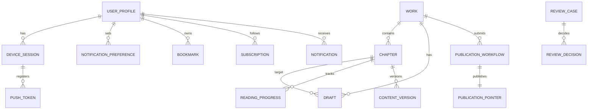

# 启明书院移动端 APP 设计方案

## 文档信息

| 项 | 内容 |
| --- | --- |
| 文档编号 | 16 |
| 版本 | v1.1（历史原生方案，技术章节已归档） |
| 状态 | 产品/页面/三模式/数据/接口/优先级仍可复用；§9、§13、§14 的原生工程与双端门禁不再代表最新技术路线。最新 Android 实施以 `17-Android移动端实施设计（Java+React+Capacitor）.md` 为准 |
| 编写日期 | 2026-11-18 |
| 适用对象 | iOS / Android 原生客户端、客户端研发、后端接口研发、QA、设计、安全与合规评审 |
| 上游权威 | `01` 需求、`02` 概要设计、`03` 详细设计、`04` 数据库、`05` 接口、`06` 原型、`07` 测试、`09` 阶段规划、`12` 产品愿景、`13` 任务清单、`14` 多形态架构、`15` 作者工作台 |
| 机器契约 | `contracts/p0.openapi.yaml`（只读，63 个 operationId） |
| 目录基线 | `mobile/ios/`、`mobile/android/`（`02` §4 标注为规划，尚未创建） |
| 单一可信源 | 页面结构与交互以本文的移动端补充为提案依据；页面 ID 仍沿用 `06`，新增页面须先更新 `06` 后生效；作者工作台只引用 `15`，不另造第二套业务规则 |

### 修订记录

| 版本 | 日期 | 修订人 | 说明 |
| --- | --- | --- | --- |
| v0.1 | 2026-11-18 | 主理人 | 建立移动端产品形态、页面、数据、接口、技术与优先级初稿 |
| v1.0 | 2026-11-18 | 主理人 | 补齐四工作空间、关键页面示意、端到端旅程、三模式移动端行为、数据模型、接口扩展、技术架构、离线/推送边界、验收与交付切片 |
| v1.1 | 2026-11-18 | 主理人 | 补齐纯 AI workflow/Agent 阶段表、记忆接受/失效、`/me/closure` 契约缺口、评论 P2 口径、注销入口与切片一致性 |
| v1.2 | 2026-11-18 | 主理人 | 技术路线变更：Android-only、Java + React + Capacitor；本文原生双端技术章节归档，最新架构、页面实现、构建与验收以 `17` 为准 |

> **技术路线说明（2026-11-18）**
> 当前项目决策为 **Java + React 全栈、Android 优先、Capacitor Android 壳**；iOS 仅在架构上预留，不实现。本文 §9、§13、§14 中关于 SwiftUI / Jetpack Compose / 双端签名的内容保留为历史评估，不再作为当前交付门禁。产品形态、页面地图、三模式、数据模型、接口清单与优先级仍然有效；技术实现与 Android 工程细节见 `docs/17`。

### 目录

1. 结论与范围
2. 现状、约束与差距
3. 产品形态与信息架构
4. 页面布局与交互
5. 关键用户旅程
6. 三种创作模式在移动端
7. 数据模型设计
8. 接口设计与系统集成
9. 技术架构与技术可行性
10. 离线、推送、支付与音频边界
11. 性能、安全、隐私与未成年保护
12. 设计系统与无障碍
13. 测试与验收
14. 发布与运维
15. 功能优先级与交付切片
16. 风险、开放问题与决策登记
附录 A. 移动端页面与优先级速查
附录 B. 移动端与 `15` 作者工作台的映射
附录 C. 本文未验证项

### 阅读方式

- 只想确认产品方向：读 §1、§3、§15。
- 要做页面与交互：读 §3、§4、§5、§12。
- 要做三模式与 AI：读 §6，并回读 `15` 的 §8、§10、§11。
- 要做后端接口：读 §7、§8，并核对 `contracts/p0.openapi.yaml` 与 `04`。
- 要做原生工程：读 §9、§10、§11、§13、§14。
- 要排期：读 §15、§16。

---

## 1. 结论与范围

### 1.1 文档定位

本文回答“启明书院如何做成手机 APP”，不是把 Web 页面截图塞进手机，也不是另建一套内容平台。移动端是现有 Web 之外的第二类客户端，与 Web 共享同一套后端契约、身份、内容版本、审核发布链和治理规则，只在界面实现、设备能力、弱网行为与交互密度上做移动适配。

本文不修改 `contracts/p0.openapi.yaml`，不创建数据库迁移，不执行 `git` 操作，不宣称 iOS/Android 已编译或已上架。任何新增接口、数据表、推送通道与离线能力都标注为“拟议”或“后续专项”，必须经过契约评审、迁移评审与设备验收后才能落地。

### 1.2 核心设计结论

| 编号 | 结论 | 影响 |
| --- | --- | --- |
| C-01 | 移动端是 **Web 并行的原生客户端**，不是替换 Web，也不是 Web-only 的包装 | 保留 `02` §2“Web + 原生并行”；复杂工作台仍以 Web 为主 |
| C-02 | 原生双端基线不改变：**iOS Swift + SwiftUI，Android Kotlin + Jetpack Compose** | 不引入 WebView、uni-app、React Native、Flutter 作为业务承载 |
| C-03 | **一个 App、四个隔离工作空间**：读者、作者、审核、运营 | 角色按服务端授权开放；读者导航不混入审核/运营入口 |
| C-04 | 移动端产品重心是 **读者消费**；作者端做“轻量创作 + 管理 + AI 监控”，不把桌面三栏编辑器照搬 | 作者复杂批量、长文排版、素材整理仍优先 Web |
| C-05 | P0 先打通 **登录/年龄、阅读、作者草稿与送审、审核最小裁决、运营配置审批** 的原生最小闭环 | 与 `13` UGC-023/024 的原生 P0 要求对齐，按切片交付 |
| C-06 | P0 **不做离线阅读、外部推送、真实支付、音频播放** | 与 `01` §3.1、`12` DEC-L07、`14` ADR-P09、`13` UGC-063 一致 |
| C-07 | 移动端只做展示、输入与本地体验缓存，**不复制业务判定** | 可见性、年龄、版权、审核、发布指针全部由服务端裁决 |
| C-08 | 三种创作模式复用 `15` 的定义与 `modeEpoch` 机制，移动端只做差异化呈现 | 不另造编辑器内核、不另造草稿协议、不另造记忆模型 |
| C-09 | 纯 AI 的 workflow + multi_agent 在服务端运行；移动端只负责任务发起（P1）、状态查看、候选确认与接管 | 后台任务不依赖 App 前台存活；绝不自动发布 |
| C-10 | 移动端必须按 **44pt / 48dp 触控目标、Dynamic Type、系统返回、读屏标签、四态** 验收 | 与 `06` §5、`09` R14、`07` T39–T41 对齐 |

### 1.3 与现有基线的关系

| 现有基线 | 本文的处理 | 不得做的事 |
| --- | --- | --- |
| `02` §2：原生 SwiftUI / Jetpack Compose，不替换 WebView/uni-app | 原样继承；本文所有页面均为原生实现 | 用 H5 页面、WebView、uni-app 充抵原生页面 |
| `02` §4：`mobile/ios/`、`mobile/android/` 规划 | 本文给出目录、模块、构建与契约生成方案 | 把移动端代码塞进 `lumin-frontend` 或复制后端业务规则 |
| `06` §2：18 个页面 ID、四类业务界面按身份开放 | 沿用 U01–U03 / R01–R03 / A01–A04 / M01–M03 / O01–O04 / N01；移动端加 `-M` 后缀表示同一页面的原生实现 | 新造一套与 06 冲突的页面权威 |
| `06` §3：手机单栏、顶部返回/标题、底部目录/排版/举报 | 作为阅读器与作者编辑器的强制布局约束 | 在手机上做三栏挤压、横向滚动正文 |
| `09` A-02 / K-05 / W-04：原生双端与设备签名门禁 | 写入 §13、§14；当前 Windows 不能完成 iOS 签名 | 以 Web 演示、模拟器截图或 Android 单端充抵双端验收 |
| `12` §5.2：历史/收藏/追更/关注分离 | 移动端书架 P1 分 Tab，收藏不等于订阅 | 把“读过”自动变成收藏，把“收藏”自动变成推送订阅 |
| `12` DEC-L07、`14` ADR-P09：离线为独立专项 | P0 不做；P2 只在合同、加密、期限、撤权都具备后立项 | 承诺“下载后永久可读”或“远程彻底删除已落设备明文” |
| `13` UGC-036/037：站内通知与外部推送分通道 | P0 只做站内通知；外部推送 P1 单独接 | 把站内通知已读等同于推送已送达 |
| `15` §8：三模式、`modeEpoch`、候选接受 | 移动端复用；只补充移动端交互差异 | 在客户端本地切换模式而不经过服务端会话 |

### 1.4 需求覆盖对照

| 需求 | 本文对应 | 优先级 | 说明 |
| --- | --- | --- | --- |
| 数据看板：阅读量、收藏、收益、热度、趋势、日/周/月 | §4.3.6、§8.1、§15 | P1（收益/排名 P2） | 复用 `15` §5 指标口径；未启用指标显示“尚未形成数据”，不编数字 |
| 写作中心：在线写作、自动保存、章节管理、发布流程 | §4.3、§5 J4、§8.1 | P0 | 手机纯文本编辑；2 秒防抖/最长 15 秒串行保存；ETag 冲突不覆盖 |
| 创作辅助：素材库、灵感收集与整理 | §4.3.7、§8.1 | P1 | 手机做查看、轻记、引用；批量整理与复杂素材仍 Web |
| AI 辅助写作与 AI 插图 | §6、§8.1 | AI 辅助 P1；AI 插图生成 P2 | 复用 `15` §9；移动端不做本地模型 |
| 读者互动、评论管理、数据导出 | §4.3.8、§8.1、§15 | P2 | 评论先书评或章评一种；导出走服务端任务与受控下载 |
| 三种创作模式并存 | §6 | 模式基座 P1，传统写作 P0 | 传统 P0 可用；辅助/纯 AI 在 P1 逐项开放 |
| 纯 AI workflow + multi_agent + 长期记忆 | §6.5–§6.7 | P1（单章）；长篇批次 P2 | 服务端编排；移动端查看计划、预算、候选、记忆变化 |
| 手机 APP 整体形态 | §3、§4、§9 | P0 | 一个 App、四工作空间、原生双端 |
| 数据模型与系统集成 | §7、§8 | P0/P1 | 复用现有表与 63 个 operationId，新增移动端设备/推送表与接口 |
| 技术可行性与优先级 | §9、§15 | — | 含原生双端成本、macOS/Xcode 前置、推送与商店风险 |

### 1.5 非目标与明确不做

1. **不做 App-only 替换 Web**。Web 继续承担完整作者工作台、复杂审核/运营表格、配置审计与批量操作；移动端不是唯一入口。
2. **不做 WebView、uni-app、React Native、Flutter 业务壳**。若 Owner 要改基线，必须单独立项、重写 `02`/`09` 并重新做双端验收，不能在本文里静默替换。
3. **不做离线阅读、整本下载、PWA**。P0 明确不交付；P1 只做图片/元数据短期缓存；P2 需独立合同与客户端安全专项。
4. **不做外部推送**。P0 只有站内通知；APNs/厂商推送是 P1，且站内与推送分别记录偏好、幂等与投递状态。
5. **不做真实支付、IAP、订阅、打赏、积分**。P0 无交易入口；未来若启用，iOS 虚拟内容按 App Store IAP 规则单独评审。
6. **不做音频/TTS/听书播放**。`13` UGC-053 属 M4，移动端只预留媒体播放器边界，不提前放空入口。
7. **不做私信、群聊、直播、开放上传任意文件**。与 `12` §2.3 一致。
8. **不做个性化推荐、行为画像、未成年行为推荐**。P0/P1 只做规则发现与元数据搜索。
9. **不做桌面级长文排版、批量章节操作、复杂素材管理**。这些留在 Web。
10. **不做本地大模型推理、端侧训练、端侧记忆库**。AI 全部经服务端受控接口；移动端不保存长期记忆权威副本。
11. **不承诺应用商店一定过审、不承诺资质自动具备**。商店、备案、内容资质、AI 标识与隐私合规需法务/安全/运营单独确认。

### 1.6 术语

| 术语 | 含义 |
| --- | --- |
| 工作空间 / Workspace | 同一 App 内按角色隔离的一组导航与页面；读者、作者、审核、运营四类 |
| AppShell | 原生应用外壳：启动、登录、路由、工作空间切换、全局错误与网络状态 |
| 移动页面 ID | 沿用 `06` 的页面 ID，加 `-M` 表示移动端实现；新增页面标“拟议” |
| `creation_session` | 章节级创作会话，保存当前模式、`modeEpoch`、`sessionRevision`、`draftId` |
| `modeEpoch` | 模式切换/接管的单调世代；旧世代任务不得覆盖新草稿 |
| 候选 / Candidate | AI 产出的正文、设定或图片建议；只有作者确认后才写入草稿 |
| 长期记忆 | 作品级版本化事实、事件、人物时态、伏笔、来源；向量/摘要只是可重建索引 |
| 站内通知 | `notification` 表中的持久记录，P0 的事实源 |
| 外部推送 | APNs / Android 厂商通道的提醒，只是站内通知的“提示”，不是事实源 |
| 四态 | 加载、空、错误/无权、成功；另含版本变化、待处理、被阻断等互斥状态 |

---

## 2. 现状、约束与差距

### 2.1 已核对的事实

| 项 | 事实 | 对移动端的含义 |
| --- | --- | --- |
| 仓库 | `lumin-academy` monorepo；后端 `lumin-backend`，前端 `lumin-frontend`，移动端 `mobile/` 仅规划 | 移动端需新建两个原生工程，不复制后端规则 |
| 后端 | Java 21 + Spring Boot 4.0.9 + Maven；MySQL 8.4；模块化单体，六层模块 | 移动端只走 `/api/v1`，不直连数据库/对象存储 |
| 契约 | `contracts/p0.openapi.yaml` 只读，63 个 operationId | 现有能力足够覆盖读者/作者/审核/运营最小闭环；缺口集中在设备、推送、书架、搜索、下载 |
| 身份 | OIDC Authorization Code + PKCE；主体取令牌 subject；原生 Keychain/Keystore | 移动端不做自建密码，不接受请求体自报 userId/角色/年龄 |
| 阅读 | `readChapter`、`getProgress`、`saveProgress`；进度 0–10000bp、版本绑定、`U(user_id, chapter_id)` | 移动端复用同一进度模型；旧版本位置不硬套新版本 |
| 作者 | `listMyWorks`、`getMyWork`、`listMyChapters`、`listMyDrafts`、`getDraft`、`saveDraft`、`submitDraft`、`getWorkflow`、`cancelWorkflow` | 移动端可做草稿、章节、送审、状态；不做批量/定时发布 |
| 审核 | `listCases`、`getCase`、`claimCase`、`getReviewContent`、`decideCase`、`reviewAppeal` | 移动端可做队列、领取、材料、裁决、申诉复核的最小闭环 |
| 运营 | `listRestrictions`、`requestRestriction`、`reviewRestriction`、`listConfigRevisions`、`reviewConfigRevision`、`activateConfigRevision`、`listAuditRecords` | 移动端做提案/审批/激活与只读审计；复杂对比仍 Web |
| 通知 | `listNotifications`、`markNotificationRead`；`NotificationCreated.v1` 已定义 | P0 站内通知可做；外部推送需新增适配器与设备令牌 |
| 收藏/追更 | `bookmark`、`subscription`、`notification_digest` 在 `04` §6.1 为 P1 预留，P0 无 HTTP 写入口 | 移动端书架/追更必须等 P1 契约，不能先用本地假数据 |
| 离线 | `01` §3.1 明确 P0 不交付离线/PWA；`12` DEC-L07、`14` ADR-P09 要求独立专项 | P0 不缓存正文；弱网只保留“未同步”状态 |
| 移动目录 | `mobile/ios/`、`mobile/android/` 尚未创建；本机无 Xcode/Android SDK 证据 | 技术可行性必须把工具链与签名列为前置风险 |

### 2.2 硬约束

1. **原生双端**：iOS SwiftUI、Android Jetpack Compose；不以 WebView/uni-app 承载业务；不共享不合适的界面实现。
2. **契约共享**：Web 与原生共用业务契约、错误语义、版本与授权规则；客户端不复制业务判定。
3. **四类界面按身份开放**：不是所有用户看到所有后台标签；审核/运营入口与读者导航隔离；服务端权限不能因隐藏菜单而省略。
4. **窄屏适配**：手机 <768px 单栏正文；顶部返回/标题；底部目录/排版/举报；触控目标 iOS ≥44pt、Android ≥48dp。
5. **无障碍**：Dynamic Type/系统字体缩放、系统返回、平台读屏标签；字号 200% 与 320px 视口无正文水平滚动。
6. **弱网诚实**：失败显示未保存/待确认；不把本地状态假称已同步；P0 不建离线同步引擎。
7. **P0 安全边界**：全量机审、四类强制人审、不可变版本、发布指针、全入口可见性、审计 append-only，移动端不得绕过。
8. **设备证据**：UGC-023/024、K-05、W-04、Q-08 要求真机与签名证据；Web/模拟器不能替代。

### 2.3 当前差距

| 差距 | 现状 | 影响 | 处理 |
| --- | --- | --- | --- |
| 无移动工程 | `mobile/` 只有目录规划 | 无法编译、无法设备验收 | §9 给出工程结构；§15 给出切片 |
| 无设备会话表 | 现有身份只有用户/角色，无 `device_session` | 无法做设备管理、推送令牌绑定、远程下线 | §7 新增拟议表 |
| 无推送适配器 | `NotificationCreated.v1` 只落站内通知 | 无法外部提醒 | P1 新增 push adapter；P0 只站内 |
| 无书架/追更接口 | 三张 P1 预留表未启用 | 移动端“书架”不能先做假入口 | P1 契约先行；P0 用“最近阅读” |
| 无搜索接口 | P0 无元数据搜索 | 书城只能分类/列表，不能做搜索框 | P1 UGC-038；P0 不放假搜索 |
| 无离线许可/加密方案 | ADR-P09 未决 | 不能承诺下载 | P2 独立专项；P0 明示需联网 |
| 无 App 商店物料/备案 | 未准备 | 无法上架 | §14 列出清单；法务/运营复核 |
| 无 iOS 构建环境 | 当前 Windows；无 Xcode 证据 | iOS 无法签名 | 需 macOS/云 Mac/CI；列为阻断 |
| 无 Android SDK 证据 | 本机未验证 | Android 无法真机验收 | 安装并锁定 SDK/Gradle/JDK |

### 2.4 设计原则

1. **内容优先**：页面先回答“读什么、读到哪、下一步做什么”，不做营销大横幅、假排行榜、装饰卡片。
2. **单一内容源**：一个作品库、一条草稿—版本—审核—发布链；不为移动端建第二套内容。
3. **最小权限**：每个页面只拿完成该任务所需字段；审核材料带水印、查看留痕；不展示完整生日/证件。
4. **渐进增强**：P0 先可靠；P1 加书架/推送/搜索/看板；P2 才讨论离线/音频/支付/AI 深度能力。
5. **状态诚实**：加载、空、失败、无权、版本变化、待处理、被阻断分开表达；超时先查状态，不重复提交。
6. **可恢复**：保存冲突保留本地内容；送审超时可查询；审核租约过期回队列；AI 任务失败不写正文。
7. **无障碍优先**：触控目标、字号缩放、读屏标签、非颜色表达、焦点顺序从第一版就是验收项。
8. **可测试**：每个页面有对应 API、四态、错误码与设备验收步骤；不以截图代替行为证据。

---

## 3. 产品形态与信息架构

### 3.1 一个 App 还是两个 App

| 方案 | 形态 | 优点 | 风险 | 结论 |
| --- | --- | --- | --- | --- |
| A. 一个消费 App + 一个内部工作 App | 读者端独立上架；作者/审核/运营另发内部 App | 消费端干净；审核/运营权限隔离强 | 两套工程、两套签名/分发、作者入口割裂；小团队成本高 | 不推荐 P0 |
| B. 一个 App、四个隔离工作空间 | 同一安装包，按角色显示读者/作者/审核/运营空间 | 一套工程；角色切换自然；与 `06` “按身份开放”一致 | 商店审核需解释多角色；高权限页面需更强门禁 | **推荐** |
| C. 纯读者 App，作者/审核/运营留在 Web | 移动端只做读者 | 最快上线 | 不满足作者手机创作与 UGC-023/024 原生 P0 | 不满足需求 |

**选择 B。** 一个 App 不意味着所有角色共用一个导航：读者、作者、审核、运营是四个独立工作空间，登录后按服务端返回的角色能力显示入口；没有角色就不显示，不靠隐藏菜单代替授权。审核/运营入口不进入读者底部导航，只能从“我的 → 工作空间”进入，并在进入时重新校验角色与会话。

### 3.2 角色与授权

| 角色 | 可见工作空间 | 默认入口 | 不可见/不可做 |
| --- | --- | --- | --- |
| 游客 | 读者（受限） | 书城 | 作者、审核、运营；跨设备进度；评论/收藏/追更 |
| 读者 | 读者 | 书城 | 审核、运营；作者工具（除非同时有作者角色） |
| 作者 | 读者 + 作者 | 书城；可从“我的”进作者空间 | 审核、运营；他人作品草稿 |
| 审核员 | 读者 + 审核 | 读者；工作入口在“我的” | 作者草稿（除案件授权材料）；运营配置 |
| 运营/配置管理员 | 读者 + 运营 | 读者；工作入口在“我的” | 内容裁决按钮；直接改数据库；作者私有草稿 |
| 多角色用户 | 对应多个空间 | 读者；可切换 | 任何未授予的空间；跨角色数据混用 |

授权规则：

1. 角色能力以服务端 `getMe`/角色分配为准；客户端只做入口显隐。
2. 进入审核/运营空间时重新读取角色与会话状态；会话过期、角色撤销、账号限制立即退出该空间。
3. 审核材料、作者草稿、运营配置不得出现在读者页面的缓存、分享卡片、通知正文或日志中。
4. 切换账号/退出登录时清除所有工作空间的内存缓存、图片缓存、深链待处理状态与本地阅读进度；不得把上一个账号的通知带入下一个账号。

### 3.3 模块划分与职责边界

| 模块 | 唯一职责 | 明确不做 |
| --- | --- | --- |
| AppShell | 启动、路由、登录态、工作空间切换、全局网络/错误/更新提示 | 不解释内容、不判定权限、不持有正文 |
| Account | 登录、年龄、监护、角色入口、设备/会话、权利请求、设置 | 不做内容编辑、审核裁决、运营配置 |
| Reader | 书城、详情、目录、阅读器、进度、通知、书架/搜索（P1） | 不创建作品、不写草稿、不审核、不运营 |
| Author | 作品/章节/草稿/自动保存/送审/工作流；数据/素材/AI 控制台（P1）；反馈（P2） | 不审核自己的稿、不做运营配置、不直接发布 |
| Review | 队列、领取、案件、材料、裁决、申诉复核 | 不编辑作者正文、不做运营配置、不导出全文 |
| Operator | 治理提案、配置审批/激活、角色审批、只读审计 | 不做内容裁决、不直接改数据库、不绕过审计 |
| Core/Network | 契约生成客户端、认证、重试、ETag/幂等、错误映射 | 不复制后端状态机、不做业务判定 |
| Core/Storage | 令牌、设置、图片缓存、崩溃恢复临时稿 | 不存权威正文/记忆/审核材料 |
| Core/DesignSystem | 令牌、组件、字号/对比度/焦点 | 不在页面内散落颜色/间距魔法值 |
| Core/Observability | 崩溃、性能、脱敏事件 | 不采集正文/token/证件/精确位置 |
| Push（服务端） | 站内通知到外部通道的适配与回执 | 不拥有通知事实、不改变已读/业务状态 |

边界规则：跨模块只通过公开接口/契约；`Reader` 不得读 `Author` 草稿；`Author` 不得读 `Review` 材料；`Review` 不得写 `Author` 正文；`Operator` 不得调用 `decideCase`。页面入口可以按角色隐藏，服务端授权仍是唯一边界。

### 3.4 工作空间导航

#### 3.4.1 读者空间

```text
[书城]  [最近]  [消息]  [我的]
```

- P0 的“最近”展示 `reading_progress` 的继续阅读与最近阅读，不冒充“书架”，不提供收藏/追更假入口。
- P1 在契约就绪后把“最近”升级为“书架”，内部再分“收藏 / 历史 / 追更”三个 Tab；三者语义分开：
  - 历史：消费事实；
  - 收藏：主动保留；
  - 追更：接收更新提醒的意愿；
  - 关注作者：关系，不等于收藏/追更。
- 消息 Tab 只放站内通知；P1 外部推送开关在“通知设置”，不改变站内事实源。
- “我的”放账号、年龄/监护、权利请求、工作空间切换、设置、关于/隐私。

#### 3.4.2 作者空间

作者空间不使用与读者相同的底部 Tab，而是一个“工作室首页 + 导航栈”：

```text
[工作室]
  ├─ 作品（P0）
  │   ├─ 作品详情
  │   ├─ 章节列表
  │   ├─ 编辑器
  │   ├─ 发布确认
  │   └─ 工作流
  ├─ 数据（P1）
  ├─ 素材（P1）
  ├─ AI 任务（P1，从作品/章节进入）
  └─ 设置（P1）
```

P0 只显示“作品 / 待办”；数据、素材、AI 任务、作者设置未启用时不显示空壳 Tab，也不显示“敬请期待”营销位。P1 启用后按 `15` 的 AW-01–AW-10 映射，移动端只保留可在窄屏完成的任务。

#### 3.4.3 审核空间

```text
[队列]  [申诉]  [我的]
```

- 队列：按优先级、风险、年龄层、来源、剩余 SLA 排序；窄屏用案件卡片，保持同一排序。
- 案件详情：材料、版本差异、规则版本、证据、裁决表单；正文带当前审核身份与时间水印，查看即审计。
- 申诉：只在后端确认回避通过后开放；不显示“已通过”，高风险显示“等待独立复核”。
- 不提供复制全文/下载按钮；不声称技术能绝对阻止截屏。

#### 3.4.4 运营空间

```text
[治理]  [配置]  [审计]  [我的]
```

- 治理：限制列表、提案、状态；运营只能提案，不能出现“直接修改审核结论”。
- 配置：当前值、提案差异、生效时间、灰度比例、提出人、审批人、审计链；审批通过仍显示“待生效”，读取 ACTIVE 后才显示“已生效”。
- 审计：只读、脱敏、游标分页；不提供删除按钮或隐藏删除快捷键。
- 高风险激活/审批需二次确认 + 生物识别/设备解锁（step-up）；复杂差异对比、批量操作留在 Web。

### 3.5 页面地图

| 页面 ID | 移动端页面 | 单一目标 | 优先级 | 对应既有页面/说明 |
| --- | --- | --- | --- | --- |
| G01-M | 登录/年龄入口 | 完成 OIDC 登录、年龄状态与本人权限说明 | P0 | 对应 U01 |
| G02-M | 工作空间切换 | 在已授权空间间切换，隔离导航 | P0 | 新增移动壳层，服务端角色驱动 |
| R01-M | 书城 | 发现可读作品、继续阅读 | P0 | R01 |
| R02-M | 作品详情/目录 | 判断是否适合并开始阅读 | P0 | R02 |
| R03-M | 阅读器 | 连续阅读、排版、进度、举报 | P0 | R03 |
| R04-M | 书架（拟议） | 收藏/历史/追更分开管理 | P1 | 06 未定义，需先补页面规格 |
| R05-M | 搜索（拟议） | 标题/作者/分类/标签检索 | P1 | 06 未定义，依赖 UGC-038 |
| N01-M | 站内通知 | 审核/监护/安全/权利/更新通知 | P0（UPDATE P1） | N01 |
| U01-M | 我的 | 账号、年龄、监护、权利、设置 | P0 | U01 |
| U02-M | 监护同意 | 核验/撤回监护同意 | P0 | U02 |
| U03-M | 权利请求/注销 | 发起并跟踪主体权利请求；App 内注销入口 | P0（注销入口）/P1（完整权利请求） | U03；商店账号删除要求 |
| A01-M | 作者工作室 | 继续写作、作品与待办 | P0 | A01 / AW-01 |
| A02-M | 作品详情 | 元数据、章节、状态、新建章节 | P0 | A02 / AW-02/03 |
| A03-M | 章节编辑器 | 纯文本写作、自动保存、预览、送审 | P0 | A03 / AW-04 |
| A04-M | 发布确认/工作流 | 确认送审并跟踪审核/发布事实 | P0 | A04 / AW-05 |
| A05-M | 数据看板（拟议） | 阅读/收藏/趋势/排名/收益 | P1（收益/排名 P2） | AW-01/03，06 未定义 |
| A06-M | 素材与灵感（拟议） | 查看、轻记、引用素材 | P1 | AW-06，06 未定义 |
| A07-M | AI 任务（拟议） | 计划、进度、预算、候选、记忆变化 | P1 | AW-08，06 未定义 |
| A08-M | 作者设置（拟议） | 默认模式、上下文授权、预算 | P1 | AW-10 |
| A09-M | 读者反馈（拟议） | 评论查看、回复、举报状态 | P2 | AW-09，06 未定义 |
| M01-M | 审核队列 | 领取授权案件 | P0 | M01 |
| M02-M | 案件详情 | 阅读材料、填写证据、裁决 | P0 | M02 |
| M03-M | 申诉复核 | 查看申诉/独立复核 | P0 | M03 |
| O01-M | 治理措施 | 查询限制、提案下架、查看状态 | P0 | O01 |
| O02-M | 配置提案/审批 | 对比、提案、审批、激活、回滚 | P0 | O02 |
| O03-M | 权限提案/审批 | 角色授予与独立审批 | P0 | O03 |
| O04-M | 审计只读 | 脱敏审计检索 | P0 | O04 |
| N02-M | 通知偏好（拟议） | 站内/推送、免打扰、通道 | P1 | 06 未定义，依赖 UGC-036 |

说明：

- `-M` 只是“同一页面的移动实现”，不改变 `06` 的页面权威；新增的 G02（工作空间壳层）与 R04/R05/A05/A06/A07/A08/A09/N02 是拟议页面，正式实现前必须先更新 `06` 并给出四态与 API。
- 页面不显示无数据/无权限/未启用的空壳入口；P0 的未启用模块直接不渲染。
- 每个页面只有一个主操作；次要操作收进“更多”，不做一排同等权重按钮。

### 3.6 工作空间切换

```text
[我的]
  昵称 / 年龄状态 / 当前角色
  [我的作品]        （有作者角色）
  [审核工作台]      （有审核角色）
  [运营工作台]      （有运营角色）
  [切换工作空间]    （多角色时）
```

规则：

1. 工作空间入口只对服务端返回的角色显示；隐藏入口不等于授权，所有请求仍由服务端鉴权。
2. 切换时保存当前页面的最小必要状态（如阅读位置），但清除另一个空间的页面栈，避免返回键穿越角色。
3. 审核/运营空间进入时展示“当前身份 + 数据范围 + 退出”条；退出后回到读者“我的”，不回到案件详情。
4. 同一账号多设备登录不共享页面栈；设备会话可在“账号安全”中查看与撤销（P1）。

### 3.7 Web 与移动端分工

| 能力 | Web | iOS/Android | 边界 |
| --- | --- | --- | --- |
| 读者书城/详情/阅读/进度/通知 | 完整 | 完整（P0） | 同一契约、同一可见性 |
| 作者作品/章节/草稿/送审/工作流 | 完整 | 轻量完整（P0） | 手机不做三栏、不做批量、不做定时发布 |
| 作者数据看板/素材/评论管理 | 完整 | 数据/素材（P1）、评论回复（P2） | 复杂筛选、批量整理、导出留在 Web |
| 审核队列/案件/裁决/申诉 | 完整 | 最小闭环（P0） | 手机不做批量分配、复杂全库检索 |
| 运营配置/权限/审计 | 完整 | 审批/激活/只读（P0） | 复杂 diff、批量审计查询留在 Web |
| 离线下载/音频/支付 | 后续 | 后续 | P0 都没有 |

### 3.8 深链与通知路由

| 场景 | 链接形态 | 处理 |
| --- | --- | --- |
| 作品分享 | `https://<domain>/works/{workId}` | Universal Link/App Link；未安装时打开 Web；安装后进 R02-M |
| 章节续读 | `lumin://reader/chapter/{chapterId}` | 需登录；按可见性回读；不携正文 |
| 作者草稿 | `lumin://studio/draft/{draftId}` | 需作者角色与本人作用域；过期/无权显示安全错误 |
| 审核案件 | `lumin://review/case/{caseId}` | 需审核角色；进入前重新校验会话与租约 |
| 运营配置 | `lumin://ops/config/{revisionId}` | 需运营角色；激活前 step-up |
| 通知点击 | 站内 `notificationId` | 先读通知事实，再按资源类型路由；不信任 payload 中的正文/角色 |

规则：

- 深链只携带资源 ID，不携带 token、正文、用户身份或角色声明。
- 未登录先进入登录，登录成功后回到原深链；登录前不预取受限资源。
- 资源已下架/无权/版本变化时显示安全错误与恢复路径，不泄露资源是否存在。
- 通知 payload 只放“有更新/待处理”的最小提示；打开 App 后以站内通知/接口回读为准。

---

## 4. 页面布局与交互

### 4.1 设计令牌与移动布局

| 令牌 | 值 | 移动端使用 |
| --- | --- | --- |
| surface | `#F5F8FA` | 冷白阅读背景；不使用奶油纸张模板 |
| paper | `#FFFFFF` | 正文、表单、卡片表面 |
| ink | `#172D3E` | 主文字 |
| secondary | `#4E6575` | 辅助说明；不用于低对比正文 |
| accent | `#245C75` | 主操作、焦点、章节位置 |
| danger | `#9C303B` | 风险与不可恢复操作；必须有文字说明 |
| border | `#C2CFD8` | 非交互分隔；交互边界用 secondary |
| nightSurface / nightInk | `#13202A / #E6EDF2` | 夜间阅读 |
| spacing | 4/8/12/16/24/32/48 | 统一间距 |
| radius | 6px 控件、8px 弹层 | 不用大圆角堆叠卡片 |
| touch | iOS ≥44pt；Android ≥48dp | 所有可点击元素，含图标按钮 |
| nav | iOS 44pt + safe area；Android 56dp | 顶部返回/标题/更多 |
| tab | iOS 49pt + safe area；Android 56dp | 读者/审核/运营底部导航 |
| 正文字号 | 默认 20，范围 16–32 | 阅读器；界面正文 16 |
| 行高 | 默认 1.8，范围 1.5–2.2 | 阅读器 |
| 正文宽度 | 32–44em | 手机单栏，不横向滚动 |
| 动效 | 120ms；reduce motion 时 0ms | 面板切换；正文不滚动劫持 |

移动端补充约束：

1. **安全区**：顶部刘海/灵动岛、底部 Home Indicator；按钮不贴边。
2. **键盘**：编辑器正文区随键盘调整，工具栏不被遮挡；收起键盘不丢失光标位置。
3. **系统返回**：iOS 边缘右滑/返回按钮；Android 系统返回/预测性返回；有未保存内容时先提示，不直接退出。
4. **底部弹层**：目录、排版、更多操作使用 bottom sheet；打开时焦点进入，关闭回到触发按钮。
5. **横屏**：阅读器可横屏但正文仍单栏；作者编辑器默认锁定竖屏，避免键盘与三栏冲突；审核/运营不强制横屏。
6. **颜色**：错误不能只靠红色；等级、状态、风险都要有文字/图标。
7. **字体**：不引入境外 CDN 字体；使用系统宋体/黑体栈；阅读器可切换系统无衬线。

### 4.2 读者页面

#### 4.2.1 书城 R01-M（P0）

```text
┌────────────────────────────────────┐
│ 启明书院                    [消息] │
│                                    │
│ [继续阅读] 作品名 · 第12章  62% →  │
│                                    │
│ 分类：全部 / 都市 / 奇幻 / 古言 … │
│                                    │
│ [封面] 作品名                       │
│        作者 · 等级 · 连载/完结      │
│        简介摘要（2 行）             │
│                                    │
│ [封面] 作品名 …                     │
└────────────────────────────────────┘
```

- 第一任务是“继续阅读”与“选择作品”，不是营销横幅；无轮播、无假榜单、无“热门推荐”伪造数字。
- 分类横向滚动，选中态明确；列表分页游标；加载保留布局骨架。
- 空态：“暂无适龄已发布作品”；错误态“加载失败，重试”；不回退展示未过滤缓存。
- 搜索框 P1 才出现；P0 不放假搜索入口。

#### 4.2.2 作品详情 R02-M（P0）

```text
┌────────────────────────────────────┐
│ [<] 作品名                          │
│ [封面占位] 作品名                   │
│            作者 · 等级 · 连载中     │
│            分类 / 标签              │
│ 简介……………………………………          │
│                                    │
│ [开始阅读 / 继续阅读]               │
│                                    │
│ 目录  第1章 … 第12章 …             │
│ [按卷展开] [倒序]                   │
└────────────────────────────────────┘
```

- 主操作固定底部或标题下方，随是否已有进度切换文案；无章节时“暂无可阅读章节”，不链接草稿。
- 目录显示章节标题、更新状态、当前章；不显示审核证据/内部状态。
- 下架/无权：“内容暂不可访问”，提供返回书城/重试，不暴露违规原因。
- 年龄/等级标签用文字，不只用颜色；未成年限制直接解释。

#### 4.2.3 阅读器 R03-M（P0）

```text
┌────────────────────────────────────┐
│ [<] 作品名 · 第12章        [更多]  │
│                                    │
│     正文……………………………………        │
│     正文……………………………………        │
│     正文……………………………………        │
│                                    │
│ 第12章 / 共220章          62%      │
│ [目录]      [排版 Aa]      [举报]  │
└────────────────────────────────────┘
```

排版面板：

```text
[排版]
字号   A- ——●—— A+        20
行高   1.5 ——●—— 2.2      1.8
主题   [日间] [夜间] [高对比]
字体   [宋体] [系统无衬线]
[完成]
```

交互规则：

1. 正文单栏，禁止横向滚动；长章用虚拟化/分页渲染，避免一次性布局全部段落。
2. 阅读位置在滚动停止 2 秒后保存；前台最密 5 秒一次；退出时提交一次。游客只保留会话内进度，不伪装跨设备同步。
3. 保存失败保留本地位置并显示“未同步”，下次前台重试；不显示“已同步”。
4. 版本变化：提示“本章已修订”，用户确认后从章首定位；不把旧百分比硬套新版本。
5. 上一章/下一章在章末；加载失败保留当前位置与重试，不自动跳章。
6. 举报入口不遮挡正文；举报表单不预填正文，只引用章节 ID 与版本。
7. 夜间/高对比/字号设置本地保存，仅影响体验，不影响后端年龄/权限。
8. P0 不缓存正文到磁盘；仅内存当前章与相邻章短期预取，退出即释放。

#### 4.2.4 书架 R04-M（P1，拟议）

```text
┌────────────────────────────────────┐
│ 书架                               │
│ [收藏]  [历史]  [追更]             │
│                                    │
│ [封面] 作品名  更新至第12章  [⋯]   │
│ [封面] 作品名  已读至第8章   [⋯]   │
│                                    │
│ 空态：还没有收藏作品               │
└────────────────────────────────────┘
```

- 收藏：主动保留；历史：消费事实；追更：接收更新提醒的意愿；关注作者：关系。四个概念分开。
- 收藏不自动开启追更；追更不自动产生外部推送；取关不自动删除历史。
- 长按/更多提供“移出收藏”“关闭追更”“删除历史展示”；删除展示不等于删除审计证据。
- 无作品时真实空态，不填充演示作品。

#### 4.2.5 通知 N01-M（P0）

```text
┌────────────────────────────────────┐
│ 消息                               │
│ [全部] [审核] [安全] [监护] [权利] │
│                                    │
│ ● 你的章节已通过审核               │
│   作品名 · 第12章 · 10:32          │
│                                    │
│   系统维护通知                     │
│   昨天                             │
└────────────────────────────────────┘
```

- 未读点 + 文字“未读”；已读由服务端回读确认，不只在本地置灰。
- 点击先读通知事实，再按资源路由；通知正文不包含完整敏感内容。
- 空态“暂无通知”；失败保留原列表并标明“刷新失败”。
- P0 不显示“推送已送达”；站内通知与外部推送分开。

#### 4.2.6 我的 U01-M（P0）

```text
┌────────────────────────────────────┐
│ [头像] 昵称                         │
│        年龄状态：成年/未成年/未核验 │
│        角色：读者 / 作者            │
│                                    │
│ [我的作品]        （作者可见）     │
│ [审核工作台]      （审核可见）     │
│ [运营工作台]      （运营可见）     │
│ [切换工作空间]    （多角色）       │
│                                    │
│ [通知设置] [隐私与权限] [权利请求]  │
│ [账号安全] [关于] [退出登录]       │
└────────────────────────────────────┘
```

- 年龄状态只显示结论，不显示出生日期/证件；未成年限制直接解释。
- 退出登录清除所有工作空间缓存与本地进度；多账号切换不串数据。
- 权利请求 P1；P0 可显示入口但必须接真实接口，否则不显示。
- 账号安全页提供“注销账号”入口（满足商店要求）：说明影响、保留义务、撤回窗口；不藏在帮助/关于深处；`/me/closure` 契约未补齐前不得声称可用。

### 4.3 作者页面

#### 4.3.1 作者工作室 A01-M（P0）

```text
┌────────────────────────────────────┐
│ 工作室                    [新建作品]│
│                                    │
│ [继续写作] 作品名 · 第12章          │
│            草稿保存于 10:32   [继续]│
│                                    │
│ [待办] 1 章待审 · 1 条退回          │
│                                    │
│ 作品                               │
│ [封面] 作品名  连载中  12章  [⋯]   │
│ [封面] 作品名  已完结  30章  [⋯]   │
└────────────────────────────────────┘
```

- 首屏突出“继续写作”和“待办”，不做欢迎口号、装饰统计卡。
- 作品列表显示标题、状态、章节数、更新时间；不显示虚假阅读/收益。
- 新建作品走独立表单；创建成功进入作品详情，不自动创建章节。
- 待办来自真实工作流/草稿冲突；无待办显示“暂无待办”。

#### 4.3.2 作品详情 A02-M（P0）

```text
┌────────────────────────────────────┐
│ [<] 作品名                 [更多]  │
│ 状态：连载中 · 分类 · 标签          │
│ 简介……………………………………          │
│ [新建章节]  [作品设置]             │
│                                    │
│ 章节                               │
│ 第12章  编辑中   3,200字   [继续]  │
│ 第11章  待审     3,050字   [查看]  │
│ 第10章  已公开   2,980字   [查看]  │
└────────────────────────────────────┘
```

- 章节状态用文字：编辑中/待审/已公开/退回/已下架；不把“待审”显示成“已发布”。
- 新建章节生成章节身份与草稿；同一目标最多一个 `EDITABLE` 草稿。
- 作品元数据修改走草稿/版本链，不直接改公开版本；手机只做标题/简介/标签等轻量字段，封面裁剪与复杂素材在 Web。

#### 4.3.3 章节编辑器 A03-M（P0）

```text
┌────────────────────────────────────┐
│ [<] 第12章        [保存中] [预览]  │
│ [标题输入                      ]   │
│                                    │
│ 正文（纯文本，保留换行）           │
│ …………………………………………             │
│ …………………………………………             │
│                                    │
│ 3,200 字   [模式：传统 ▾]  [AI]    │
│ [章节列表]        [提交审核]       │
└────────────────────────────────────┘
```

规则：

1. **纯文本**：不采用富 HTML 输入；粘贴保留换行；不自动插入复杂排版。
2. **自动保存**：2 秒防抖；最长 15 秒串行；保存状态独立于发布状态；显示“尚未保存/保存中/已保存/保存失败”。
3. **乐观锁**：保存带 `If-Match`/revision；412 冲突保留本地内容，展示本地/最新版本对比，用户复制合并后重新保存；不静默覆盖。
4. **离开保护**：有未保存修改时，返回/切章/切模式先提示“保存并离开/放弃/取消”。
5. **恢复**：重启 App 后从 `listMyDrafts/getDraft` 找回；P0 不承诺离线持久草稿；本地只保留崩溃恢复的最小临时副本（加密、退出清除）。
6. **预览**：预览使用只读渲染，不触发发布；预览页标明“预览，未公开”。
7. **送审**：保存至 CLEAN 后可用；提交前进入独立发布确认页。
8. **字数**：本地即时统计 + 服务端确认；以服务端版本为准时显示差异。
9. **无障碍**：标题/正文有读屏标签；工具栏按钮 44/48；键盘焦点可见；字号缩放不破坏布局。

P0 编辑器只显示“传统”模式；模式选择器与 AI 入口在 P1 服务端 `capabilities` 开启后才渲染，未开启时不显示灰色假按钮。P1 的三模式行为见 §6。

#### 4.3.4 发布确认 A04-M（P0）

```text
┌────────────────────────────────────┐
│ 提交审核                            │
│ 作品：作品名                        │
│ 章节：第12章                        │
│ 目标版本：草稿 revision 17          │
│ 字数：3,200                         │
│ 年龄/监护：已满足 / 需监护同意      │
│ 版权：本人确认拥有发布权利          │
│ AI 来源：无 / AI辅助 / 主要AI生成   │
│ [ ] 我确认以上信息                 │
│ [提交审核]              [取消]      │
└────────────────────────────────────┘
```

- 按钮文案是“提交审核”，不是“发布”；202 后显示“已提交审核”，不是“已发布”。
- 只有公开指针回读吻合才显示“已发布”；审核中显示“审核中”，退回显示原因与修订入口。
- 年龄/监护不满足时直接解释，不以隐藏按钮作为唯一控制。
- AI 来源标识不可手动删除；纯 AI 内容必须显示“主要 AI 生成，作者确认”；提交后进入审核。
- 重复提交使用幂等键；超时先查工作流，不重复创建版本。

#### 4.3.5 工作流 A04-M（P0）

```text
┌────────────────────────────────────┐
│ [<] 审核进度                        │
│ 第12章 · 版本 v17                   │
│ ● 已提交   10:32                    │
│ ● 机审通过 10:33                    │
│ ○ 人审中   预计…                    │
│ ○ 发布                             │
│                                    │
│ 状态：人审中                       │
│ [取消提交]（仅允许时）              │
│ 退回原因 / 证据 / 申诉入口（如适用）│
└────────────────────────────────────┘
```

- 状态时间线只显示事实，不预测通过；高风险显示“等待独立复核”。
- 退回原因可操作、适当证据、申诉入口；不展示其他用户身份/内部风控秘密。
- 取消只在服务端允许的状态出现；取消不是删除版本。
- 轮询/推送更新，避免频繁请求；页面不可见时停止轮询。

#### 4.3.6 数据看板 A05-M（P1，拟议）

```text
┌────────────────────────────────────┐
│ 数据                    [最近7天 ▾]│
│ 阅读人数   阅读次数   收藏净增      │
│ 1,234      2,345      56            │
│ 收益（未启用）  排名（未形成数据）  │
│                                    │
│ [阅读趋势折线图]                    │
│  日期 / 单位 / 数据截至时间         │
│ [查看数据表]                        │
│                                    │
│ 作品表现：作品 | 阅读 | 收藏 | 排名 │
└────────────────────────────────────┘
```

- 指标口径复用 `15` §5：有效阅读、UV、收藏净增、收益、排名；不把点击当阅读，不把 PV 当 UV。
- 日/周/月切换；区间上限；数据截至时间；完整性标记。
- 收益未启用显示“尚未启用”，不显示 0 元假装有收益；排名无真实数据时“尚未形成数据”，不编榜单。
- 图表有可访问数据表替代；不补造未知日期为 0；加载骨架、真空值 0、失败重试分开。
- 导出 P2：服务端生成受控文件，移动端只打开受控下载/分享；不在本地拼 CSV。

#### 4.3.7 素材与灵感 A06-M（P1，拟议）

```text
┌────────────────────────────────────┐
│ 素材                 [新建灵感]    │
│ [全部] [当前作品] [图片] [未整理]  │
│                                    │
│ 灵感：雨夜车站的相遇               │
│ 人物参考：主角旧照（授权待确认）   │
│ 世界资料：北境地理                 │
│                                    │
│ [条目详情] 来源 / 许可 / 笔记      │
│ [引用到当前章节]                   │
└────────────────────────────────────┘
```

- 手机做查看、轻记、引用；批量导入、复杂标签、许可编辑留在 Web。
- 来源与许可可见；未知许可从严，不自动抓取 URL 内容。
- 引用只写引用记录，不把素材全文复制进正文；图片生成候选走 AI 任务，不直接调用供应商。
- 素材与作品权限绑定；跨作品引用需明确许可。

#### 4.3.8 读者反馈 A09-M（P2，拟议）

```text
┌────────────────────────────────────┐
│ 反馈                               │
│ [未回复] [全部] [被举报]           │
│ 读者A：第12章节奏…        [回复]   │
│ 读者B：…                  [举报]   │
│ 状态：待审核 / 已展示 / 已折叠     │
└────────────────────────────────────┘
```

- 先做章评或书评一种，避免同时开段评/弹幕/私信。
- 回复、举报、屏蔽、拉黑、剧透折叠按权限开放；被下架正文不能借评论区传播。
- 作者只能看到与本人作品相关的评论；不展示其他用户敏感信息。

#### 4.3.9 AI 任务 A07-M（P1，拟议）

```text
┌────────────────────────────────────┐
│ [<] AI 任务 · 第12章               │
│ 模式：纯AI   状态：等待作者确认     │
│ 计划：3 步 · 预算 ¥… · 已用 ¥…     │
│ ● 规划  ● 起草  ○ 一致性检查       │
│                                    │
│ [候选正文] 3,180 字                 │
│ [差异摘要] 新增 2 处 / 冲突 1 处    │
│ [记忆变化] 人物时态 / 伏笔          │
│ [接受候选] [拒绝] [接管编辑]        │
└────────────────────────────────────┘
```

- 运行期正文区只读；接受前必须完成保存屏障与基线校验。
- 接受是原子命令：正文、来源、作者批准的记忆变化一起提交；不是发布。
- 失败/超时显示可重试；任务在后台继续，App 退出不丢状态；推送/SSE 只作提示，事实以任务快照为准。
- 预算、步骤、供应商信息可见；不展示 Agent 内部提示词/私密推理。
- 插图候选（P2）：按场景生成图片候选，标“AI 生成”；作者确认后才可作为封面/正文插图素材，仍走图片审核；不在手机端直接发布。

### 4.4 审核页面

#### 4.4.1 队列 M01-M（P0）

```text
┌────────────────────────────────────┐
│ 审核队列                 [刷新]    │
│ 优先级：SLA ↑                      │
│                                    │
│ [高风险] 案件 #…  年龄 C2           │
│ 来源：作者提交 · 剩余 02:10        │
│ 状态：待领取        [领取]         │
│                                    │
│ [中风险] 案件 #…  年龄 C1           │
│ 剩余 05:40        [领取]           │
└────────────────────────────────────┘
```

- 卡片显示优先级、风险、年龄层、来源、剩余 SLA、状态；窄屏不改成无排序长列表。
- 领取失败：“该案件已被领取，请刷新”；不覆盖他人租约。
- 队列空：“当前队列暂无案件”；加载/失败分开。

#### 4.4.2 案件详情 M02-M（P0）

```text
┌────────────────────────────────────┐
│ [<] 案件 #…        [剩余 02:10]    │
│ 风险：高 · 年龄：C2 · 规则 v…      │
│ 版本差异：v16 → v17                │
│                                    │
│ [受控正文，带审核身份/时间水印]     │
│ …………………………………………             │
│                                    │
│ 裁决：○ PASS ○ LABEL ○ LIMIT       │
│ 等级：…  理由码：…  证据：…        │
│ [提交裁决]                         │
└────────────────────────────────────┘
```

- 只展示最少必要材料、版本差异、规则版本、证据、原裁决；不展示姓名/证件/完整生日。
- 正文区域带当前审核身份与时间水印；查看即审计；不显示复制全文/下载；不声称绝对防截屏。
- 高风险首审后显示“等待独立复核”，不显示“已通过”；双人分歧显示“需要新的 L2 裁决”。
- 租约过期回队列，不能继续裁决；提交裁决锁按钮 + 幂等。
- 手机端可做单案裁决；批量分配、全库检索、复杂证据对比留在 Web。

#### 4.4.3 申诉 M03-M（P0）

```text
┌────────────────────────────────────┐
│ [<] 申诉                           │
│ 原案件 #… · 申诉人（脱敏）         │
│ 理由 / 新证据 / 原裁决             │
│ 回避校验：已通过 / 未通过          │
│ [受理] [维持] [转复核]             │
└────────────────────────────────────┘
```

- 只在后端确认回避通过后开放；不显示申诉人完整身份。
- 终局违规/解约不能通过普通申诉恢复传播；临时措施可依法复核。
- 处理时限与跟踪入口可见；重复申诉提示。

### 4.5 运营页面

#### 4.5.1 治理 O01-M（P0）

```text
┌────────────────────────────────────┐
│ 治理措施                           │
│ [全部] [待审] [生效中] [已到期]    │
│ 作品/章节 · 措施类型 · 范围 · 状态 │
│ [提案下架]（运营只能提案）          │
└────────────────────────────────────┘
```

- 运营只能提案，不出现“直接修改审核结论”。
- 措施显示对象、范围、原因、生效/到期、复核要求；不展示内部风险秘密。
- 高危确认必须有具体对象、影响范围、原因与复核要求，不用通用“确定吗”。

#### 4.5.2 配置 O02-M（P0）

```text
┌────────────────────────────────────┐
│ 配置提案 #…                        │
│ 当前值 → 提案值                    │
│ 生效时间 / 灰度 / 提出人 / 审批人  │
│ 审计链：…                          │
│ [批准] [驳回] [激活]               │
│ 状态：待生效 / 已生效              │
└────────────────────────────────────┘
```

- 审批与激活分离；异人审批；审批通过仍显示“待生效”；读取 ACTIVE 后才“已生效”。
- 回滚创建新提案，不直接覆盖旧值。
- 高风险激活 step-up；手机不做复杂 diff 编辑器，只读差异 + 批准/驳回。
- ADMIN 空间不包含内容裁决按钮。

#### 4.5.3 权限 O03-M 与审计 O04-M（P0 最小）

- 权限：角色授予提案、独立审批、到期/撤销；显示申请人、对象、范围、理由、审计链。
- 审计：脱敏、只读、游标分页；不提供删除/隐藏删除；复杂检索与导出留在 Web。

### 4.6 四态与异常

| 页面组 | 加载态 | 空态 | 错误/无权 | 成功/版本变化 |
| --- | --- | --- | --- | --- |
| 书城/详情 | 布局骨架 + 读屏“加载中” | 暂无适龄已发布作品 | 重试；不回退未过滤缓存 | 可读列表/目录 |
| 阅读器 | 当前章骨架，保留位置 | 本章暂无内容 | 重试/返回目录；不自动跳章 | 正文 + 进度；“本章已修订” |
| 书架 P1 | 列表骨架 | 还没有收藏/历史/追更 | 重试；保留原列表 | 分 Tab 的真实数据 |
| 通知 | 列表骨架 | 暂无通知 | 保留原列表 + 刷新失败 | 已读由服务端回读 |
| 作者作品/草稿 | 列表/编辑骨架 | 引导创建作品/章节 | 412 冲突保留本地；503 查原请求 | 已保存 revision/已提交审核 |
| 发布确认 | 按钮忙碌 + 同幂等键 | 无目标不允许提交 | 年龄/权限说明；超时先查状态 | 已提交审核 + 进度入口 |
| 审核队列/案件 | 领取/裁决锁按钮 | 当前队列暂无案件 | 租约过期回队列；不继续裁决 | 已记录裁决/等待二审 |
| 申诉 | 受理中 | 无新证据提示 | 回避/重复申诉提示 | 受理时限 + 跟踪 |
| 配置 | 对比/审批中 | 无变更提案 | 版本冲突刷新；不降弱底线 | 待生效/已生效分开 |
| AI 任务 | 计划/步骤骨架 | 无任务时引导创建 | 失败可重试；旧世代 STALE | 等待确认/已接受/已拒绝 |
| 工作空间 | 角色校验中 | 无工作空间 | 角色撤销/会话过期 -> 退出 | 进入授权空间 |

通用规则：

1. 切换作品/章节/账号立即清除旧结果；迟到请求不得污染新页面。
2. 失败保留用户输入；不清空正文、不重置滚动位置、不假装成功。
3. 错误文案给原因与下一步（重试/比较/保存/返回），不输出堆栈、SQL、token、正文。
4. 危险操作二次确认；确认文案写具体对象与后果，不用泛化“确定吗”。
5. 页面不可见时停止轮询/SSE；回到前台重新拉快照。

### 4.7 无障碍与平台差异

| 项 | iOS | Android |
| --- | --- | --- |
| 触控目标 | ≥44pt | ≥48dp |
| 字体缩放 | Dynamic Type，正文支持 200% | 系统字体缩放，sp 不锁死 |
| 读屏 | VoiceOver，标签/值/提示完整 | TalkBack，contentDescription/角色 |
| 返回 | 边缘右滑 + 返回按钮 | 系统返回/预测性返回 |
| 安全区 | safeAreaInsets + Home Indicator | WindowInsets + 手势导航 |
| 键盘 | keyboardLayoutGuide，正文不被遮挡 | adjustResize/imePadding |
| 深色 | 系统深色 + 阅读器夜间独立 | 系统深色 + 阅读器夜间独立 |
| 动效 | Reduce Motion 时 0ms | 移除动画/减少动态 |
| 弹层 | 焦点进入/关闭恢复 | 焦点/返回关闭，读屏不穿透 |

无障碍验收：

- 登录、书城、详情、阅读、作者编辑/送审、审核裁决、申诉、配置审批、通知全旅程有 VoiceOver/TalkBack 记录。
- 字号 200%、320px 视口无正文水平滚动；按钮文字不被截断。
- 颜色对比：常规文字 ≥4.5:1，大字 ≥3:1，控件边界 ≥3:1；用实际合成背景测量。
- 错误不只红色；状态有文字；图表有数据表替代。
- 不用仅手势可完成的动作；所有滑动操作有按钮替代。

---

## 5. 关键用户旅程

### 5.1 J1 首次启动、登录与年龄状态

| 步骤 | 客户端 | 服务端 | 作者/读者可见 | 失败处理 |
| --- | --- | --- | --- | --- |
| 1 | 启动 App，显示品牌/骨架，不立即请求推荐 | — | “正在启动” | 崩溃/超时进入离线错误页 |
| 2 | 从 Keychain/Keystore 读取 refresh token，尝试静默续期 | OIDC token endpoint | 已登录则直接进书城 | 续期失败清除本地会话，进游客/登录 |
| 3 | 游客可浏览书城；点“登录”或保存进度/进入作者空间时触发登录 | — | “登录后可跨设备保存进度” | 不强迫登录才能阅读公开作品 |
| 4 | 使用 `ASWebAuthenticationSession`（iOS）/ Custom Tabs（Android）打开 OIDC Authorization Code + PKCE | issuer/audience/签名/expiry 校验 | 系统浏览器完成登录 | 取消/失败回到原页面，不丢当前阅读位置 |
| 5 | 收到 callback，换取 token；access token 只存内存，refresh token 存 Keychain/Keystore | 返回 subject/角色/年龄结论 | 登录成功 | 不回传 token 到 WebView/日志 |
| 6 | 调 `getMe`，读取年龄状态、角色能力、账号限制 | 服务端判定 | “成年/未成年/未核验”；角色入口 | 未核验按保守年龄处理；限制账号只显示必要说明 |
| 7 | 按角色显示工作空间入口；读者默认进书城 | — | 我的 → 工作空间 | 无角色不显示入口；不靠 UI 隐藏代替授权 |

**年龄与监护**：未核验不能自行升为成年；C0/C1/C4 不公开；C2 需监护同意；年龄不明从严。监护同意/撤回在 U02-M，入口只在需要时出现；未成年不显示外部推送营销、支付、私信等未开放能力。

### 5.2 J2 发现、阅读与进度同步

| 步骤 | 客户端 | 服务端 | 可见状态 |
| --- | --- | --- | --- |
| 1 | `listWorks` 游标分页；`listCategories` | 授权后返回适龄/合法作品 | 书城列表 |
| 2 | 点作品 → `getWork` + `listChapters` | 同一可见性闸门 | 详情 + 目录 |
| 3 | 点“开始阅读/继续阅读” → `readChapter` | 返回正文、版本、章节元数据 | 阅读器 |
| 4 | 滚动停止 2 秒 → `saveProgress`；前台最密 5 秒；退出再提交 | 校验版本、位置 0–10000、时长、时间 | “已同步/未同步” |
| 5 | 章末预取下一章（仅内存） | 下一章正文 | 无感切换；失败保留章末重试 |
| 6 | 返回目录/书城 | — | 保留目录上下文与焦点 |
| 7 | 切换账号/退出 | — | 清除本地进度与缓存，不串号 |

**游客**：只保留会话内进度；不显示“已同步到云端”；登录后以服务端进度为准，若本地有更新位置，提示“使用本地位置/使用云端位置”，不静默覆盖。

### 5.3 J3 版本变化与跨端进度冲突

| 场景 | 判定 | 客户端行为 | 不得做 |
| --- | --- | --- | --- |
| 同版本、两台设备 | 服务端按 `reading_progress` 最新合法写入 | 拉取服务端位置；若本地未同步，提示“另一设备已更新”，让用户选择 | 静默用旧本地覆盖新服务端 |
| 章节已修订（versionId 变化） | 旧百分比不能硬套新版本 | 提示“本章已修订”，确认后从章首定位；保留旧版本阅读事实 | 把 62% 直接写成新版本 62% |
| 客户端时钟异常 | 服务端拒绝未来超过 5 分钟 | 用服务端时间校正；显示“时间异常，已使用服务器时间” | 信任本地时间写入 |
| 服务端保存失败 | 网络/5xx | 保留本地位置，标“未同步”，下次前台重试 | 显示“已同步” |
| 离线候选 | P0 无离线正文 | 不产生离线进度候选；仅在线保存 | 建设隐形离线同步引擎 |
| 章节被下架 | 读闸门拒绝 | 停止拉取，显示“内容暂不可访问” | 从缓存继续展示正文 |

### 5.4 J4 作者恢复草稿、编辑与送审

| 步骤 | 客户端 | 服务端 | 可见状态 |
| --- | --- | --- | --- |
| 1 | A01-M `listMyWorks` + `listMyDrafts` | 返回本人作品/草稿 | 继续写作、待办 |
| 2 | 进作品 A02-M `listMyChapters` | 返回章节状态 | 章节列表 |
| 3 | 点“新建章节” → `createChapter`；或点草稿 → `getDraft` | 创建章节身份/返回草稿 ETag | 编辑器 |
| 4 | 输入标题/正文 | — | 本地字数、保存状态 |
| 5 | 2 秒防抖/最长 15 秒 → `saveDraft` + `If-Match` | 更新 revision/ETag | “保存中/已保存” |
| 6 | 412 冲突 | 返回最新 revision | 展示本地/最新对比；保留本地，复制合并后重存 |
| 7 | 点“预览” | 只读渲染，不发布 | “预览，未公开” |
| 8 | 点“提交审核” → 发布确认页 | 校验年龄/监护/版权/AI 来源 | 确认页 |
| 9 | `submitDraft` + Idempotency-Key | 202 受理，创建 workflow | “已提交审核”（不是“已发布”） |
| 10 | A04-M `getWorkflow` 轮询/通知 | 返回机审/人审/挂起/退回/发布事实 | 时间线 |
| 11 | 退回 → 新建修订草稿 | 旧公开版本不变 | 退回原因 + 修订入口 |
| 12 | 发布指针回读吻合 | `ContentPublished` | 才显示“已发布” |

**保存失败**：5xx/超时保留 dirty 状态与本地临时副本；不重复创建版本；恢复网络后用同一草稿 revision 重试。**离开保护**：返回/切章/切模式先提示保存；不静默丢弃。

### 5.5 J5 模式切换与 AI 辅助改写

| 阶段 | 客户端 | 服务端 | 作者可见 |
| --- | --- | --- | --- |
| 1 | 打开章节，`getCreationSession` | 返回 mode、`modeEpoch`、sessionRevision、capabilities | 当前模式 + 可用能力 |
| 2 | 点模式选择器，选“AI辅助” | — | 说明发送范围、预算、影响 |
| 3 | 有未保存修改 → “保存并切换/放弃/取消” | — | 保存屏障 |
| 4 | 保存至 CLEAN → `transitionCreationMode` | 锁会话、递增 epoch、撤销旧任务接受资格、记录事件 | “正在切换…” |
| 5 | 成功后重渲染 AI 面板 | 返回新 epoch/session | “已切换到 AI 辅助模式” |
| 6 | 选中一段正文 → 选“改写/润色” | 创建单次任务，返回候选 | 候选卡片 + 差异 |
| 7 | 比较候选 → “接受/插入/另存/拒绝” | 校验选区 hash、基线、预算；接受写草稿 | 接受后保存新 revision |
| 8 | 切换失败 | 409/403/网络 | 保留原模式与正文；给重试/比较/保存 |

移动端不做“边流式输出边写正文”：流式只作预览，完整候选通过校验后才出现接受按钮。选区用手柄/键盘选择；候选面板全屏或底部大面板，不挤占正文到不可读。

### 5.6 J6 纯 AI 单章：发起、后台运行、确认

| 阶段 | 客户端 | 服务端 | 作者可见 |
| --- | --- | --- | --- |
| 1 | 在章节/作品页点“纯 AI 写作” | 检查模式、记忆水位、预算、作品唯一批次 | 范围/预算/预计步骤确认 |
| 2 | 提交 `createAuthorAiRun` + Idempotency-Key | 202 返回 runId/state/reservedBudget | “已受理，排队中” |
| 3 | App 可退到后台/锁屏 | workflow + multi_agent 继续 | 推送/SSE 只作提示 |
| 4 | 回到 App，`getAuthorAiRun` 拉快照 | 返回状态、步骤、费用、候选摘要 | 计划/步骤/预算 |
| 5 | 等待决策 → `decideAuthorAiRun` | 绑定 decisionId/版本，继续 | 选择项 + 影响 |
| 6 | 等待作者 → 预览候选/差异/记忆 delta | 返回完整候选包 | 接受/拒绝/接管 |
| 7 | 接受 → `acceptAuthorAiCandidate` | 原子写草稿 + 来源 + 已批准记忆 + run ACCEPTED | “已生成草稿，待送审” |
| 8 | 拒绝/取消/失败 | 终态不回退；旧任务失效 | 可查看/重试；绝不写正文 |
| 9 | 送审 | 正常作者流程 | 不自动发布 |

**移动端边界**：P1 支持发起单章、查看、决策、接受/拒绝、接管编辑；P2 才讨论长篇批次、自动连续多章、插图生成/批量。运行期间不展示 Agent 内部提示词、工具调用细节；只展示业务步骤、预算与候选。

### 5.7 J7 审核裁决

| 步骤 | 客户端 | 服务端 | 可见状态 |
| --- | --- | --- | --- |
| 1 | M01-M `listCases` | 授权队列、排序、分页 | 案件卡片 |
| 2 | 领取 `claimCase` | 租约、幂等 | “已领取，剩余 SLA” |
| 3 | 进详情 `getCase` + `getReviewContent` | 最小材料、版本差异、水印 | 受控正文 |
| 4 | 填写结果/等级/理由码/证据 | — | 表单校验 |
| 5 | `decideCase` | 校验租约、证据、双审规则 | “已记录/等待独立复核” |
| 6 | 租约过期 | 409/410 | 回队列，不能继续裁决 |
| 7 | 高风险 | 双审/仲裁 | 不显示“已通过” |

### 5.8 J8 运营配置审批

| 步骤 | 客户端 | 服务端 | 可见状态 |
| --- | --- | --- | --- |
| 1 | O02-M `listConfigRevisions` | 提案列表、状态 | 待审/待生效/已生效 |
| 2 | 详情 `getConfigRevision` | 当前值、提案值、差异、审计链 | 只读 diff |
| 3 | 批准/驳回 `reviewConfigRevision` | 异人审批、版本校验 | 审批记录 |
| 4 | 激活 `activateConfigRevision` + step-up | 校验审批、生效时间、灰度 | “待生效” |
| 5 | 回读 ACTIVE | 返回生效版本 | “已生效” |
| 6 | 回滚 | 创建新提案 | 不直接覆盖旧值 |

### 5.9 J9 通知与深链

1. 站内通知列表 → 点击 → `markNotificationRead` → 按 `resourceType/resourceId` 路由。
2. 未登录 → 登录 → 回原深链；登录前不预取受限资源。
3. 资源无权/下架/版本变化 → 安全错误 + 返回；不泄露存在性。
4. P1 外部推送点击 → 打开 App → 先读站内通知事实 → 再路由；不信任推送 payload 的角色/正文。
5. 通知已读失败 → 保留未读态，提供重试；不在本地假装已读。

### 5.10 J10 离线下载（P2，仅设计边界）

1. 作者/读者在已授权作品页点“下载”；服务端校验合同许可、账号状态、设备绑定、下载范围。
2. 返回 `download-manifest`：章节 ID、版本 ID、分片、摘要、到期时间、加密参数。
3. 客户端用设备密钥加密落盘；密钥存 Keychain/Keystore；明文不落普通缓存。
4. 打开 App/定期校验授权与版本；撤权/到期/账号切换 → 删除本地密钥与文件索引，显示“需重新下载”。
5. 不能承诺远程彻底删除已落设备明文；用户须知明确“已阅读/已导出内容无法保证撤回”。
6. 审核材料、作者草稿、未公开版本永不进入下载清单。

---

## 6. 三种创作模式在移动端

### 6.1 模式定义（复用 `15` §8.1）

| 维度 | 传统 MANUAL | AI 辅助 ASSISTED | 纯 AI AUTONOMOUS |
| --- | --- | --- | --- |
| 作者角色 | 直接撰写正文 | 直接撰写并按需请求建议 | 制定目标/约束/计划并确认候选 |
| 编辑器 | 完整可编辑 | 完整可编辑 + 候选差异 | 运行期候选只读；接管后转可编辑 |
| AI 介入 | 默认无正文模型调用 | 选区/指定段落/单项任务 | workflow 调度多 Agent、自动检查、有限返工 |
| 正文写入 | 作者保存 | 作者接受候选后条件写入 | 作者接受完整候选包后条件写入 |
| 长期记忆 | 作者手动维护；不自动抽取 | 可申请提取，候选需确认 | 使用冻结记忆；接受时确认新增事实/冲突 |
| 费用 | 0 | 每次任务前显示范围/上限 | 批次/步骤预算、确认执行、实时归集 |
| 发布 | 作者保存、预览、送审 | 同左，保留 AI 来源 | 同左，绝不自动公开 |
| 内容来源 | 作者输入/已存在来源 | 人工 + AI 混合，逐次可追溯 | 主要 AI 生成，人工确认/修改可追溯 |

“纯 AI”描述主要文本生成方式，不保证没有人的创意贡献，也不表示平台可以替作者作出法律承诺。

### 6.2 模式作用域与移动端会话

1. 账号保存默认偏好；作品保存默认模式；章节 `creation_session` 保存当前有效模式、`modeEpoch`、`sessionRevision`、`draftId`。
2. 新会话继承作品默认；切换章节不批量改变其他章节、既有任务或历史内容。
3. 移动端**不得只在本地改开关**：每次切换都调 `transitionCreationMode`，以服务端 `modeEpoch` 为唯一真相；多设备刷新后看到同一模式。
4. 所有任务绑定 `workId`、`chapterId`、`sessionRevision`、`draftId`、`baseRevision`、`modeEpoch`、`memoryRevision`、`sourceEpoch`、`outlineRevision`；旧世代任务成功也不能覆盖新草稿。
5. 首版同一作品只允许一个会写章节候选/记忆的纯 AI 批次处于执行/待确认；辅助任务可并发只读候选，接受时逐一 CAS。

### 6.3 移动端切换逻辑

| 切换 | 移动端交互 | 服务端 | 切换后 |
| --- | --- | --- | --- |
| MANUAL → ASSISTED | 模式选择器 → 说明面板（发送范围/预算）→ 保存屏障 | 保存当前稿、检查 AI 资格、递增 epoch | 原文保持；AI 面板出现，不自动生成 |
| ASSISTED → MANUAL | 提示“取消/保留只读结果” | 停接受旧任务、递增 epoch、请求取消后续 | 已接受内容保留；未接受结果不可写入 |
| MANUAL → AUTONOMOUS | 选择“从空稿/现有稿续写”→ 确认提纲/记忆/目标/上限 | 保存快照、检查来源许可、创建有界计划 | 现有稿保留；候选不替换 |
| ASSISTED → AUTONOMOUS | 处理未接受候选 → 确认新任务范围 | 旧候选只读/拒绝；新 epoch 绑定新基线 | 建议不默认为已接受设定 |
| AUTONOMOUS → ASSISTED | 点“接管”→ 选择原稿/已完成候选 | 废止旧接受资格、冻结任务、条件应用选择 | 转可编辑；旧后台结果不得覆盖 |
| AUTONOMOUS → MANUAL | 同上 + 关闭后续 AI | 停止新调度、递增 epoch、保存来源 | 原文/已选候选可编辑，来源保留 |

**失败**：本地未保存、断网、版本冲突时切换不完成，保留原模式与可恢复内容；不把 UI 先切成新模式再补服务端。**原子接管**：本地有未保存修改时禁止直接以候选接管；先保存或明确放弃，旧候选按 STALE 处理。

### 6.4 各模式编辑器行为（移动端）

| 行为 | 传统 | AI 辅助 | 纯 AI（运行期） |
| --- | --- | --- | --- |
| 正文区 | 全屏可编辑 | 全屏可编辑；候选用底部大面板/全屏对比 | 只读候选预览；提供“接管编辑” |
| 工具栏 | 保存状态、字数、预览、送审 | 同左 + AI 按钮 + 候选计数 | 任务状态、预算、暂停/取消/接管 |
| 输入/撤销 | 正常输入、撤销栈 | 正常；接受后合并撤销栈 | 运行期无输入；接管后恢复 |
| 自动保存 | 2 秒防抖/最长 15 秒串行 | 同左；接受前先完成保存屏障 | 不写本地正文；只持久化任务状态 |
| 候选呈现 | 无 | 选区差异、替换/插入/另存 | 整章候选包 + 冲突 + 记忆 delta |
| 字数 | 本地 + 服务端确认 | 同左 | 候选统计与原稿统计并列 |
| 送审 | 保存至 CLEAN 后 | 同左，保留 AI 来源 | 接受候选生成草稿后才可送审 |
| 失败 | 保留本地稿 | 保留本地稿 + 候选；锚点失效标 STALE | 任务失败可重试，绝不写正文 |

移动端不为纯 AI 另造编辑器内核：三种模式共用同一保存、撤销、字数、无障碍基础设施，差异只在“正文是否可编辑、候选如何呈现、接受后如何落稿”。

### 6.5 移动端 AI 能力矩阵

| 能力 | 传统 | AI 辅助 | 纯 AI | 移动端优先级 |
| --- | --- | --- | --- | --- |
| 续写/改写 | 不提供 | 选区/指定段落单次任务 | 按章节计划整章生成 | P1 |
| 校对/连续性检查 | 作者自查 | 指定范围发起 | 每章自动检查 + 有限修订 | P1 |
| 情节/人物建议 | 不提供 | 多个独立建议，不写正文 | 规划 Agent 生成章节计划，作者确认 | P1 |
| 世界观/人物设定 | 手动维护 | 生成设定候选，确认入记忆 | 记忆 delta 候选，接受时确认 | P1 |
| 摘要/记忆提取 | 手动 | 可申请单章提取 | 自动提取候选，作者确认 | P1 |
| AI 插图 | 可上传合法图片 | 按需生成单图候选 | 批次内按场景生成候选 | P2（移动端生成入口） |
| 费用 | 0 | 任务前显示范围/上限 | 批次预算、步骤上限、实时归集 | P1 |
| 内容来源 | 作者输入/引用 | 人工 + AI 逐次可追溯 | 主要 AI 生成，作者确认 | P1 |

实际能力以服务端 `capabilities` 与会话状态为准；移动端不用本地开关绕过服务端判定。

### 6.6 纯 AI 的 workflow + multi_agent 在移动端如何呈现

**架构责任**（详见 `15` §10）：

- workflow 负责确定性编排：校验、计划、步骤派发、检查点、预算、返工上限、终态。
- 窄职责 Agent 分别做规划、起草、一致性检查、记忆提取等；Agent 不拥有发布权、不直连 Repository、不直接写正文。
- 移动端只是“任务控制台”和“候选确认器”，不是编排器，不保存 Agent 运行状态，不执行本地工作流。

**业务阶段与责任**（移动端只显示业务名，不显示内部 Agent 名称）：

| 阶段 | 服务端责任 | 移动端可见 |
| --- | --- | --- |
| 资格与预算 | 校验权限、许可、记忆水位、预算、同作品唯一批次 | “校验中” |
| 章节计划 | 规划 Agent 产出章节目标、场景、约束、检查点 | “计划” |
| 记忆上下文 | 按 `storyCutoff` 组装硬约束、人物时态、伏笔、摘要、素材 | “记忆版本/覆盖水位” |
| 起草 | 写作 Agent 按计划生成章节候选 | “起草中” |
| 一致性检查 | 检查 Agent 校验硬冲突、时间线、人物知情、伏笔 | “检查中/冲突数” |
| 有限修订 | 按批准上限修订，不无限返工 | “修订 1/2” |
| 候选包 | 结构化候选、差异、来源、记忆 delta、费用摘要 | “等待作者确认” |
| 作者决策 | 等待接受/拒绝/接管/补充选择 | “需要你确认” |
| 原子接受 | 草稿 + 来源 + 已批准记忆 + run ACCEPTED + 审计/Outbox | “已生成草稿，待送审” |
| 索引/摘要 | 异步重建向量/摘要，设置水位；失败不回滚正文 | “记忆待就绪” |

**Agent 职责（内部）**：

| 角色 | 只做什么 | 不做什么 |
| --- | --- | --- |
| 规划 | 章节计划、场景拆分、约束清单 | 不写正文、不改记忆、不发布 |
| 起草 | 按计划生成候选 | 不直接写草稿、不发布 |
| 一致性检查 | 找硬冲突/时间线/知情/伏笔问题 | 不擅自改事实、不把软建议当硬冲突 |
| 记忆提取 | 产出事实/事件/人物时态候选 | 不自动确认、不覆盖旧事实 |
| 插图（P2） | 按场景生成图片候选 | 不直接发布、不绕过图片审核 |
| workflow | 状态、预算、租约、重试、终态 | 不代替作者接受、不直接写 Repository |

**移动端可见状态**：

| 服务端状态 | 移动端显示 | 可用操作 |
| --- | --- | --- |
| QUEUED | 排队中，预计步骤 | 取消 |
| RUNNING | 当前业务步骤、已用预算、检查点 | 暂停/取消（按能力） |
| PAUSED | 已暂停，原因 | 恢复/取消 |
| WAITING_DECISION | 需要作者选择的问题 | 选择并继续/拒绝/取消 |
| WAITING_AUTHOR | 候选包、差异、记忆变化 | 接受/拒绝/接管 |
| ACCEPTED | 已生成草稿（不是已发布） | 去送审/查看 |
| REJECTED / FAILED / CANCELLED / STALE | 终态与原因 | 查看/从快照新建（新 run） |

**移动端不展示**：Agent 名称列表、内部提示词、工具调用日志、供应商原始响应、未校验的流式全文。只展示业务步骤、预算、候选与冲突。

**长任务**：App 退后台不取消服务端任务；iOS 不用后台任务假装持续生成；Android 不用前台服务保活 UI。回到前台用 `getAuthorAiRun` 拉快照，SSE 断线用 `seq` 补齐；SSE 不是事实源。

**接受**：只有 `WAITING_AUTHOR` 且当前基线未失效时可接受；接受是原子命令，成功后 run 变 ACCEPTED，草稿 revision 增加；失败保留候选供比较，不把候选粘进正文。

### 6.7 长期记忆的移动端查看与确认

记忆权威在服务端（详见 `15` §11）：

| 层 | 内容 | 移动端呈现 |
| --- | --- | --- |
| 创作约束/世界圣经 | 世界规则、视角、禁区 | 作品“设定”页只读/确认；P1 |
| 人物档案 | 身份、外貌、性格、关系、别名 | 人物卡片；改名/别名分开 |
| 人物时态 | 年龄/位置/伤势/持有物/知情 | 按故事时间展示，不用未来状态覆盖过去 |
| 情节时间线 | 事件、参与者、因果、时间 | 时间线列表；冲突高亮 |
| 伏笔/承诺 | 埋设、预计回收、已回收 | 状态 + 证据；不自动宣称回收 |
| 提纲/规划 | 总纲/卷纲/章纲 | 标“计划，不是已发生” |
| 章节摘要 | 派生压缩 | 可失效；可回到原文 |
| 文风偏好 | 作者许可样稿 | 只读；不存未授权仿作语料 |
| 运行工作记忆 | 当前候选/临时判断 | run 隔离；拒绝后不污染 |

移动端规则：

1. 不下载/不缓存完整记忆库；只按当前章节/任务拉取最小必要子集。
2. “记忆变化”以 delta 形式展示：新增/修改/冲突/失效；作者可逐条批准或拒绝。
3. 记忆冲突不能“一键忽略全部”；硬冲突必须解决或明确选择修订策略。
4. 人工改稿后 `sourceEpoch` 递增，旧候选/旧摘要标 STALE；移动端显示“需重新生成/等待记忆就绪”，不偷偷用旧记忆。
5. 未确认的未来计划不作为已发生事实；移动端把 authorPlan 与 storyFacts 分开展示。
6. 不承诺“永远记住”或“零幻觉”；显示记忆版本、来源与覆盖水位，允许纠错。

**接受与失效**：接受候选时，服务端在同一事务内写草稿 revision、来源记录、作者批准的 memory delta，并推进 `sourceEpoch`/`memory_commit`；移动端只提交“批准了哪些 delta”，不提交完整记忆库。人工保存正文会同步递增 `sourceEpoch` 并把覆盖状态置 PENDING；在覆盖水位未追平前，依赖旧记忆的新 run 不得假装“记忆完整”，旧候选标 STALE。索引/摘要异步重建失败不回滚已接受正文，但移动端显示“记忆待就绪”，不开放依赖该水位的生成。

### 6.8 版权归属与内容来源

| 问题 | 平台立场 | 移动端体现 |
| --- | --- | --- |
| 作者原创内容 | 作者保留著作权；平台仅按授权范围提供发布/分发服务 | 发布确认页展示“你确认拥有发布权利” |
| AI 辅助内容 | 人工创意 + AI 生成混合；来源逐次记录 | 草稿/版本显示“AI 辅助”，不可手动删除 |
| 纯 AI 内容 | 主要 AI 生成、作者确认；不自动发布 | 显示“主要 AI 生成，作者确认”；送审前确认 |
| 平台是否取得著作权 | 平台不因提供工具/发布服务取得作者著作权 | 用户协议/作者条款单独说明，不在 UI 作法律承诺 |
| 模型训练 | 未经作者单独、可撤回的授权，不将作品正文用于训练/微调 | 作者设置页默认关闭；授权与撤回留审计，不默认勾选 |
| AI 生成内容能否确权 | 不作出超出法律现状的承诺；由作者/法务按实际贡献判断 | 不显示“平台保证版权”之类文案 |
| 模型训练/二次使用 | 需单独授权；不因发布自动取得训练权 | 设置页单独开关/说明；未知许可从严 |
| 插图 | 作者对合法素材负责；AI 插图记录提示词/来源/供应商标识 | 插图候选显示“AI 生成”标识；P2 |
| 未成年 | 不开放未审批的 AI 生成/付费能力 | 年龄状态限制入口；监护同意可撤回 |
| 删除/撤回 | 已公开版本按治理规则处理；已下载明文无法保证远程删除 | 离线须知明确限制；不承诺“彻底抹除” |

来源记录 append-only：`content_version` 的 `source/provenance` 不因编辑而擦除；AI 参与标识进入版本与审核材料；审核可看到“人工/AI 混合/主要 AI”与供应商版本。

### 6.9 三种模式的用户体验差异与移动端限制

| 模式 | 移动端主界面 | 适合场景 | 不适合 |
| --- | --- | --- | --- |
| 传统 | 空白编辑器 + 轻工具栏 | 通勤随手写、修短章、隐私敏感 | 长文复杂排版、批量章节 |
| AI 辅助 | 编辑器 + 选区 + 候选面板 | 卡文、改写、校对、灵感 | 大规模自动生成、长篇批量 |
| 纯 AI | 任务控制台 + 候选确认 | 已有大纲/设定，想快速得到单章候选 | 边生成边精修、无提纲的长篇、批量多章 |

移动端明确限制：

1. 不做三栏并排、不做桌面级大纲树、不做批量章节操作。
2. 不在手机上编辑复杂表格/富文本；正文纯文本，复杂排版在 Web。
3. AI 任务创建一次一个目标；不做“同时开十个 Agent 窗口”。
4. 作者可随时“接管编辑”，但接管是模式切换，不是把候选静默粘进正文。
5. 所有 AI 结果都必须经作者确认后才能进入草稿；进入草稿也不等于发布。

---

## 7. 数据模型设计

### 7.1 共通约定

- 主键 UUID；时间 UTC 存储，客户端按本地时区展示；自然日/免打扰时区按用户偏好。
- 所有业务表带 `created_at`、`updated_at`；审计 append-only，不物理删除。
- 资源版本用 `revision`/ETag；写操作带 `If-Match`；重复提交带 `Idempotency-Key`。
- 列表使用游标分页，不用 offset 深分页。
- 客户端不存权威业务状态；本地缓存必须可丢弃、可重建。
- 新表只做增量迁移，不重建现有 ID/版本。

### 7.2 复用现有 V1–V6 表

| 表 | 移动端用途 | 注意事项 |
| --- | --- | --- |
| `user_profile` | 账号、年龄状态、角色绑定 | 不展示出生日期/证件；年龄结论由服务端 |
| `work` | 作品元数据、状态、作者 | 读者只读公开字段；作者走本人作用域 |
| `chapter` | 章节身份、序号、状态 | 目录不泄露未公开章节 |
| `draft` | 作者草稿、目标、正文 | 同目标最多一个 `EDITABLE`；手机走 ETag |
| `content_version` | 不可变版本、对象键、摘要 | 正文不从公开对象地址取；版本绑定进度 |
| `publication_workflow` | 送审/审核/发布流程 | 202 只是受理，不是发布 |
| `publication_pointer` | 当前公开版本 | 只有回读吻合才显示“已发布” |
| `review_case` / `machine_report` / `review_decision` | 审核队列/材料/裁决 | 手机只读最小字段；水印/留痕 |
| `notification` | 站内通知事实 | P0 唯一通知事实源；已读幂等 |
| `reading_progress` | 阅读进度 | `U(user_id, chapter_id)`；0–10000bp；版本绑定 |
| `audit_record` | 审计 | 只读投影；不删除 |
| `config_revision` | 配置提案/激活 | 审批/激活分离；回滚新提案 |
| `role_assignment` | 角色 | 工作空间入口依据；服务端授权 |
| `restriction` / `appeal` / `report` | 治理/申诉/举报 | 移动端只做最小闭环 |
| `billing_*` | 付费骨架 | P0 无交易入口；不展示余额/收益假数据 |

### 7.3 新增移动端表（拟议）

#### 7.3.1 `device_session`

| 字段 | 类型 | 约束 | 说明 |
| --- | --- | --- | --- |
| `device_id` | UUID | PK | 客户端安装生成的设备标识，不读硬件不可变 ID |
| `user_id` | UUID | NN FK | 账号 |
| `platform` | VARCHAR(16) | NN | IOS / ANDROID |
| `app_version` | VARCHAR(32) | NN | 语义版本 |
| `os_version` | VARCHAR(32) | NN | 系统版本 |
| `device_model` | VARCHAR(64) | N | 脱敏机型，不采集广告 ID |
| `status` | VARCHAR(16) | NN | ACTIVE / REVOKED / EXPIRED |
| `last_seen_at` | TIMESTAMPTZ | NN | 最近活跃 |
| `created_at` | TIMESTAMPTZ | NN | 首次登录 |
| `revoked_at` | TIMESTAMPTZ | N | 撤销时间 |
| `revocation_reason` | VARCHAR(64) | N | 用户退出/风控/换机 |

约束/索引：`U(user_id, device_id)`；`(user_id, status, last_seen_at DESC)`；不存 refresh token 明文，只存 token hash/会话引用。

#### 7.3.2 `push_token`

| 字段 | 类型 | 约束 | 说明 |
| --- | --- | --- | --- |
| `id` | UUID | PK | 令牌记录 |
| `device_id` | UUID | NN FK | 设备 |
| `user_id` | UUID | NN FK | 账号 |
| `provider` | VARCHAR(16) | NN | APNS / HUAWEI / XIAOMI / OPPO / VIVO / FCM |
| `token_ciphertext` | VARBINARY | NN | 加密存储；可解密发送 |
| `token_hash` | CHAR(64) | NN | 去重/检索，避免明文索引 |
| `status` | VARCHAR(16) | NN | ACTIVE / INVALID / REVOKED |
| `last_seen_at` | TIMESTAMPTZ | NN | 最近注册/刷新 |
| `expires_at` | TIMESTAMPTZ | N | 供应商过期 |

约束：`U(provider, token_hash)`；`(user_id, device_id, status)`；无效令牌由推送回执/供应商反馈标记，不反复重试。

#### 7.3.3 `notification_preference`（P1）

| 字段 | 类型 | 约束 | 说明 |
| --- | --- | --- | --- |
| `user_id` | UUID | NN | 账号 |
| `category` | VARCHAR(24) | NN | REVIEW_RESULT / SAFETY / GUARDIAN / RIGHTS / UPDATE |
| `in_app_enabled` | BOOLEAN | NN | 站内通知 |
| `push_enabled` | BOOLEAN | NN | 外部推送；与站内分开 |
| `quiet_start` / `quiet_end` | TIME | N | 免打扰 |
| `timezone` | VARCHAR(64) | NN | IANA 时区 |
| `updated_at` | TIMESTAMPTZ | NN | — |

约束：`U(user_id, category)`；收藏 ≠ 订阅；`UPDATE` 只来自新章发布，每作品每接收者每自然日最多 1 条聚合。

#### 7.3.4 P1/P2 预留

| 表 | 状态 | 说明 |
| --- | --- | --- |
| `bookmark` | `04` §6.1 已预留，P1 启用 | 收藏；无通知语义 |
| `subscription` | `04` §6.1 已预留，P1 启用 | 追更/免打扰/推送开关；不等于收藏 |
| `notification_digest` | `04` §6.1 已预留，P1 启用 | 同人同作品同日聚合去重 |
| `download_entitlement` | P2 拟议 | 离线许可、范围、到期、设备绑定、撤权 |
| `download_task` | P2 拟议 | 分片、加密、进度、失败恢复 |
| `client_release` | 可不建表 | 版本门禁可用配置/静态清单，不新增无必要表 |

### 7.4 实体关系



说明：`device_session`/`push_token`/`notification_preference` 是移动端新增；`bookmark`/`subscription` 是 P1 既有预留；`download_*` 是 P2 拟议，不在 P0 迁移。

### 7.5 数据所有权与保留

| 数据 | 所有者 | 移动端权限 | 保留/删除 |
| --- | --- | --- | --- |
| 账号/年龄/角色 | identity | 只读结论 | 注销按 `account_closure`/法律保全 |
| 作品/章节/版本 | catalog/authoring | 作者本人写草稿；读者只读公开 | 版本不可变；公开修订走新版本 |
| 阅读进度 | engagement | 本人读写 | 账号切换清除本地；服务端按保留策略 |
| 通知 | engagement | 本人读写已读 | 站内事实；推送回执单独 |
| 设备/推送令牌 | identity/engagement | 本人注册/撤销 | 退出/换机撤销；无效令牌清理 |
| 审核材料 | moderation | 授权审核员只读 | 水印/审计；不下载 |
| 配置/审计 | configuration/audit | 授权运营只读/审批 | append-only；脱敏 |
| AI 运行/记忆 | AI 服务/authoring | 作者本人只读/确认 | 版本化；删除按作品/账号策略 |
| 离线文件（P2） | 客户端 | 本人设备 | 到期/撤权/退出删除；不保证远程彻底删除 |

### 7.6 迁移、回滚与兼容

1. **迁移**：新增表走 V7（`device_session`、`push_token`）与 V8（P1 `notification_preference`）；不改 V1–V6 既有列语义。`bookmark/subscription/notification_digest` 在 P1 批次启用，不提前建空表。
2. **契约**：新增接口先进入新契约版本；旧客户端不认识新字段时忽略；删除/改语义必须版本化，不能直接改旧字段。
3. **回滚**：移动端功能用服务端开关关闭；关闭推送不删除站内通知；关闭书架入口不删除收藏数据；回滚不删除审计/版本事实。
4. **客户端兼容**：最低支持版本 + 强制更新门槛；旧版本遇到新枚举显示“请升级”，不猜测。
5. **数据修复**：不以清空表“恢复正常”；设备/推送令牌可重建，阅读进度/草稿/版本不可重建。

### 7.7 P1/P2 数据边界

- 书架：`bookmark` 只表达收藏；历史用 `reading_progress`/阅读会话投影；追更用 `subscription`；关注作者单独关系表（P2），不混用。
- 推送：`notification_preference` 只表达偏好；`notification` 是事实；`notification_digest` 是聚合去重；三者不能合并成一张“消息表”。
- 离线：`download_entitlement` 必须绑定合同许可、账号、设备、作品/章节、版本、到期、撤权；`download_task` 只存分片状态，不存明文正文。
- AI：移动端不新增记忆表；复用 `15` 的作品记忆/运行表；手机只缓存当前任务快照，退出可丢弃。

---

## 8. 接口设计与系统集成

### 8.1 优先复用的现有接口

以下均为 `/api/v1` 前缀，operationId 来自 `contracts/p0.openapi.yaml`：

| 领域 | 方法与路径 | operationId | 移动端用途 |
| --- | --- | --- | --- |
| 身份 | GET /me | `getMe` | 登录后角色/年龄/限制 |
| 身份 | POST /profiles | `createProfile` | 首次建档 |
| 身份 | POST /me/age-checks | `verifyAge` | 年龄核验入口 |
| 身份 | GET/POST /guardian-consents | `listGuardianConsents` / `createConsent` | 监护同意/撤回 |
| 身份 | GET/POST /me/rights-requests | `listRightsRequests` / `createRightsRequest` | 权利请求（P1 完整） |
| 读者 | GET /works；GET /works/{id} | `listWorks` / `getWork` | 书城/详情 |
| 读者 | GET /works/{id}/chapters | `listChapters` | 目录 |
| 读者 | GET /chapters/{id}/content | `readChapter` | 阅读器正文 |
| 读者 | GET/PUT /me/reading-progress/{id} | `getProgress` / `saveProgress` | 进度读取/保存 |
| 读者 | GET /me/notifications | `listNotifications` | 站内通知 |
| 读者 | POST /me/notifications/{id}/read-receipts | `markNotificationRead` | 已读 |
| 读者 | GET /categories | `listCategories` | 分类 |
| 作者 | GET /me/works；GET /me/works/{id} | `listMyWorks` / `getMyWork` | 作者作品 |
| 作者 | GET /me/works/{id}/chapters | `listMyChapters` | 作者章节 |
| 作者 | POST /works；POST /works/{id}/chapters | `createWork` / `createChapter` | 新建作品/章节 |
| 作者 | GET /me/drafts；GET /drafts/{id} | `listMyDrafts` / `getDraft` | 找回/读取草稿 |
| 作者 | POST /drafts；PUT /drafts/{id} | `createDraft` / `saveDraft` | 建稿/自动保存 |
| 作者 | POST /drafts/{id}/submissions | `submitDraft` | 送审 |
| 作者 | GET /me/publication-workflows；GET /publication-workflows/{id} | `listMyPublicationWorkflows` / `getWorkflow` | 工作流列表/详情 |
| 作者 | POST /publication-workflows/{id}/cancellations | `cancelWorkflow` | 取消（允许时） |
| 素材 | POST /asset-uploads；GET /asset-uploads/{id}；POST /asset-uploads/{id}/completions；GET /assets/{id}/content | `createAssetUpload` / `getAssetUpload` / `completeAssetUpload` / `getAssetContent` | 封面/头像/证据（P1） |
| 审核 | GET /review-cases；GET /review-cases/{id} | `listCases` / `getCase` | 队列/详情 |
| 审核 | POST /review-cases/{id}/claims | `claimCase` | 领取 |
| 审核 | GET /review-cases/{id}/content | `getReviewContent` | 受控正文 |
| 审核 | POST /review-cases/{id}/decisions | `decideCase` | 裁决 |
| 审核 | GET/POST /appeals；GET /appeals/{id}；POST /appeals/{id}/reviews | `listAppeals` / `createAppeal` / `getAppeal` / `reviewAppeal` | 申诉 |
| 治理 | GET/POST /restrictions；GET /restrictions/{id}；POST /restrictions/{id}/reviews | `listRestrictions` / `requestRestriction` / `getRestriction` / `reviewRestriction` | 治理 |
| 配置 | GET/POST /config-revisions；GET /config-revisions/{id}；POST /config-revisions/{id}/reviews；POST /config-revisions/{id}/activations | `listConfigRevisions` / `createConfigRevision` / `getConfigRevision` / `reviewConfigRevision` / `activateConfigRevision` | 配置 |
| 权限 | GET/POST /role-grants；GET /role-grants/{id}；POST /role-grants/{id}/reviews | `listRoleGrants` / `requestRoleGrant` / `getRoleGrant` / `reviewRoleGrant` | 权限审批 |
| 审计 | GET /audit-records | `listAuditRecords` | 只读审计 |

**契约缺口（必须处理）**：后端 `identity/api/ClosureController` 已提供 `POST/GET /api/v1/me/closure`（注销申请/推进状态），但当前 `contracts/p0.openapi.yaml` 未收录该 operationId。移动端若提供 App 内注销入口，必须先把该接口纳入契约、生成客户端并补验收；不能直接按后端源码臆造契约，也不能把“Web 可注销”当作 App 内注销已可用。

### 8.2 新增移动端接口（拟议）

| 方法与路径 | 候选 operationId | 用途 | 优先级 | 约束 |
| --- | --- | --- | --- | --- |
| POST/GET /me/closure | 待定（契约补齐） | App 内注销申请/推进状态 | P0 | 后端 `ClosureController` 已存在；当前契约未收录，先补契约/生成/验收 |
| POST /me/devices | `registerDevice` | 注册安装/设备会话 | P0 | 幂等；不采集广告 ID；返回 deviceId |
| DELETE /me/devices/{deviceId} | `revokeDevice` | 退出/换机/远程下线 | P1 | 本人；撤销后 refresh token 失效 |
| PUT /me/devices/{deviceId}/push-token | `updatePushToken` | 注册/刷新推送令牌 | P1 | 令牌加密；按 provider 去重 |
| GET /app/bootstrap | `getAppBootstrap` | 冷启动聚合：服务器时间、能力、未读数、继续阅读 | P1 | 只读聚合，不做业务裁决；可缓存 |
| GET /me/bookshelf | `getBookshelf` | 收藏/历史/追更分 Tab | P1 | 游标；权限过滤；删除展示 |
| POST /me/bookshelf/{workId} | `addBookshelf` | 收藏 | P1 | 不自动追更 |
| DELETE /me/bookshelf/{workId} | `removeBookshelf` | 取消收藏 | P1 | 不删除历史 |
| GET /me/subscriptions | `listSubscriptions` | 追更列表 | P1 | 与收藏分开 |
| PUT /me/subscriptions/{workId} | `updateSubscription` | 追更/免打扰/推送 | P1 | 未成年按同意范围 |
| GET /search/works | `searchWorks` | 元数据搜索 | P1 | 标题/作者/分类/标签；不泄漏隐藏作品 |
| GET/PUT /me/notification-preferences | `getNotificationPreferences` / `updateNotificationPreferences` | 站内/推送/免打扰/时区 | P1 | 站内与推送分开 |
| POST /me/download-tickets | `createDownloadTicket` | 离线许可/清单 | P2 | 合同许可、设备绑定、到期、撤权 |
| GET /me/downloads；DELETE /me/downloads/{id} | `listDownloads` / `deleteDownload` | 下载任务/删除 | P2 | 分片、加密、账号切换清理 |

**AI 相关**：复用 `15` §13.2 的 `getCreationSession`、`transitionCreationMode`、`createAuthorAiRun`、`getAuthorAiRun`、`streamAuthorAiRunEvents`、`actOnAuthorAiRun`、`decideAuthorAiRun`、`acceptAuthorAiCandidate`、`getStoryMemory`、`commitStoryMemory`、`listMemoryConflicts`。移动端不新增“万能 AI 代理”接口，不允许客户端传供应商/模型/工具名单。

### 8.3 契约、生成与错误语义

1. **契约先行**：新增接口先改契约/评审，再实现客户端；`contracts/p0.openapi.yaml` 当前只读，扩展走新版本，不直接改旧文件。
2. **代码生成**：iOS 用 Swift OpenAPI Generator + URLSession；Android 用 OpenAPI Generator/Retrofit + kotlinx.serialization；生成类型与 `libs/error-codes.json` 对齐。
3. **统一信封**：`code/message/data/traceId`；客户端按 `code` 分支，不解析 `message` 做业务判断。
4. **分页**：`{items,nextCursor}`；空列表给 `items:[]`，不返回 `null`。
5. **写操作**：`Idempotency-Key`；资源更新 `If-Match`；202 只表示受理，客户端必须回读状态。
6. **版本**：`ETag`/`revision`；412 冲突保留本地；409/410 给可恢复动作；429 按 `Retry-After` 退避。
7. **错误码**：新增移动端错误（设备撤销、推送无效、下载无权、版本过低）进入字典；不在源码散落自造字符串。
8. **契约测试**：消费者/提供者双向；旧客户端字段兼容；未知枚举显示“请升级”，不猜测。

### 8.4 认证、设备与推送集成

**登录时序**：

```text
App -> ASWebAuthenticationSession/Custom Tabs -> OIDC authorize (PKCE)
OIDC -> App callback(code)
App -> token endpoint(code + verifier) -> access/refresh
App -> getMe(Bearer) -> 角色/年龄/限制
App -> registerDevice(deviceId, platform, appVersion) -> deviceSession
```

- access token 只存内存；refresh token 存 Keychain/Keystore；日志/崩溃报告不采集 token。
- `registerDevice` 可在登录后异步执行；失败不阻塞阅读，只影响推送/设备管理。
- 设备撤销/角色撤销后，服务端令牌失效；客户端收到 401 清理会话并回登录。

**推送时序（P1）**：

```text
NotificationCreated.v1 -> engagement 站内通知（事实）
                      -> push adapter（异步）
push adapter -> 查 notification_preference/quiet hours/时区/未成年限制
             -> APNs / 厂商通道 -> 回执 -> 更新投递状态
App 点击 -> 打开站内通知 -> 再路由
```

- 站内通知与外部推送分别记录；推送失败不改变站内已读/未读。
- payload 最小化：`notificationId` + 资源类型，不放正文/角色/金额。
- 无效令牌标记 INVALID，不反复重试；用户关闭推送只影响外部通道。

### 8.5 与现有系统的集成矩阵

| 系统/模块 | 移动端职责 | 集成方式 | 禁止 |
| --- | --- | --- | --- |
| identity | 登录、年龄/监护、角色、设备会话 | OIDC PKCE + `getMe` + `device_session` | 自建密码；请求体自报 userId/年龄/角色 |
| catalog | 作品/章节/分类读取 | `listWorks/getWork/listChapters/listCategories` | 本地拼公开状态；绕过可见性 |
| authoring | 草稿/版本/送审 | `draft`/`content_version` 接口；ETag | 本地正文当权威；复制版本规则 |
| publication | 工作流/发布指针 | `workflow`/`submit`/回读 | 202 当发布；本地判定“已发布” |
| moderation | 队列/案件/裁决/申诉 | `review_case` 接口 + 水印 | 下载全文；展示证件/生日；批量绕过 |
| governance | 限制/举报/申诉 | `restriction`/`report`/`appeal` | 运营直接改裁决；隐藏下架事实 |
| configuration | 配置提案/审批/激活 | `config_revision` 接口 + step-up | 自批；直接改数据库；跳过审计 |
| engagement | 进度/通知/收藏/追更 | `reading_progress`/`notification`/P1 表 | 收藏=订阅；本地假已读；离线假同步 |
| audit | 只读审计 | `audit_record` 投影 | 删除/隐藏删除；展示未脱敏字段 |
| 对象存储 | 封面/头像/证据 | 预签名上传/受控读取 | 公开桶；客户端直传永久 URL |
| AI 服务 | 任务/候选/记忆 | `15` §13.2 接口 + SSE | 本地编排；自动发布；供应商密钥下发 |
| analytics | 阅读/打开/崩溃事件 | 服务端事件/受控埋点 | 采集正文/证件/token；未成年行为画像 |
| 推送 | 站内/外部通道 | push adapter + APNs/厂商 | 推送当事实源；payload 放正文 |

### 8.6 事件清单

| 事件 | 生产者 | 消费者 | 移动端影响 |
| --- | --- | --- | --- |
| `ContentSubmitted.v1` | authoring | moderation | 作者看到“已提交审核” |
| `ReviewResolved.v1` | moderation | publication/engagement | 作者通知、审核状态 |
| `ContentPublished.v1` | publication | engagement/analytics | 读者可见；P1 追更 |
| `ContentBlocked.v1` | catalog/governance | 读闸门/缓存失效 | 客户端停止拉取，显示不可访问 |
| `IdentityPolicyChanged.v1` | identity | 授权租约/发布 | 角色/年龄变化，刷新会话 |
| `PolicyActivated.v1` | configuration | 策略缓存/客户端能力 | 功能开关/文案版本 |
| `NotificationCreated.v1` | engagement | 站内通知/P1 推送 | 未读数、通知列表 |
| `AuditRecorded.v1` | audit | 审计投影 | 运营审计只读 |
| `PushDeliveryUpdated.v1`（拟议，P1） | push adapter | engagement | 投递状态，不影响站内事实 |

### 8.7 关键集成时序

**自动保存**：

```text
Editor -> debounce 2s -> saveDraft(If-Match: rev N, Idempotency-Key)
Server -> 200 {revision:N+1, ETag} -> Editor CLEAN
Server -> 412 {latest revision/content} -> Editor 保留本地 -> 对比 -> 用户合并 -> saveDraft(If-Match:N+1)
Server -> 5xx/timeout -> Editor 保持 DIRTY -> 重试同一请求身份 -> 成功后 CLEAN
```

**送审**：

```text
PublishConfirm -> submitDraft(Idempotency-Key) -> 202 {workflowId}
App -> getWorkflow(workflowId) -> 审核中
ReviewResolved.v1 -> publication -> ContentPublished.v1
App -> 回读 publication pointer -> 只有吻合才显示“已发布”
```

**纯 AI 接受**：

```text
App -> acceptAuthorAiCandidate(candidateHash, sessionRevision, draftRevision, modeEpoch,
                                memoryRevision, sourceEpoch, outlineRevision, deltaIds)
Server -> 原子事务：草稿 revision + 来源 + 已批准记忆 + run ACCEPTED + 审计/Outbox
App -> 回读草稿/任务 -> 显示“已生成草稿，待送审”
```

**推送**：

```text
Outbox -> NotificationCreated.v1 -> engagement 落 notification
                                  -> push adapter (async)
push adapter -> preference/quiet hours/age -> APNs/厂商 -> 回执
App 点击 -> notificationId -> 站内事实 -> 路由
```

---

## 9. 技术架构与技术可行性

### 9.1 技术基线

| 项 | 选定 | 说明 |
| --- | --- | --- |
| iOS | Swift 6 / SwiftUI / async-await / URLSession / Swift OpenAPI Generator | 最低 iOS 16.0（拟议，需 Owner 与构建矩阵确认） |
| Android | Kotlin 2.x / Jetpack Compose / Coroutines+Flow / Retrofit+OkHttp / kotlinx.serialization / Room / DataStore | 最低 Android 8.0（API 26，拟议）；compileSdk/targetSdk 按商店要求锁定 |
| 共享 | OpenAPI 契约、错误码字典、设计令牌、测试素材 | 不共享运行时业务对象；不把后端规则复制到客户端 |
| 构建 | iOS：Xcode + Swift Package Manager；Android：Gradle + AGP | 版本在 P0-A 前锁定，写入构建矩阵 |
| 签名 | iOS：Apple Developer + Provisioning；Android：Keystore + Play/渠道签名 | 当前 Windows 不能完成 iOS 签名，需 macOS/云 Mac/CI |
| 后端 | 现有 `/api/v1`、OIDC、MySQL、对象存储、RabbitMQ | 移动端不直连数据库/对象存储 |

**最低系统版本说明**：iOS 16 与 Android 8.0 是设计基线，不是市场承诺；发布前按真实设备分布、SwiftUI/Compose 依赖、商店要求复核。若下调，必须重新验证安全区、动态字体、TLS、Keychain/Keystore 与推送。

### 9.2 iOS 工程结构

```text
mobile/ios/
  LuminAcademy/
    App/
      AppShell.swift            # 启动、路由、工作空间
      WorkspaceRouter.swift
      DeepLinkRouter.swift
    Core/
      Auth/                     # OIDC PKCE、Keychain、会话
      Networking/               # URLSession、ETag、重试、错误映射
      Contracts/                # OpenAPI 生成类型
      Storage/                  # 本地设置、临时稿、缓存
      DesignSystem/             # 令牌、组件、字体、颜色
      Observability/            # 日志、崩溃、性能
      Push/                     # APNs 注册（P1）
    Features/
      Reader/
      Author/
      Review/
      Operator/
      Account/
    Resources/
    Tests/
    UITests/
```

约束：

- `Features` 只依赖 `Core` 的公开接口；不跨 Feature 直接引用内部类型。
- 生成契约类型集中在 `Core/Contracts`，不手写重复 DTO。
- 页面状态用 `ObservableObject`/`@Published` 或显式 State；若采用 iOS 17 的 `@Observable`，最低版本需相应上调。
- 所有网络请求经统一 `APIClient`；日志不打印正文/token。

### 9.3 Android 工程结构

```text
mobile/android/
  app/                          # 入口、Application、导航宿主
  core/
    network/                    # OkHttp、Retrofit、错误映射、重试
    auth/                       # OIDC、EncryptedStorage、会话
    storage/                    # DataStore、Room、临时稿
    designsystem/               # Compose 主题、组件、令牌
    observability/              # 日志、崩溃、性能
    push/                       # 厂商通道/FCM（P1）
  feature/
    reader/
    author/
    review/
    operator/
    account/
  data/
    api/                        # 生成契约
    db/                         # Room（仅非权威缓存）
    repository/
```

约束：

- `feature` 不直接依赖其他 feature；共享通过 `core`/`data` 公开接口。
- ViewModel 持有 UI 状态；Compose 只渲染；业务判定在服务端。
- 所有页面支持系统返回/预测性返回；有未保存内容时先拦截。
- 不使用 `WebView` 承载业务页面；外部隐私/帮助页用 Custom Tabs。

### 9.4 契约生成与共享

| 项 | iOS | Android |
| --- | --- | --- |
| 生成器 | Swift OpenAPI Generator | OpenAPI Generator（kotlin/retrofit 或 kotlin/kotlinx） |
| 网络 | URLSession + async/await | Retrofit + OkHttp + kotlinx.serialization |
| 错误 | 统一 `APIError` 映射 `code` | 统一 `ApiException` 映射 `code` |
| 分页 | `items/nextCursor` 泛型 | 同左 |
| 版本 | `If-Match`/ETag | 同左 |
| 幂等 | `Idempotency-Key` | 同左 |
| 代码审查 | 生成物可重复、可 diff | 同左 |

**禁止**：客户端手写与契约不一致的 DTO；用 `message` 文本做业务分支；把未知字段当失败；把 202 当最终成功。

### 9.5 本地存储与缓存

| 数据 | 存储 | 生命周期 | 说明 |
| --- | --- | --- | --- |
| access token | 内存 | 会话 | 不落盘、不进日志 |
| refresh token | Keychain / Keystore | 登录期 | 退出/撤销清除 |
| 用户资料摘要 | 加密本地缓存 | 账号期 | 可重建；退出清除 |
| 阅读设置 | UserDefaults / DataStore | 安装期 | 仅体验层 |
| 图片/封面 | 有界磁盘缓存 | LRU | 不含正文；退出可清 |
| 当前章正文 | 内存 | 页面期 | P0 不落盘 |
| 崩溃恢复临时稿 | 加密临时文件 | 保存成功后删除/退出清除 | 仅 dirty 状态；非权威 |
| 任务快照 | 内存/短期缓存 | 页面期 | AI 任务以服务端为准 |
| 离线下载（P2） | 加密分片 | 到期/撤权 | 独立专项 |

### 9.6 网络与弱网策略

| 场景 | 策略 |
| --- | --- |
| GET 列表/详情 | 可重试 2 次，指数退避 + jitter；保留骨架/旧数据并标“刷新失败” |
| GET 正文 | 不展示旧版本冒充新版本；失败保留章末重试 |
| 写操作（保存/送审/裁决） | 只在有 `Idempotency-Key` 时重试；超时先查状态，不盲目重放 |
| 401 | 尝试一次静默续期；失败清理会话回登录 |
| 403/404 | 不重试；显示无权/不可访问；不泄露资源存在性 |
| 409/412 | 不自动覆盖；进入比较/刷新流程 |
| 429 | 按 `Retry-After` 退避；显示“请求过多，稍后再试” |
| 5xx | 保留用户输入；提供重试；不显示“成功” |
| SSE | 仅前台；断线用 `seq` 续；缺口回读快照；后台停止 |
| 轮询 | 页面可见时；间隔退避；后台停止 |

超时建议（拟议，压测后调整）：连接 10 秒、普通读 20 秒、上传 60 秒；不以超时判断业务失败，写操作必须有状态查询路径。

### 9.7 推送架构（P1）

```text
NotificationCreated.v1
  -> engagement 落 notification（事实）
  -> push adapter（异步，独立预算/限流）
     -> 读取 notification_preference / quiet hours / timezone / 年龄
     -> APNs（iOS）
     -> Android 厂商通道（Huawei/Xiaomi/OPPO/VIVO），可选 FCM
     -> 回执/失效令牌 -> 更新投递状态
App 点击 -> 站内通知事实 -> 深链路由
```

- 推送适配器不拥有通知事实，不直接写业务状态；失败不改变站内未读。
- Android 国内设备不以 GMS 为前提；FCM 只作可选补充。
- 令牌注册/刷新/失效清理见 §8.2/§8.4；payload 最小化。
- 免打扰、时区、自然日聚合由服务端计算；客户端不自行猜测。

### 9.8 安全架构

| 层 | 措施 |
| --- | --- |
| 传输 | TLS 1.2+；ATS/Network Security Config 禁止明文；证书固定可选（需轮换方案） |
| 认证 | OIDC Authorization Code + PKCE；系统浏览器；state/nonce 校验 |
| 令牌 | access 内存；refresh Keychain/Keystore；不写日志/剪贴板/URL |
| 本地 | 临时稿加密；图片缓存有界；退出/换号清除 |
| 页面 | 审核/作者私有页面防截屏/后台模糊（iOS `isCaptured` 遮罩、Android `FLAG_SECURE`）；不承诺绝对防截屏 |
| 深链 | Universal Link/App Link 校验；只带资源 ID；进入前鉴权；不信任 payload 角色 |
| 输入 | 正文按文本处理；图片安全解码/尺寸限制；不执行 HTML/脚本 |
| 调试 | Release 关闭详细日志；崩溃报告脱敏；禁止测试后门 |
| 完整性 | 越狱/root 检测可作为风险信号（P2），不作为授权边界 |

### 9.9 可观测性

| 类型 | 内容 | 隐私 |
| --- | --- | --- |
| 崩溃 | 堆栈、设备型号、系统、App 版本、页面 ID | 不含正文/token/手机号 |
| 性能 | 冷启动、首章渲染、滚动卡顿、内存、网络耗时 | 采样；不含内容 |
| 业务 | 登录成功/失败、章节打开、进度同步、保存、送审、审核领取、推送打开 | 事件名 + 资源类型；不含正文 |
| 审计 | 审核查看、裁决、配置审批 | 服务端审计为准；客户端只上报页面动作 |

**不得采集**：正文、草稿、证件、完整生日、token、精确位置、通讯录、广告 ID、剪贴板。

### 9.10 备选方案评估

| 方案 | 与现有基线 | 性能/无障碍 | 成本 | 结论 |
| --- | --- | --- | --- | --- |
| 原生 SwiftUI + Compose | 完全一致 | 最佳；系统控件/读屏/手势 | 双端两套代码，成本最高 | **采用** |
| React Native | 基线变更 | 长列表/阅读器可做，但原生模块与无障碍需额外验证 | 可复用 TS 类型，但不能复用 Web UI | 不采用；如 Owner 改基线需单独立项 |
| Flutter | 基线变更 | 渲染一致、性能好；Dart 新栈 | 一套代码，但生态/原生能力/读屏需验证 | 不采用；同上 |
| uni-app / WebView | 明确禁止 | 无法满足原生设备证据 | 看似快，验收不可过 | 禁止 |
| 纯 Web/PWA | P0 明确不交付 | 无原生推送/离线/商店体验 | 低 | 禁止作为移动端交付 |

**基线变更流程**：若 Owner 决定改用跨平台，必须更新 `02`/`09`、重做技术选型 ADR、重做无障碍/性能/设备验收，不能用本文的“原生”结论自动套用。

### 9.11 技术可行性判断

| 能力 | 可行性 | 前置条件 | 风险 |
| --- | --- | --- | --- |
| 登录/年龄/角色 | 高 | OIDC 供应商、回调域名、Keychain/Keystore | 供应商未接、回调配置 |
| 阅读器 | 高 | 正文接口、字体/排版、长章性能 | 低端机长章内存 |
| 作者草稿/送审 | 高 | 现有 draft/workflow 接口、ETag | 412 冲突处理、弱网 |
| 审核/运营最小闭环 | 中高 | 现有接口、水印、step-up | 手机小屏裁决风险、角色门禁 |
| 书架/搜索/推送 | 中 | P1 契约、推送账号/厂商 | 通道碎片化、商店审核 |
| AI 辅助/纯 AI 单章 | 中 | `15` 拟议接口、AI 服务、预算 | 长任务状态、成本、记忆一致性 |
| 离线下载 | 低（P2） | 合同许可、加密、设备绑定、撤权 | 版权/安全/存储，ADR-P09 |
| 音频/支付 | 低（P2） | 音频权、IAP 合同、商店 | 资质/分账/未成年 |

**当前环境事实**：本机为 Windows，未找到 Xcode/`xcodebuild`，Android SDK 未验证；iOS 编译签名必须 macOS/Xcode，Windows 不能替代。因此“iOS 可编译”目前是**未验证**，不是既成事实。

### 9.12 技术验证探针

| 探针 | 目标 | 通过标准 | 失败处理 |
| --- | --- | --- | --- |
| POC-M01 | iOS/Android OIDC PKCE 登录/续期/退出 | 双端完成登录、角色读取、token 不落日志 | 阻断 P0；换供应商/回调方案 |
| POC-M02 | 5 万字长章 + 200% 字体 + 夜间 | 无横向滚动；滚动 60fps；内存 ≤200MB | 调整分页/虚拟化/降级 |
| POC-M03 | 自动保存 + 412 冲突 | 本地不丢；比较后可合并；无静默覆盖 | 阻断作者 P0 |
| POC-M04 | APNs + 一个 Android 厂商推送 | 注册、送达、深链、失效令牌清理 | 降级为站内通知；P1 延期 |
| POC-M05 | 审核水印/防截屏 | 水印可见；后台遮罩；无复制入口 | 收紧审核手机端范围 |
| POC-M06 | 纯 AI 后台运行/回前台/接受 | 状态不丢；候选不自动写；接受原子 | 仅开放查看，不接受 |
| POC-M07 | 离线加密/撤权（P2） | 到期/换号/撤权不可读；无明文导出 | 不立项离线 |

### 9.13 工作量量级

| 切片 | 双端合计量级 | 说明 |
| --- | --- | --- |
| M0-A 壳层/登录/设计系统/契约/CI | L | 两套工程、签名、OIDC、生成器 |
| M0-B 读者核心 | L | 书城/详情/阅读器/进度/通知 |
| M0-C 作者最小 | L | 草稿/自动保存/送审/工作流 |
| M0-D 审核/运营最小 | M–L | 队列/裁决/配置审批/step-up |
| M1 增长 | XL | 书架/搜索/推送/看板/素材/反馈/AI 辅助 |
| M2 AI/离线/音频/支付 | XL | 各自独立专项，不可并行硬塞 |

量级仅用于排序，不是工期承诺；POC 后按真实缺陷率、设备覆盖与商店等待重估。单人开发时，双端并行会显著增加上下文切换成本，建议“契约/设计一次，Android 先通，iOS 紧随；双端证据同时收口”，但不能用单端验收代替双端 P0。

---

## 10. 离线、推送、支付与音频边界

### 10.1 离线阅读

| 阶段 | 能力 | 明确不做 |
| --- | --- | --- |
| P0 | 仅内存当前章/相邻章短期预取；无“下载”按钮；断网显示“需联网” | 不落盘正文；不做离线同步引擎；不承诺离线可用 |
| P1 | 图片/封面/元数据短期缓存；阅读设置本地保存；最近阅读摘要 | 不缓存完整正文；不提供整本下载 |
| P2（需立项） | 经合同许可的章节下载、加密分片、设备绑定、到期/撤权、账号切换清理 | 不承诺远程彻底删除；不下载草稿/审核材料/未公开版本 |

P2 的准入条件（全部满足才可立项）：

1. 版权合同明确允许离线复制、设备范围、期限、撤回方式。
2. 加密方案、密钥管理、设备绑定、越狱/root 风险、备份泄露评估完成。
3. 下载范围、并发、存储配额、低端设备内存/磁盘预算冻结。
4. 账号切换、注销、换机、撤权、到期、版本更新的行为定义并测试。
5. 用户须知明确“已落设备明文/已导出内容无法保证远程撤回”；不虚假承诺 60 秒彻底删除。
6. `14` ADR-P09 正式采纳，不再停留在提案。

### 10.2 推送

| 阶段 | 能力 | 说明 |
| --- | --- | --- |
| P0 | 站内通知列表/未读/已读 | `notification` 为事实源；无外部推送 |
| P1 | APNs + Android 厂商通道 + 可选 FCM | 设备令牌、偏好、免打扰、时区、自然日聚合 |
| P2 | 更细粒度订阅/作者关注推送 | 仍受收藏≠订阅、未成年限制 |

规则：

- 站内通知与外部推送分别记录偏好、幂等与投递状态；推送失败不改变站内未读。
- 同人同作品同日最多 1 条 UPDATE 聚合；修订不触发 UPDATE；退订/下架不推。
- 推送 payload 不含正文、金额、角色、完整作品名（可用“你追更的作品有更新”）。
- 点击推送先读站内事实，再路由；不信任 payload。
- 未成年推送按监护同意范围控制；不发送营销/付费诱导。

### 10.3 支付与 IAP

- P0 无交易入口、无余额、无收益提现；`billing_*` 只是骨架，移动端不展示。
- 未来若启用付费章节/订阅/打赏：iOS 虚拟内容/服务按 App Store IAP 规则；Android 按渠道与支付合规；服务端校验收据/订单，客户端不自行发放权益。
- 未成年支付、退款、分账、对账、四眼审批单独立项；移动端不先做“假支付”或“积分换名”。
- 作者收益看板在商业化启用前显示“尚未启用”，不显示 0 元或假排名。

### 10.4 音频与 TTS

- P0/P1 不做音频播放；`13` UGC-053 属 M4，需音频权、声线授权、媒体流水线、三端播放验收。
- P2 预留：iOS AVPlayer/AVAudioSession，Android ExoPlayer/MediaSession；后台播放、锁屏、耳机、中断、倍速、定时、续播分别真机验证。
- 文本/音频版本映射未证明前只做章级切换，不做句段级假同步。

### 10.5 分享与深链

- 分享只发作品/章节链接与公开元数据，不发正文、草稿、审核材料。
- Universal Link/App Link 只带资源 ID；未安装时回退 Web；安装后进对应页面。
- 分享卡片不显示未公开/受限内容；下架后旧链接返回安全错误，不暴露原因。
- 不默认开放第三方爬虫/内容预览；遵守 `12` DEC-L10。

---

## 11. 性能、安全、隐私与未成年保护

### 11.1 性能预算

| 指标 | 目标（拟议，需实测） | 测量 |
| --- | --- | --- |
| 冷启动 p95 | iOS ≤1.5s；中端 Android ≤2.0s | Xcode Instruments / Macrobenchmark |
| 书城首屏 p95 | ≤1.0s（有缓存元数据）；≤1.5s（弱网 4G） | 真机网络剖面 |
| 章节首屏 p95 | 内存命中 ≤300ms；网络 ≤1.5s | 阅读器埋点/Profiler |
| 滚动 | 目标 60fps；无长帧 >16ms 连续卡顿 | 帧率工具 |
| 内存 | 阅读峰值 ≤200MB；低端机不 OOM | 设备矩阵 |
| 安装包 | iOS ≤80MB；Android APK ≤40MB（不含后续媒体） | 构建产物 |
| 流量 | 单章正文 + 必要元数据；不整本预取 | 网络统计 |
| 耗电 | 前台阅读不异常发热；后台不轮询 | 设备测试 |

优化顺序：先保证正确与可读，再做虚拟化/预取/图片降级；不以牺牲字号/行高/对比度换性能。

### 11.2 弱网与恢复

1. 所有列表保留骨架/旧数据并标“刷新失败”；正文不展示旧版本冒充新版本。
2. 写操作只在幂等键存在时重试；超时先查状态；重复提交不产生多版本。
3. 图片加载失败显示占位与重试，不阻塞正文。
4. 退出/切章保留未保存内容；崩溃后用加密临时稿恢复；恢复失败明确告知。
5. 页面不可见停止 SSE/轮询；回前台拉快照。
6. 网络从无到有时，先重试当前页面，不批量重放历史写操作。

### 11.3 安全威胁模型

| 威胁 | 边界/控制 | 验证 |
| --- | --- | --- |
| Token 被日志/崩溃报告采集 | 日志白名单；崩溃脱敏；release 关闭调试 | MA-T24 |
| 深链劫持/伪造 | Universal Link/App Link 校验；只带 ID；进入前鉴权 | MA-T24 |
| 截屏/后台快照泄露审核材料 | 水印、后台遮罩、FLAG_SECURE；不承诺绝对 | POC-M05 |
| 剪贴板泄露 | 不提供复制全文；敏感页禁用复制/粘贴提示 | 安全评审 |
| 恶意图片/超大图片 | 安全解码、像素/字节上限、私有存储 | 上传/阅读测试 |
| 推送伪造 | 服务端签名/供应商校验；payload 不含权限 | P1 推送测试 |
| 设备丢失 | 远程撤销会话（P1）、refresh token 失效 | 设备管理测试 |
| 越狱/root | 风险信号；不作为唯一授权边界 | P2 评估 |
| 账号切换串数据 | 退出清缓存/临时稿/通知；服务端主体校验 | MA-T21 |

### 11.4 隐私与合规

| 项 | 要求 |
| --- | --- |
| 最小收集 | 不采集通讯录、精确位置、广告 ID、剪贴板；设备型号脱敏 |
| 权限 | 通知（P1 推送）、相册（头像/封面，P1）；相机按需；拒绝不影响阅读 |
| 隐私政策 | 首启/设置可见；说明收集目的、保留、第三方 SDK、AI 处理 |
| 第三方 SDK | 推送、崩溃、统计分别列明；境内部署/合同；不默认境外上报 |
| 账号权利 | 查阅、更正、删除、注销、导出；U03 权利请求 |
| App 备案/资质 | App 备案、ICP/网络文化/出版等按内容与分发评估；不代替法务意见 |
| AI 标识 | AI 辅助/主要 AI 生成标识；生成插图标识；审核材料可见来源 |
| 商店隐私 | iOS Privacy Nutrition Labels；Android Data Safety；与实际一致 |
| 数据出境 | 默认境内；供应商/跨境单独评估，不在客户端埋点偷传 |

### 11.5 未成年保护

1. 年龄未核验按保守策略；C0/C1/C4 不公开；C2 需监护同意。
2. 未成年不开放：支付/打赏、私信/群聊、个性化推荐、个性化广告、未审批的 AI 生成/外部推送营销。
3. 监护同意可撤回；撤回后停止相关处理，已发生内容按合同/法律处理。
4. 推送/通知按同意范围；免打扰默认更严格；不发送诱导消费/连续签到。
5. 举报/屏蔽/拉黑入口可见；审核/申诉对未成年有更明确说明。
6. 不公开家庭关系、完整生日、证件；界面只显示必要结论。

### 11.6 内容安全与审核衔接

- 移动端不绕过机审/人审；所有发布仍走 `content_version → workflow → review → publication`。
- 读者端所有入口（书城/详情/目录/正文/搜索/通知深链）走同一可见性闸门；客户端缓存不能成为绕过。
- 下架/限制通过 `ContentBlocked.v1`/读闸门体现；客户端停止拉取并清除当前正文内存，不承诺清除用户已截图/已导出内容。
- AI 生成内容仍按普通内容审核；AI 标识不替代审核。

---

## 12. 设计系统与实现规范

### 12.1 组件清单

| 组件 | 用途 | 必须状态 |
| --- | --- | --- |
| PrimaryButton | 主操作（开始阅读/保存/提交审核） | 默认/按下/加载/禁用/读屏 |
| SecondaryButton | 次要操作（预览/取消） | 默认/按下/禁用 |
| DestructiveButton | 下架/删除/退出 | 默认/二次确认/禁用 |
| TextField | 标题/搜索/理由 | 默认/聚焦/错误/字数 |
| ReaderToolbar | 目录/排版/举报 | 固定底部；安全区 |
| EditorToolbar | 保存状态/字数/模式/送审 | 键盘上方；不遮挡 |
| StatusBadge | 连载/审核/风险/等级 | 文本 + 颜色/图标 |
| ListRow | 作品/章节/案件/通知 | 默认/未读/禁用/加载 |
| SectionHeader | 分组标题 | 无装饰编号 |
| BottomSheet | 目录/排版/模式/候选 | 焦点进入/关闭恢复 |
| EmptyState | 空态 | 说明 + 合法下一步 |
| ErrorState | 失败/无权 | 原因 + 重试/返回 |
| Skeleton | 加载 | 读屏“加载中” |
| Progress | 阅读/任务/上传 | 百分比 + 文本 |
| SegmentedControl | 日/周/月、收藏/历史/追更 | 选中/禁用/读屏 |
| WorkspaceSwitcher | 角色切换 | 角色 + 数据范围 + 退出 |

### 12.2 视觉与排版

- 标题 28/24/20；界面正文 16；辅助 14；阅读默认 20，可调 16–32。
- 行高阅读 1.8（1.5–2.2）；正文宽度 32–44em；手机单栏。
- 间距 4/8/12/16/24/32/48；控件半径 6，弹层 8；不做大圆角卡片堆叠。
- 日间冷白 + 夜间 `#13202A/#E6EDF2`；高对比模式单独验证。
- 图标用系统 SF Symbols/Material Icons；不引入未评审图标库。
- 动效 120ms；Reduce Motion 0ms；正文无滚动劫持、无自动播放。

### 12.3 文案规范

| 场景 | 推荐 | 禁止 |
| --- | --- | --- |
| 保存 | “已保存 10:32” / “保存失败，重试” | “操作成功”无对象 |
| 送审 | “已提交审核” | “已发布”（除非指针回读吻合） |
| 审核 | “等待独立复核” | “已通过”在高风险首审后 |
| 配置 | “待生效/已生效” | 审批通过即“已生效” |
| 空态 | “暂无适龄已发布作品” | “暂无数据”无原因 |
| 无权 | “内容暂不可访问” | 暴露下架原因/资源存在性 |
| AI | “主要 AI 生成，作者确认” | “平台保证版权”/“零幻觉” |
| 离线 | “需联网阅读” | “已离线保存”（未实现时） |
| 错误 | 具体原因 + 下一步 | 堆栈/错误码裸奔/“未知错误” |

### 12.4 平台差异

| 项 | iOS | Android |
| --- | --- | --- |
| 导航 | NavigationStack；边缘右滑；大标题慎用 | Navigation Compose；系统返回；TopAppBar |
| 弹层 | Sheet/Alert；焦点管理 | ModalBottomSheet/Dialog；返回关闭 |
| 列表 | List/ScrollView + 虚拟化 | LazyColumn |
| 分享 | UIActivityViewController | Intent Chooser |
| 推送 | APNs | 厂商通道/FCM |
| 生物识别 | LocalAuthentication | BiometricPrompt |
| 后台 | 不保活；任务服务端 | 不用前台服务保活阅读/AI |

### 12.5 设计验收

- 320/375/390/430 宽度截图；iPhone SE 小屏、Android 720p 低端机。
- 字号 200%、粗体文本、减少动态、深色模式、横屏阅读。
- VoiceOver/TalkBack 走完登录、阅读、作者保存/送审、审核裁决、配置审批。
- 对比度用实际合成背景测量；不靠设计稿色值自证。
- 所有空态/错误/无权/加载/成功有截图与读屏记录；不以“看起来正常”代替。

---

## 13. 测试与验收

### 13.1 测试层级

| 层级 | 内容 | 证据 |
| --- | --- | --- |
| 契约测试 | 生成客户端对每个 operationId 的成功/失败/信封/分页/ETag/幂等 | 消费者/提供者报告 |
| 单元测试 | 状态映射、错误映射、保存队列、模式屏障、权限显隐 | 覆盖率 + 关键分支 |
| 快照/组件测试 | 设计令牌、四态、字号 200%、深色 | 截图 diff |
| UI 测试 | 登录、阅读、作者保存/送审、审核裁决、配置审批 | XCUITest/Compose UI Test |
| 设备测试 | 真机生命周期、返回、权限、推送、键盘、安全区 | 设备型号/系统/构建号 |
| 性能测试 | 冷启动、长章、滚动、内存、流量 | Instruments/Macrobenchmark |
| 安全测试 | token、日志、深链、截屏、剪贴板、恶意图片 | 安全评审记录 |
| 无障碍测试 | VoiceOver/TalkBack、200%、对比度、焦点 | 读屏录像/步骤 |
| 故障测试 | 弱网、超时、412、429、5xx、租约过期、SSE 断线 | 故障注入记录 |

### 13.2 设备矩阵

| 类别 | 覆盖 |
| --- | --- |
| iOS 小屏 | iPhone SE（第 3 代）或同等 4.7 英寸 |
| iOS 主流 | iPhone 15/16（刘海/灵动岛） |
| iOS 大屏 | iPad（P1 适配；P0 可运行但不承诺完整体验） |
| Android 低端 | 720p、4GB 内存、Android 8/12 |
| Android 中端 | 1080p、6–8GB、Android 13/14 |
| Android 高端 | 1440p、Android 15 |
| 厂商推送 | Huawei / Xiaomi / OPPO / vivo 各一台（P1） |
| 网络 | Wi-Fi、4G、弱网（高延迟/丢包）、断网恢复 |
| 字体 | 100%、150%、200%；粗体文本 |
| 主题 | 日间、夜间、高对比、系统深色 |
| 读屏 | VoiceOver（iOS）、TalkBack（Android） |

设备矩阵必须记录型号、系统版本、构建号、签名类型、测试日期；模拟器截图不能替代真机证据。

### 13.3 验收用例

| ID | Given | When | Then | 证据 |
| --- | --- | --- | --- | --- |
| MA-T01 | 未登录用户，OIDC 可用 | 点登录并完成 PKCE | 进入书城；`getMe` 返回角色/年龄；token 不落日志；取消/失败可回原页 | 双端录屏 + 日志扫描 |
| MA-T02 | 未成年/未核验账号 | 打开受限作品/尝试发布 | 按年龄结论限制；C2 需监护；未核验不能自行升成年；文案可理解 | 双端截图 + 服务端日志 |
| MA-T03 | 合法公开作品与未公开草稿 | 浏览书城/详情/目录 | 只看到合法公开；草稿/待审版本不通过链接/缓存泄露 | 接口 + UI 证据 |
| MA-T04 | 5 万字长章、200% 字体、夜间 | 打开阅读器并滚动到章末 | 无横向滚动；排版可读；滚动无明显卡顿；内存不 OOM | 设备性能记录 |
| MA-T05 | 已登录读者在第 12 章 62% | 停止滚动 2 秒/前台 5 秒/退出 | 进度按协议保存；成功显示已同步；失败保留本地并标未同步 | 网络抓包 + 服务端记录 |
| MA-T06 | 同章两台设备/章节已修订 | 两设备分别保存；或旧版本进度打开新版本 | 冲突有确定规则；旧百分比不硬套；提示版本变化；不静默覆盖 | 双设备录屏 |
| MA-T07 | 作者账号 | 新建作品/章节 | 私有草稿创建；同目标最多一个 EDITABLE；不公开 | 数据库/接口证据 |
| MA-T08 | 作者在编辑器输入 | 停止 2 秒/最长 15 秒 | 自动保存串行；状态显示保存中/已保存；不重复创建版本 | 抓包 + revision |
| MA-T09 | 草稿 revision 17，另一端已改为 18 | 本端保存 | 412；保留本地；展示对比；合并后重存；不静默覆盖 | 双端录屏 + 服务端 |
| MA-T10 | 草稿 CLEAN，年龄/版权满足 | 提交审核并重复点击/超时重试 | 202 只显示“已提交审核”；同幂等键不产生多版本；超时先查状态 | workflow 记录 |
| MA-T11 | 已提交章节被退回 | 查看工作流并修订 | 显示原因/证据/申诉入口；新建修订草稿；旧公开版本不变 | 状态机证据 |
| MA-T12 | 传统模式，有未保存修改 | 切 AI 辅助 | 先保存屏障；失败保留原模式与正文；成功后 epoch 递增；多端一致 | 双端 + 服务端 epoch |
| MA-T13 | AI 辅助模式，选中一段 | 请求改写并接受/拒绝 | 候选带差异/来源；接受才写；拒绝不写；锚点失效标 STALE | 草稿 revision + 来源 |
| MA-T14 | 纯 AI 单章运行中 | App 退后台/锁屏/断网再回前台 | 服务端任务继续；回前台拉快照；SSE 断线可续；状态不丢 | 任务快照 + 录屏 |
| MA-T15 | 纯 AI 候选 WAITING_AUTHOR | 接受候选 | 原子写草稿 + 来源 + 已批准记忆；run ACCEPTED；不自动发布；旧任务失效 | 事务/审计证据 |
| MA-T16 | 记忆冲突/旧章修订 | 尝试生成/接受旧候选 | 硬冲突阻断；旧候选 STALE；不偷偷用旧记忆；显示需复核 | 记忆版本 + 任务状态 |
| MA-T17 | 审核员有队列权限 | 领取案件并裁决 | 租约生效；水印/留痕；提交幂等；过期回队列；不覆盖他人 | 审计 + 双端录屏 |
| MA-T18 | 高风险案件 | 首审 PASS | 不显示“已通过”；等待独立复核；双人分歧走 L2 | 案件状态 |
| MA-T19 | 运营有配置审批权 | 批准并激活配置 | 异人审批；审批后“待生效”；激活 step-up；回读 ACTIVE 才“已生效” | 配置/审计记录 |
| MA-T20 | 有未读通知 | 点击通知/深链 | 先读站内事实；已读幂等；未登录先登录；无权/下架安全错误 | 双端录屏 |
| MA-T21 | 多角色账号/角色被撤销 | 切换工作空间/回前台 | 只进授权空间；撤销立即退出；不串数据/页面栈 | 角色/缓存证据 |
| MA-T22 | VoiceOver/TalkBack 开启 | 走登录/阅读/保存/送审/裁决 | 标签/顺序/焦点正确；200% 不截断；错误有文本 | 读屏录像 |
| MA-T23 | 中端 Android/主流 iPhone | 冷启动、开章、滚动、切后台 | 达到 §11.1 预算或记录偏差与优化项 | 性能报告 |
| MA-T24 | 安全评审环境 | 检查 token/日志/深链/截屏/剪贴板 | 无 token/正文日志；深链鉴权；审核页遮罩/水印；无复制全文 | 安全报告 |
| MA-T25 | P2 离线包（若立项） | 到期/换号/撤权/断网 | 不可读；密钥清除；不承诺远程彻底删除；用户须知可见 | 离线专项报告 |
| MA-T26 | P1 外部推送已开启 | 新章事件/免打扰/退订 | 同人同作品同日≤1；免打扰不推；退订不推；站内事实不受影响 | 推送回执 + 站内记录 |
| MA-T27 | P1 书架/搜索；P2 评论 | 收藏/追更/搜索/回复 | 收藏≠追更；搜索不泄漏；评论治理可举报/折叠 | 接口 + UI |
| MA-T28 | App 内注册的账号 | 发起注销/删除账号 | App 内可进入注销流程；说明影响、保留义务与撤回窗口；注销后会话/缓存清除；不把入口只藏在 Web | 商店审核材料 + 双端录屏 |

### 13.4 原生门禁与证据

| 门禁 | 要求 | 本文对应 |
| --- | --- | --- |
| K-05 | iOS/Android 真机与签名环境；iOS 需 macOS/Xcode；Windows 不能替代 | §9.11、§14.1 |
| W-04 | 原生设备与签名环境；禁止 Web 演示充抵双端 | §13.2、§13.3 |
| W-06 | 上线复核证据：T01–T49 适用项、法务/安全、双端设备、迁移/回滚 | §13.3、§14.2 |
| Q-08 | Owner 批准 + ≥1 评审 + CI 全绿 + 适用用例 + 法务/安全 + 双端证据 | §16.4 |

### 13.5 测试数据与隐私

- 只用合成正文、合成账号、合成图片；不使用真实证件、真实未成年敏感材料、生产数据。
- 审核测试材料带“测试”水印；测试结束清理，不进入公开环境。
- 日志哨兵：合成正文片段、token、手机号、证件号；出现即失败。
- 推送测试用测试设备/测试账号；不向真实用户群发。

---

## 14. 发布与运维

### 14.1 构建、签名与 CI

| 项 | iOS | Android |
| --- | --- | --- |
| 构建机 | macOS + Xcode（必须） | Linux/Windows + JDK + Android SDK |
| 包管理 | Swift Package Manager | Gradle |
| 签名 | Apple Developer 证书 + Provisioning Profile | Keystore（上传/渠道） |
| 内测 | TestFlight | Internal Testing/渠道内测包 |
| 自动构建 | CI macOS runner；产物归档 | CI Android runner；AAB/APK |
| 质量门 | 编译、单测、UI 冒烟、契约、静态检查 | 同左 + Lint/Detekt |
| 密钥 | CI Secret/Keychain，不进仓库 | CI Secret/Keystore，不进仓库 |

CI 最小阶段：`lint → unit → contract → build → UI smoke → sign → upload artifact`。没有签名环境时只能产出未签名构建，不能称“可发布”。

### 14.2 环境与配置

| 环境 | 用途 | API | 数据 |
| --- | --- | --- | --- |
| Dev | 本地/联调 | 开发后端 | 合成数据 |
| Staging | 预发/验收 | 预发后端 | 隔离合成/授权样本 |
| Prod | 商店 | 生产 | 真实数据，最小权限 |

- API base URL 按构建配置注入；不把生产地址硬编码在业务代码。
- Feature flags：书架、搜索、外部推送、AI、离线、支付分别开关；关闭时入口不渲染。
- 远程配置：`minSupportedVersion`、`recommendedVersion`、`forceUpdate`、公告、维护窗口。
- 日志级别按环境；Release 不含调试后门。

### 14.3 发布流程与回滚

1. 内部 dogfood（开发/产品/QA）→ 2. TestFlight/Android 内测 → 3. 小比例灰度 → 4. 分阶段放量 → 5. 全量。
2. 灰度观察：崩溃率、ANR、登录失败、章节打开失败、保存失败、审核领取失败、推送失败。
3. 停止条件：崩溃/ANR 超阈值、登录不可用、正文不可读、保存丢失、审核/配置越权、严重隐私事件。
4. 回滚：优先服务端开关/版本门禁；原生二进制不能瞬时回滚，必要时停止放量并引导更新。
5. 数据回滚：不删除已产生的版本/裁决/审计；客户端缓存可清，服务端事实不可清。
6. 热修：原生不发“热更新”绕过商店；紧急修复走新版本/加急审核。

### 14.4 监控指标

| 指标 | 口径 | 告警 |
| --- | --- | --- |
| 崩溃率 | 无崩溃会话/总会话 | 超阈值阻断放量 |
| ANR | Android ANR 率 | 超阈值 |
| 冷启动 | p95 | 超预算 |
| 章节打开成功率 | 成功/请求 | 下降 |
| 进度保存成功率 | 2xx/请求 | 下降 |
| 草稿保存成功率 | 2xx/请求 | 下降；412 单独统计 |
| 登录成功率 | 完成/开始 | 下降 |
| 推送送达/打开 | 回执/发送 | P1 |
| API 5xx/429 | 按端点 | 突增 |
| 审核领取/裁决失败 | 按操作 | 突增 |
| 安全事件 | 越权/泄露/异常 | 立即 |

监控不含正文、token、证件；按用户/设备分群时遵守隐私与未成年限制。

### 14.5 商店与合规清单

| 项 | iOS | Android |
| --- | --- | --- |
| 开发者账号 | Apple Developer Program | 各商店开发者账号 |
| 应用备案 | 按分发地要求 | App 备案/工信部要求 |
| 隐私 | Privacy Policy、Privacy Labels、ATT 不需要则不请求 | Data Safety、权限说明 |
| UGC | 举报/屏蔽/拉黑、审核、联系信息 | 同左 |
| 账号删除 | App 内可发起（若 App 内可注册） | 同左 |
| AI | 生成内容标识、举报、审核说明 | 同左 |
| 支付 | 虚拟内容用 IAP（若启用） | 渠道/支付合规（若启用） |
| 内容资质 | ICP/网络文化/出版等按业务评估 | 同左 |
| 版权 | 投诉/下架/申诉通道 | 同左 |

商店审核备注要说明：读者/作者/审核/运营是同一 App 的隔离工作空间，审核/运营仅对授权角色可见；提供测试账号与步骤；不隐藏核心功能。

### 14.6 版本门禁

- 服务端返回 `minSupportedVersion`；低于则只显示“请升级后继续”，不进入写操作。
- 推荐版本可跳过；强制版本用于安全/契约破坏。
- 旧版本遇到新枚举显示“请升级”，不猜测；契约新增字段可忽略。
- 版本门禁不能替代服务端授权；旧客户端仍受权限/可见性约束。

---

## 15. 功能优先级与交付切片

### 15.1 优先级总表

> 说明：本节 P0/P1/P2 是**移动端交付优先级**，不改变项目产品阶段 P0/P1/P2 的定义。移动端 P0 对齐项目 P0 的原生最小闭环；P1/P2 是移动端增量。P0 不等于所有页面同一批上线，按 §15.2 切片顺序交付。

| 模块 | P0（首个可验收原生版本） | P1（增长与 AI） | P2（后续专项） |
| --- | --- | --- | --- |
| 账号/身份 | 登录、年龄、监护、角色、工作空间、注销入口 | 设备管理、完整权利请求、生物识别解锁 | 多账号切换优化 |
| 读者 | 书城、详情、目录、阅读器、进度、站内通知 | 书架（收藏/历史/追更）、搜索、分享深链 | 离线下载、音频/听书 |
| 作者 | 工作室、作品、章节、编辑器、自动保存、发布确认、工作流 | 数据看板、素材/灵感、AI 辅助、纯 AI 单章、作者设置 | 评论管理、插图生成入口、长篇批次、定时/批量 |
| 审核 | 队列、领取、案件、裁决、申诉最小闭环 | 更细 SLA/证据视图、平板优化 | 批量/高级检索（仍建议 Web） |
| 运营 | 治理提案、配置审批/激活、权限审批、只读审计 | 更细审计筛选、公告/维护窗口 | 高级运营分析 |
| AI | 无（传统写作可用） | 三模式基座、AI 辅助、纯 AI 单章、记忆查看/确认 | AI 插图生成、纯 AI 长篇批次、更多 Agent |
| 通知 | 站内通知 | 外部推送、偏好/免打扰/聚合 | 更细订阅/作者关注推送 |
| 数据 | 无 | 基础看板（阅读/收藏/趋势，日/周/月） | 收益、热度排名、导出 |
| 商业化 | 无入口 | 无 | 付费/IAP/分账（独立立项） |
| 离线 | 无 | 仅图片/元数据缓存 | 加密章节下载（ADR-P09） |

### 15.2 交付切片

#### M0-A 基座（P0）

**范围**：AppShell、工作空间路由、OIDC PKCE、Keychain/Keystore、设计系统、契约生成、网络层、错误映射、CI/签名、POC-M01；账号注销入口（`/me/closure` 契约补齐后）。

**出口**：

- iOS/Android 均可编译、签名、安装；登录/续期/退出/角色读取通过。
- 工作空间按角色隔离；无角色不显示入口；服务端授权验证通过。
- 设计令牌/组件/四态在双端一致；无 WebView。
- 崩溃/日志脱敏基线通过；POC-M01 证据归档。
- App 内注销入口可用，或明确记录契约缺口并阻断商店提交（不能假装可用）。

#### M0-B 读者核心（P0）

**范围**：R01-M、R02-M、R03-M、N01-M、U01-M、U02-M；阅读进度；版本变化；举报入口；站内通知。

**出口**：

- MA-T03–T06、T20、T22、T23 通过；双端真机。
- 长章/200% 字体/夜间/弱网通过；无横向滚动。
- 进度失败不假称同步；版本变化提示。
- 无离线下载入口；无搜索/书架假入口。

#### M0-C 作者最小（P0）

**范围**：A01-M、A02-M、A03-M、A04-M；作品/章节/草稿/自动保存/冲突/预览/送审/工作流；传统模式。

**出口**：

- MA-T07–T11、T22 通过；双端真机。
- 自动保存 2 秒/15 秒；412 不丢稿；202 不称发布；退回可修订。
- 三栏不搬到手机；纯文本；离开保护。
- 审核/运营入口不在作者导航。

#### M0-D 审核/运营最小（P0）

**范围**：M01-M–M03-M、O01-M–O04-M；队列/领取/案件/裁决/申诉；治理提案/配置审批/激活/权限/审计只读；step-up。

**出口**：

- MA-T17–T19、T21、T22、T24 通过；双端真机。
- 水印/留痕/租约/双审/待生效语义正确；无复制全文。
- 配置审批异人、激活 step-up、回读 ACTIVE 才已生效。
- 手机不做批量/复杂检索；Web 仍可用。

#### M1 增长与 AI（P1）

**范围**：R04-M 书架、R05-M 搜索、N02-M 通知偏好、外部推送；A05-M 数据、A06-M 素材、A07-M AI 任务、A08-M 设置；U03-M 完整权利请求；三模式基座、AI 辅助、纯 AI 单章、记忆查看/确认。

**出口**：

- MA-T12–T16、T26、T27 通过；AI 任务后台/断线/接受原子；记忆冲突阻断。
- 书架三分；收藏≠追更；搜索不泄漏；推送偏好/免打扰/聚合。
- 看板口径与 `15` §5 一致；未启用指标不造假。
- P1 所有入口有服务端开关；关闭不显示空壳。

#### M2 后续专项（P2）

**范围**：离线加密下载、音频/听书、付费/IAP、AI 插图生成、纯 AI 长篇批次、评论管理（A09-M）、iPad/平板优化、审核/运营高级工具。

**出口**：每个专项独立立项、独立合同/合规、独立设备验收；不以“移动端顺手做”绕过 ADR/门禁。离线必须满足 ADR-P09；支付必须满足商店/财务/未成年；音频必须满足权利/媒体流水线。

### 15.3 关键路径与依赖

```text
macOS/Xcode + Apple Developer
        ↓
M0-A 基座 → M0-B 读者 → M0-C 作者 → M0-D 审核/运营 → P0 原生验收
        ↓
OIDC 供应商、Android 签名、真机矩阵
        ↓
M1 契约扩展（书架/搜索/推送/看板/AI）→ 外部推送账号/厂商 → P1
        ↓
M2 离线合同/加密、音频权、IAP 合同 → 专项
```

阻断项：

1. 无 macOS/Xcode → iOS 不能编译签名；Windows 不能替代。
2. 无 OIDC 供应商/回调配置 → 登录不可用。
3. 无 Android SDK/签名 → Android 不能真机验收。
4. 无 P1 契约 → 书架/搜索/推送/看板/ AI 不能先做假入口。
5. 无 AI 服务/预算 → AI 只能设计，不能宣称可用。
6. 无离线合同/加密方案 → 离线不立项。

### 15.4 完成定义（DoD）

一个移动端切片“完成”必须同时满足：

- 代码合并、编译通过、无禁用依赖；契约/生成物同步。
- 单元/契约/UI/设备/无障碍/性能证据齐全；失败项有记录与处理。
- 服务端权限/可见性/幂等/ETag 验证；不以客户端隐藏代替授权。
- 无正文/token/证件日志；安全检查通过。
- 双端真机签名构建；iOS/Android 证据分别归档。
- 文档（页面/接口/数据/测试）更新；功能开关与回滚方案就绪。
- 未验证项明确标注“未验证”，不宣称已上线/已通过商店。

### 15.5 资源与排期风险

| 项 | 影响 | 缓解 |
| --- | --- | --- |
| 单人开发双端 | 上下文切换、进度慢 | 契约/设计一次；Android 先通，iOS 紧随；切片交付 |
| iOS 构建环境 | 无法签名/TestFlight | 云 Mac/租用 Mac/CI macOS runner；提前配置证书 |
| 商店审核 | 上架延期 | 提前准备隐私/UGC/AI/账号删除材料；测试账号 |
| 推送厂商 | Android 通道碎片 | 先站内通知；P1 先接 1–2 厂商，再扩 |
| AI 成本/一致性 | 预算超、记忆冲突 | 有界运行、预算上限、记忆金标、人工确认 |
| 无障碍/性能返工 | 后期成本高 | 第一版就纳入验收；低端机早期测试 |

---

## 16. 风险、开放问题与决策登记

### 16.1 风险登记

| ID | 风险 | 等级 | 影响 | 缓解 |
| --- | --- | --- | --- | --- |
| R-M01 | iOS 无 macOS/Xcode，无法签名 | 高 | P0 无法双端验收 | 云 Mac/CI；提前申请证书 |
| R-M02 | 单人双端产能不足 | 高 | 切片延期/质量下降 | 缩范围、先 Android、契约复用；不砍安全/无障碍 |
| R-M03 | 双端行为漂移 | 中 | 同一页面两套 bug | 契约/设计令牌/测试用例共享；双端对照 |
| R-M04 | P1 契约未定，页面先做假入口 | 中 | 返工/欺骗用户 | 契约先行；未启用不渲染 |
| R-M05 | Android 推送碎片化 | 中 | 送达率低 | 站内事实；厂商适配层；先接主流 |
| R-M06 | 商店审核（UGC/AI/多角色） | 高 | 上架延期/下架 | 举报/审核/账号删除/AI 标识；审核备注/测试账号 |
| R-M07 | 离线版权/撤权 | 高 | 侵权/泄露 | P2 独立合同；加密/设备绑定；不承诺彻底删除 |
| R-M08 | 低端机长章性能 | 中 | 卡顿/OOM | 虚拟化/分页/图片降级；早期低端测试 |
| R-M09 | 审核材料截屏/泄露 | 高 | 合规事件 | 水印/遮罩/最小字段/审计；不承诺绝对 |
| R-M10 | AI 记忆冲突/幻觉 | 高 | 内容一致性/信任 | 版本化记忆、硬冲突阻断、作者确认、金标 |
| R-M11 | AI 成本超支 | 中 | 预算/滥用 | 预算预留、上限、熔断、审计 |
| R-M12 | 支付/IAP 合规 | 高 | 下架/财务风险 | P2 独立立项；不提前开入口 |
| R-M13 | 统计/崩溃 SDK 隐私 | 中 | 合规/数据出境 | 境内/合规供应商；最小字段；清单 |
| R-M14 | 内容资质/备案 | 高 | 无法上架 | 法务/运营提前评估；不替用户承诺 |

### 16.2 开放问题

| ID | 问题 | 建议默认 | 需谁决定 |
| --- | --- | --- | --- |
| Q-M01 | App 名称/bundle ID/包名 | “启明书院”；`com.leyon.lumin` 系列 | Owner |
| Q-M02 | iOS/Android 最低版本 | iOS 16 / Android 8.0（API 26） | Owner + 构建矩阵 |
| Q-M03 | 一个 App 还是两个 App | 一个 App、四工作空间 | Owner |
| Q-M04 | 手机审核是否可裁决 | P0 可单案裁决；批量/复杂留 Web；step-up | Owner/安全 |
| Q-M05 | 外部推送供应商 | APNs + 华为/小米/OPPO/vivo；FCM 可选 | Owner/运营 |
| Q-M06 | Android 分发渠道 | 国内商店为主；Google Play 视出海 | Owner/运营 |
| Q-M07 | 离线是否立项 | P2，ADR-P09 通过后再做 | Owner/法务 |
| Q-M08 | AI 移动端范围 | P1 辅助 + 纯 AI 单章；P2 插图/长篇 | Owner |
| Q-M09 | 数据看板收益/排名 | P2；未启用不显示 0/假榜 | Owner |
| Q-M10 | 统计/崩溃供应商 | 境内合规、最小字段 | 安全/法务 |
| Q-M11 | 账号注销入口 | 若 App 内可创建/建档账号则 P0；否则按商店规则确认，仍需入口；先补 `/me/closure` 契约 | Owner/后端/商店 |
| Q-M12 | iPad/平板 | P1/P2 适配，不阻塞手机 P0 | Owner |
| Q-M13 | 评论形态 | 先书评或章评一种，P2 | Owner/产品 |
| Q-M14 | 音频/TTS | P2，UGC-053 专项 | Owner/法务 |

### 16.3 决策登记

| ID | 决策 | 推荐 | 状态 |
| --- | --- | --- | --- |
| D-M01 | 移动端与 Web 关系 | Web 并行，不替换；移动 readers-first | 建议采纳 |
| D-M02 | 技术路线 | 原生 SwiftUI + Compose；不改基线 | 已有基线，建议维持 |
| D-M03 | App 形态 | 一个 App、四隔离工作空间 | 建议采纳 |
| D-M04 | 作者移动范围 | 轻量创作 + 管理 + AI 监控；复杂留 Web | 建议采纳 |
| D-M05 | P0 离线 | 不做；P2 独立专项 | 与 ADR-P09 一致 |
| D-M06 | P0 推送 | 只站内；外部 P1 | 与 UGC-036/037 一致 |
| D-M07 | 审核/运营手机端 | P0 最小闭环 + step-up；批量留 Web | 建议采纳 |
| D-M08 | AI 移动端 | P1 辅助/纯 AI 单章；不自动发布 | 与 `15` 一致 |
| D-M09 | 最低系统 | iOS 16 / Android 26（拟议） | 待 Owner |
| D-M10 | 商店形态 | 一个 App；角色入口按授权隐藏；审核备注说明 | 建议采纳 |
| D-M11 | 分析/推荐 | 不做行为画像/未成年个性化；只做必要埋点 | 与 `12` 一致 |
| D-M12 | 支付/IAP | P0 无入口；P2 独立立项 | 与 `01` 一致 |

### 16.4 文档评审退出条件

本文通过评审需满足：

1. Owner 确认 §16.2 的 Q-M01–Q-M14（至少 Q-M01–Q-M08、Q-M11）。
2. 移动端负责人确认原生双端可实施；macOS/Xcode、Android SDK、签名路径有明确安排。
3. 后端/契约负责人确认 §8.1–§8.3 的复用与新增接口；P1 契约进入评审计划。
4. 安全/法务确认审核材料、AI 标识、未成年、隐私、商店合规边界；未确认项标“未验证”。
5. QA 确认 §13.3 验收用例可执行，设备矩阵可获取。
6. 设计确认 §4 页面与 `06` 不冲突；新增页面先更新 `06`。
7. 没有任何“以 Web/模拟器充抵双端”“以 202 当发布”“以本地假数据填空态”的未处理项。

### 16.5 与现有文档的追溯

| 本文内容 | 上游依据 |
| --- | --- |
| 原生双端、目录、契约共享 | `02` §2/§4/§5；`09` A-02/A-10/C-03 |
| 页面 ID、移动布局、触控/无障碍 | `06` §1–§5；`09` R14 |
| P0 范围、离线/支付不做 | `01` §3.1；`09` §1.3 |
| 书架/收藏/追更/通知分离 | `12` §5.2/§6.2；`04` §6.1；`13` UGC-035–037 |
| 离线独立专项 | `12` DEC-L07；`14` ADR-P09；`13` UGC-063 |
| 设备/签名/上线门禁 | `09` K-05/W-04/W-06/Q-08；`13` UGC-023/024/033 |
| 三模式、workflow、multi_agent、长期记忆 | `15` §8、§10、§11、§13 |
| 作者页面/数据/素材/反馈 | `15` §4–§7、§9 |
| 数据表/字段/迁移 | `04` V1–V6、§6.1；本文 §7 仅增量 |
| 接口/operationId | `contracts/p0.openapi.yaml`；`05` |

### 16.6 变更管理

1. 本文是移动端设计提案，不替代 `01`–`15` 的权威；冲突时以更高权威/最新评审结论为准。
2. 新增页面/接口/表必须先更新对应权威文档（`06`/`05`/`04`），再更新本文。
3. P0 范围变更、技术基线变更（原生→跨平台）、离线/支付/音频立项，必须走 Owner 评审 + 影响分析 + 重新验收。
4. 每次版本变更记录：日期、变更人、影响页面/接口/表/测试、回滚方式。
5. 未验证项（iOS 编译、Android 真机、推送、AI 供应商、离线、支付、音频）保持“未验证”，不因文档完成而视为已通过。

---

## 附录 A：移动端页面与优先级速查

| 优先级 | 页面 |
| --- | --- |
| P0 | G01-M 登录、G02-M 工作空间、U01-M 我的、U02-M 监护、U03-M 注销入口、R01-M 书城、R02-M 详情、R03-M 阅读器、N01-M 通知、A01-M 工作室、A02-M 作品、A03-M 编辑器、A04-M 发布/工作流、M01-M 队列、M02-M 案件、M03-M 申诉、O01-M 治理、O02-M 配置、O03-M 权限、O04-M 审计 |
| P1 | R04-M 书架、R05-M 搜索、N02-M 通知偏好、A05-M 数据、A06-M 素材、A07-M AI 任务、A08-M 作者设置、U03-M 权利请求（完整） |
| P2 | 评论管理 A09-M、数据导出、收益/热度排名、离线下载、音频/听书、付费/IAP、AI 插图生成、纯 AI 长篇批次、iPad/平板优化、审核/运营高级工具 |

## 附录 B：移动端与 `15` 作者工作台的映射

| `15` 页面 | 移动端 | 差异 |
| --- | --- | --- |
| AW-01 概览 | A01-M | 手机只保留继续写作/待办/作品，不做大看板 |
| AW-02 作品列表 | A01-M/A02-M | 列表 + 详情；不做批量 |
| AW-03 单作品概览 | A02-M | 元数据/章节/状态；数据摘要 P1 |
| AW-04 编辑器 | A03-M | 单栏全屏；三栏→抽屉；纯文本 |
| AW-05 发布 | A04-M | 独立确认页；工作流时间线 |
| AW-06 素材 | A06-M | 查看/轻记/引用；批量留 Web |
| AW-07 小说记忆 | A07-M/作品设定 | 只读/确认/冲突；不下载全库 |
| AW-08 AI 运行 | A07-M | 计划/预算/候选/接受；不展示 Agent 内部 |
| AW-09 反馈 | A09-M | 查看/回复/举报；P2 |
| AW-10 设置 | A08-M | 默认模式/授权/预算；P1 |

## 附录 C：本文未验证项

- iOS 编译、签名、TestFlight。
- Android SDK、Gradle/AGP、真机。
- APNs/厂商推送、FCM。
- OIDC 供应商回调、真实账号。
- 真实 AI 供应商、预算、长任务。
- 离线加密/撤权。
- 支付/IAP。
- 音频/TTS。
- 商店审核、备案、资质。
- 真实低端机性能/无障碍读数。
- P1 契约（书架/搜索/推送/看板/偏好）与 `/me/closure` 契约补齐。

以上全部保持“未验证”，不得在发布说明、路演或汇报中写成已完成。


